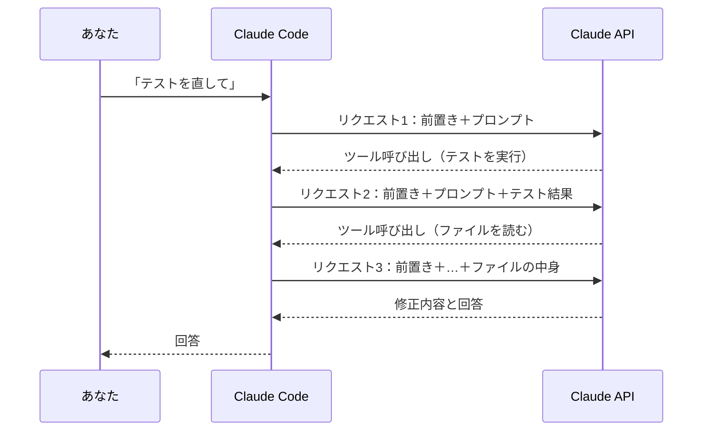

# 生成AIのコンテキストとトークンコストの仕組み

## はじめに

Claude Code や GitHub Copilot のエージェントを使っていると、「短い質問をしただけなのに、思ったより使用量が増えている」と感じることがあります。Claude Code のドキュメントは、長いセッションで使用量が増える理由として、**会話全体が毎回送られること（長いコンテキスト）**と、**キャッシュの期限切れ（キャッシュミス）**などを挙げています（[Manage costs effectively](https://code.claude.com/docs/en/costs) の "Why usage climbs in a long session"）。

この記事では、次の6つを順に説明します。

1. 1回目のプロンプトで積み上がるコンテキスト
2. 2回目以降に積み上がるコンテキスト（キャッシュが有効な間のコスト）
3. 2回目以降に積み上がるコンテキスト（キャッシュの期限が切れた後のコスト）
4. コンテキスト汚染を防ぐ方法
5. Lost in the Middle の回避方法
6. 中断耐性の強化

Claude Code を中心に説明し、各節の最後に「GitHub Copilot ではどうか」を補足します。

> **前提**
> - 価格は 2026年11月時点の Claude Opus 5.5 の API 定価で試算します。最新の価格は [Anthropic の料金ページ](https://platform.claude.com/docs/en/about-claude/pricing) で確認してください。
> - Claude の Pro / Max などのサブスクリプションでは、料金ではなく「プランの使用量の上限」として消費されます。長いコンテキストやキャッシュミスで使用量が増えることは同じです（[Manage costs effectively](https://code.claude.com/docs/en/costs)）。

### 先に結論

| やること | 理由 |
|---|---|
| 無関係な作業に移るときは `/clear`（新しいチャット） | 古い履歴は、以降の**すべてのリクエストで送り直される** |
| 作業の途中でモデルを切り替えない（effort・fast mode なども、条件によって同じ） | キャッシュが無効になり、履歴全体を書き込み直す（2節） |
| 5分以上（設定によっては1時間以上）離れる前に区切りをつける | 期限が切れると履歴全体をキャッシュ書き込み（入力の1.25倍）し直すので、キャッシュを使わない場合（1倍）より**高く**なる（3節） |
| 大量のログ読みや調査はサブエージェントに任せる | メインの会話に残るのは要約だけになる |
| 重要な指示は先頭（CLAUDE.md）か末尾（最新のプロンプト）に置く | 2023年の研究で、長い入力の中ほどにある情報を使う性能が大きく下がることが報告されている（5節） |
| 作業の状態は会話ではなくファイルに書く | 中断・`/clear`・コンパクションの後も再開できる |
| effort（思考の深さ）は、セッションの最初に作業に合わせて決める | 思考は画面に出なくても出力（入力の5倍の価格）として課金され、次のターン以降も入力として送り直される |
| effort の `max` は常用しない | 公式ドキュメントに「コストを大きく増やす割に、品質の向上は比較的小さい」「考えすぎを招くことがある」（Opus 4.7）、「わずかな向上であることが多い」（Fable 5.2）とある。推論を長くすると精度が下がる作業がある、という研究もある（4節） |

---

## 0. 前提知識：LLM は会話を覚えていない

LLM の API はステートレスです。**モデルはリクエストとリクエストの間で何も覚えていません。** 会話が続いているように見えるのは、クライアント（Claude Code や Copilot）が**毎回、それまでの会話をまるごと送り直している**からです。

> Each time you send a message in Claude Code, it makes a new API request. The model doesn't remember anything between requests, so Claude Code re-sends the full context: the system prompt, your project context, every prior message and tool result, and your new message.
> （[How Claude Code uses prompt caching](https://code.claude.com/docs/en/prompt-caching.md)）

そのため、会話が長くなるほど1回のリクエストで送るトークンは増えていきます。これを安くする仕組みが**プロンプトキャッシュ**です。

### トークンの種類と価格（Claude Opus 5.5）

| 種類 | 意味 | 100万トークンあたり | 入力価格との比 |
|---|---|---|---|
| 入力（キャッシュなし） | 通常の入力 | $4.00 | 1倍 |
| キャッシュ書き込み（5分TTL） | 今回の入力をキャッシュに保存する | $5.00 | 1.25倍 |
| キャッシュ書き込み（1時間TTL） | 同上。保存期間が長い | $8.00（2倍から計算） | 2倍 |
| キャッシュ読み込み | 前回保存した部分を再利用する | $0.20 | 0.05倍 |
| 出力 | モデルが生成したテキスト・ツール呼び出し・**思考（thinking）** | $20.00 | 5倍 |

- 書き込みは 5分TTL で 1.25倍、1時間TTL で 2倍です。読み込みは多くのモデルで約0.1倍ですが、Opus 5.5 と Sonnet 5.5 は 0.05倍です（[Prompt caching](https://platform.claude.com/docs/en/build-with-claude/prompt-caching)、[Pricing](https://platform.claude.com/docs/en/about-claude/pricing)）。
- 思考（reasoning / thinking）のトークンは**出力**として課金されます。「Thinking tokens are billed as output tokens」（[Manage costs effectively](https://code.claude.com/docs/en/costs)）
- 思考の本文が画面に表示されなくても、課金は同じです。Opus 5.5 は思考の本文を返さない（`display: "omitted"`）のが既定ですが、「You're still charged for the full thinking tokens. Omitting reduces latency, not cost.」とされています（[Thinking](https://platform.claude.com/docs/en/build-with-claude/thinking)）。
- Opus 4.5 以降などのモデルでは、前のターンの思考も会話の履歴に残り、次のリクエストでは**入力**として課金されます（詳しくは2節）。

---

## 1. 1回目のプロンプトで積み上がるコンテキスト

### 送られるもの

Claude Code は、変わりにくいものから順に並べてリクエストを組み立てます（[How Claude Code uses prompt caching](https://code.claude.com/docs/en/prompt-caching.md) の表より）。

| 層 | 中身 | 変わるタイミング |
|---|---|---|
| システムプロンプト | Claude Code の基本指示、ツール定義 | 読み込むツール定義の組み合わせが変わったとき |
| プロジェクトのコンテキスト | CLAUDE.md、自動メモリ、ルール | セッション開始時、`/clear` や `/compact` の後 |
| 会話 | あなたのメッセージ、Claude の応答、ツールの結果 | 毎ターン |

```
┌──────────────────────────────────────────────┐
│ システムプロンプト（基本指示＋ツール定義）          │
├──────────────────────────────────────────────┤
│ プロジェクトのコンテキスト（CLAUDE.md・メモリ・ルール）│
├──────────────────────────────────────────────┤
│ 環境情報（作業ディレクトリ、git status など）        │
├──────────────────────────────────────────────┤
│ あなたのプロンプト「この関数のバグを直して」          │
└──────────────────────────────────────────────┘
```

あなたが打った1行の前に、**これだけのものが毎回付きます。** それぞれ何トークン使っているかは `/context` で確認できます。

### 1回のプロンプトは1回のリクエストとは限らない

エージェントがツール（ファイル読み込み、grep、テスト実行など）を使うと、**ツールを使うたびに、それまでの全文＋ツールの結果を付けて、もう一度リクエストを送ります。**

> each time Claude uses tools it sends another request carrying that batch of tool results.
> （[Manage costs effectively](https://code.claude.com/docs/en/costs)）



このシーケンスで、コンテキストは次のように積み上がります（キャッシュが有効な場合）。

```
【リクエスト1】
┌────────────────────────────────────────────┐
│ システムプロンプト（基本指示＋ツール定義） │  ← 書き込み（1.25倍）
│ プロジェクトのコンテキスト（CLAUDE.md）    │  ← 書き込み（1.25倍）
│ 環境情報（作業ディレクトリ、git status）   │  ← 書き込み（1.25倍）
│ プロンプト「テストを直して」               │  ← 書き込み（1.25倍）
└────────────────────────────────────────────┘
  ↓ 応答（出力・5倍）：思考1＋ツール呼び出し（テストを実行）

【リクエスト2】リクエスト1の全文は読み込み
┌────────────────────────────────────────────┐
│ システムプロンプト（基本指示＋ツール定義） │  ← 読み込み（0.05倍）
│ プロジェクトのコンテキスト（CLAUDE.md）    │  ← 読み込み（0.05倍）
│ 環境情報（作業ディレクトリ、git status）   │  ← 読み込み（0.05倍）
│ プロンプト「テストを直して」               │  ← 読み込み（0.05倍）
├────────────────────────────────────────────┤
│ 思考1＋ツール呼び出し（テストを実行）      │  ← 書き込み（1.25倍）
│ テスト結果                                 │  ← 書き込み（1.25倍）
└────────────────────────────────────────────┘
  ↓ 応答（出力・5倍）：思考2＋ツール呼び出し（ファイルを読む）

【リクエスト3】リクエスト2の全文は読み込み
┌────────────────────────────────────────────┐
│ システムプロンプト（基本指示＋ツール定義） │  ← 読み込み（0.05倍）
│ プロジェクトのコンテキスト（CLAUDE.md）    │  ← 読み込み（0.05倍）
│ 環境情報（作業ディレクトリ、git status）   │  ← 読み込み（0.05倍）
│ プロンプト「テストを直して」               │  ← 読み込み（0.05倍）
│ 思考1＋ツール呼び出し（テストを実行）      │  ← 読み込み（0.05倍）
│ テスト結果                                 │  ← 読み込み（0.05倍）
├────────────────────────────────────────────┤
│ 思考2＋ツール呼び出し（ファイルを読む）    │  ← 書き込み（1.25倍）
│ ファイルの中身                             │  ← 書き込み（1.25倍）
└────────────────────────────────────────────┘
  ↓ 応答（出力・5倍）：思考3＋修正内容と回答 → あなたに表示
```

- 1回のプロンプトでも、リクエストのたびに**思考とツール呼び出し（出力）**と**ツールの結果**が履歴に足されていきます。
- 前のリクエストの全文は読み込み（0.05倍）で済みますが、**応答（思考を含む）は毎回、出力（5倍）として課金されます。**
- リクエスト2で入ったテスト結果は、リクエスト3以降、さらに次のプロンプト以降でも**ずっと送り直されます。** 長いログを読ませるほど、後のリクエストすべてが重くなるのはこのためです。

### 応答には思考（reasoning）も含まれる

モデルの応答は、画面に出る回答だけではありません。Opus 5.5 などのモデルは、回答の前に**思考（thinking）**を生成します。Opus 5.5 では思考を止めることはできず、effort（思考の深さ）で量を調整します（[Manage costs effectively](https://code.claude.com/docs/en/costs)）。

```
応答（すべて「出力」として課金。入力の5倍の価格）
┌────────────────────────────────────────────┐
│ 思考（thinking）                           │  ← 本文が返されなくても、課金される
├────────────────────────────────────────────┤
│ 回答のテキスト                             │  ← 画面に出る
├────────────────────────────────────────────┤
│ ツール呼び出し                             │
└────────────────────────────────────────────┘
```

- 思考は、リクエストごとに生成されることがあります（どれだけ考えるかはモデルが判断します）。上のシーケンス図では、3回のリクエストのそれぞれで思考が出力になりえます。
- Claude Code のドキュメントには、思考の既定の予算が「モデルによっては1リクエストあたり数万トークンになりうる（the default budget can be tens of thousands of tokens per request depending on the model）」とあります（[Manage costs effectively](https://code.claude.com/docs/en/costs)）。
- 手動の思考予算（`budget_tokens`）について説明した [Extended thinking](https://platform.claude.com/docs/en/build-with-claude/extended-thinking) のページには、思考に使ったトークン数を API の応答の `usage.output_tokens_details.thinking_tokens` で確認できるとあります。Opus 5.5 などの adaptive thinking でも同じフィールドで確認できるかは、確認できていません。Claude Code では、作業中にスピナーの横に出るトークン数に思考も含まれます（[Manage costs effectively](https://code.claude.com/docs/en/costs)）。

### 1回目のコスト

1回目は、まだキャッシュがありません。前置きを含む入力全体を**キャッシュに書き込む**ため、入力は1.25倍（5分TTL）の価格になります。これは「2回目以降に安く読むための先行投資」です。

これに加えて、**思考を含む応答全体**が出力（入力の5倍の価格）として課金されます。

---

## 2. 2回目以降：キャッシュが有効な間のコスト

### 毎回「全部」送るが、前回と同じ部分は安い

2回目のリクエストは、「1回目の全文＋前回の応答＋新しいプロンプト」です。キャッシュは**先頭から完全に一致する部分**（プレフィックス）を再利用します。

```
【1回目】まだキャッシュがないので、すべてキャッシュ書き込み
┌────────────────────────────────────────────┐
│ システムプロンプト（基本指示＋ツール定義） │  ← キャッシュ書き込み（1.25倍）
│ プロジェクトのコンテキスト（CLAUDE.md）    │  ← キャッシュ書き込み（1.25倍）
│ 環境情報（作業ディレクトリ、git status）   │  ← キャッシュ書き込み（1.25倍）
│ プロンプト1                                │  ← キャッシュ書き込み（1.25倍）
└────────────────────────────────────────────┘

【2回目】1回目と同じ部分はキャッシュ読み込み、増えた部分だけキャッシュ書き込み
┌────────────────────────────────────────────┐
│ システムプロンプト（基本指示＋ツール定義） │  ← キャッシュ読み込み（0.05倍）
│ プロジェクトのコンテキスト（CLAUDE.md）    │  ← キャッシュ読み込み（0.05倍）
│ 環境情報（作業ディレクトリ、git status）   │  ← キャッシュ読み込み（0.05倍）
│ プロンプト1                                │  ← キャッシュ読み込み（0.05倍）
├────────────────────────────────────────────┤
│ 応答1                                      │  ← キャッシュ書き込み（1.25倍）
│ プロンプト2                                │  ← キャッシュ書き込み（1.25倍）
└────────────────────────────────────────────┘

【3回目】キャッシュから読む部分が伸びていき、キャッシュに書き込むのは毎回増えた分だけ
┌────────────────────────────────────────────┐
│ システムプロンプト（基本指示＋ツール定義） │  ← キャッシュ読み込み（0.05倍）
│ プロジェクトのコンテキスト（CLAUDE.md）    │  ← キャッシュ読み込み（0.05倍）
│ 環境情報（作業ディレクトリ、git status）   │  ← キャッシュ読み込み（0.05倍）
│ プロンプト1                                │  ← キャッシュ読み込み（0.05倍）
│ 応答1                                      │  ← キャッシュ読み込み（0.05倍）
│ プロンプト2                                │  ← キャッシュ読み込み（0.05倍）
├────────────────────────────────────────────┤
│ 応答2                                      │  ← キャッシュ書き込み（1.25倍）
│ プロンプト3                                │  ← キャッシュ書き込み（1.25倍）
└────────────────────────────────────────────┘
```

- 前回と同じ部分は**キャッシュ読み込み**（Opus 5.5 では入力価格の0.05倍）
- 新しく増えた部分だけ**キャッシュ書き込み**（1.25倍）

### 図の「応答」には思考も含まれる

図の「応答1」「応答2」には、回答のテキストだけでなく**思考（thinking）も含まれます**。つまり、思考は次のように2回課金されます。

1. 生成したターンで、**出力**として（入力の5倍の価格）
2. 次のターン以降、会話の履歴の一部として、**入力**として（キャッシュが有効ならキャッシュ読み込み 0.05倍、期限切れならキャッシュ書き込み 1.25倍）

> Thinking tokens are billed as output tokens once, when they are generated. On models that keep previous thinking blocks, the kept blocks are then part of later requests' input and are billed as input tokens, like the rest of the conversation history.
> （[Context windows](https://platform.claude.com/docs/en/build-with-claude/context-windows)）

前のターンの思考が履歴に残るかどうかは、モデルによって違います（同ページ）。

| モデル | 前のターンの思考 |
|---|---|
| Claude Opus 4.5 以降の Opus（Opus 5.5 を含む）、Sonnet 4.6 以降の Sonnet、Haiku 5.5、Fable / Mythos | 既定で**残る**。入力トークンとしてコンテキストウィンドウを使う |
| それより前の Opus・Sonnet、Haiku 4.5 までの Haiku | API が自動で**取り除く** |

Opus 5.5 などを使う場合、**思考は会話の履歴として積み上がっていきます。**

### 試算：10ターンの会話

次の条件で計算します。

- 1ターン目の入力：25,000トークン（前置き 20,000＋プロンプト）
- 1ターンごとに増える入力：5,000トークン（前回の応答〔思考を含む〕・ツール結果・新しいプロンプト）
- 1ターンごとの出力：1,000トークン（思考を含む）
- 5分TTL、各ターンの間隔は5分未満

| ターン | 送る入力の合計 | うちキャッシュ読み込み | うちキャッシュ書き込み | そのターンのコスト |
|---|---|---|---|---|
| 1 | 25,000 | 0 | 25,000 | $0.145 |
| 2 | 30,000 | 25,000 | 5,000 | $0.050 |
| 5 | 45,000 | 40,000 | 5,000 | $0.053 |
| 10 | 70,000 | 65,000 | 5,000 | $0.058 |
| **10ターン合計** | | | | **$0.631** |

送る量は 25,000 から 70,000 に増えていますが、増えた部分の大半は 0.05倍で読めるので、1ターンあたりのコストはほとんど増えません。

#### 思考が多い場合

同じ条件で、思考が1ターンあたり9,000トークン多い場合を比べます。出力は1ターン10,000トークンになり、その分、次のターンで増える入力も14,000トークンになります。

| 条件 | 1ターンの出力 | 10ターン目に送る入力 | 10ターン合計 |
|---|---|---|---|
| 上の試算 | 1,000 | 70,000 | $0.631 |
| 思考が多い場合 | 10,000 | 151,000 | $2.901 |

約4.6倍です。増えた分のほとんどは出力の料金（入力の5倍の価格）ですが、コンテキストも2倍以上に膨らみます。簡単な作業では effort を下げると、思考の量を減らせます（4節）。

### キャッシュの有効期間（TTL）

- キャッシュは**最後に使われてから**一定時間で消えます。読み込むたびにタイマーがリセットされるので、作業を続けている限り温かいままです。

Claude Code でどちらの TTL になるかは、契約の種類で決まります（[How Claude Code uses prompt caching](https://code.claude.com/docs/en/prompt-caching.md) の「Which TTL each request gets」）。

| リクエストの種類 | Claude サブスクリプション（プランの範囲内） | 使用量クレジット、API キー、クラウドプロバイダー |
|---|---|---|
| メインの会話 | 1時間 | 5分 |
| それ以外（サブエージェント、コンパクションなど） | 5分（一部のヘルパーは1時間） | 5分 |

API キーでも、`promptCacheTtl` の設定か `CLAUDE_CODE_PROMPT_CACHE_TTL` 環境変数で `1h` にできます。ただし書き込みが2倍になるので、**5分以上離れることがほとんどない作業では、かえって高くなります。** 同じ10ターンを1時間TTLで計算すると、合計は $0.841 です（5分TTLは $0.631）。

### 期限内でもキャッシュが壊れる操作

キャッシュは先頭からの完全一致なので、途中が少しでも変わると、それより後ろはすべて書き込み直しです（"The match is exact, so a change anywhere in the prefix recomputes everything after it."、[How Claude Code uses prompt caching](https://code.claude.com/docs/en/prompt-caching.md)）。Claude Code のドキュメントには、次のような操作が挙げられています（主なもの）。

- モデルの切り替え（`/model`）。キャッシュはモデルごとに別です
- effort の変更（Opus 5.5 など一部のモデルでは、API キーやサブスクリプションならキャッシュが保たれます）
- fast mode の切り替え
- MCP サーバーの接続・削除（ツール定義を最初に全部読み込む設定のとき）
- MCP サーバーを含むプラグインの有効化・無効化（MCP サーバーの接続・削除と同じ条件）
- ツール全体の拒否（deny ルール）（ツール検索が使えないとき）
- コンパクション（`/compact`、自動コンパクション）
- 画像がたまって、古い画像が削除されたとき
- Claude Code のアップデート

一方、**ファイルの編集、作業中の CLAUDE.md の編集、権限モードの変更、スキルの呼び出し、`/rewind`、サブエージェントの起動**はキャッシュを壊しません。

> Pick your model and effort level at the top of a session, then save `/compact` for natural breaks between tasks.
> （[How Claude Code uses prompt caching](https://code.claude.com/docs/en/prompt-caching.md)）

### GitHub Copilot では

- 2026年6月1日から、Copilot の課金は premium request（プロンプト1回ごとの課金）から、**トークン量に応じた GitHub AI Credits** に変わりました。入力・出力・キャッシュのトークンが、モデルごとの API 価格で計算されます。コード補完と Next Edit Suggestions は対象外です（[GitHub Copilot is moving to usage-based billing](https://github.blog/news-insights/company-news/github-copilot-is-moving-to-usage-based-billing/)）。
  - 既存の年額プランの Pro / Pro+ 利用者向けには、premium request による説明ページがあります（"This article only applies to Copilot Pro and Copilot Pro+ subscribers on an existing annual plan."、[GitHub Docs：Copilot のリクエスト（年額プラン向け）](https://docs.github.com/en/copilot/concepts/billing/copilot-requests)）。
- Copilot 経由の Claude Opus 5.5 の価格は、入力 $4.00、キャッシュ済み入力 $0.20、キャッシュ書き込み $5.00、出力 $20.00 で、Anthropic の定価と同じです（[Models and pricing for GitHub Copilot](https://docs.github.com/en/copilot/reference/copilot-billing/models-and-pricing)）。
- トークン量で課金されるので、**履歴の長さとキャッシュが料金に影響します。**「長いスレッドは、新しいリクエストのたびに履歴全体を運ぶ（A long thread carries its entire history into every new request.）」と GitHub 自身も書いています（[Optimizing your AI usage to maximize efficiency and reduce cost](https://docs.github.com/en/copilot/tutorials/optimize-ai-usage)）。
- 自動で付く内容は、システム指示、カスタム指示（`copilot-instructions.md` など）、会話履歴、エディタの情報（開いているファイルや選択範囲。設定による）、ツールの結果です（[VS Code Docs：コンテキストの概念](https://code.visualstudio.com/docs/copilot/concepts/context)）。
- キャッシュが壊れる操作も同じで、**作業中のモデル切り替え、reasoning effort・コンテキストサイズの変更、有効なツールや MCP サーバーの変更**が挙げられています（[Optimizing your AI usage to maximize efficiency and reduce cost](https://docs.github.com/en/copilot/tutorials/optimize-ai-usage)）。

---

## 3. 2回目以降：キャッシュの期限が切れた後のコスト

### 期限切れの直後は、履歴全体を書き込み直す

TTL を過ぎてから次のプロンプトを送ると、キャッシュに読めるものがありません。**それまでの履歴全体が、1.25倍の書き込みとして処理されます。**

> your first message after a break longer than the cache lifetime misses the cache and reprocesses your full context.
> （[Manage costs effectively](https://code.claude.com/docs/en/costs)）

2節の図の3回目で、2回目から5分以上たってから送った場合と比べると、次のようになります。

```
【3回目・キャッシュが有効な場合】（2節の図と同じ）
┌────────────────────────────────────────────┐
│ システムプロンプト（基本指示＋ツール定義） │  ← キャッシュ読み込み（0.05倍）
│ プロジェクトのコンテキスト（CLAUDE.md）    │  ← キャッシュ読み込み（0.05倍）
│ 環境情報（作業ディレクトリ、git status）   │  ← キャッシュ読み込み（0.05倍）
│ プロンプト1                                │  ← キャッシュ読み込み（0.05倍）
│ 応答1                                      │  ← キャッシュ読み込み（0.05倍）
│ プロンプト2                                │  ← キャッシュ読み込み（0.05倍）
├────────────────────────────────────────────┤
│ 応答2                                      │  ← 非キャッシュ：キャッシュ書き込み（1.25倍）
│ プロンプト3                                │  ← 非キャッシュ：キャッシュ書き込み（1.25倍）
└────────────────────────────────────────────┘

【3回目・2回目から5分以上たって送った場合】
┌────────────────────────────────────────────┐
│ システムプロンプト（基本指示＋ツール定義） │  ← 非キャッシュ：期限切れのため再書き込み（1.25倍）
│ プロジェクトのコンテキスト（CLAUDE.md）    │  ← 非キャッシュ：期限切れのため再書き込み（1.25倍）
│ 環境情報（作業ディレクトリ、git status）   │  ← 非キャッシュ：期限切れのため再書き込み（1.25倍）
│ プロンプト1                                │  ← 非キャッシュ：期限切れのため再書き込み（1.25倍）
│ 応答1                                      │  ← 非キャッシュ：期限切れのため再書き込み（1.25倍）
│ プロンプト2                                │  ← 非キャッシュ：期限切れのため再書き込み（1.25倍）
├────────────────────────────────────────────┤
│ 応答2                                      │  ← 非キャッシュ：キャッシュ書き込み（1.25倍）
│ プロンプト3                                │  ← 非キャッシュ：キャッシュ書き込み（1.25倍）
└────────────────────────────────────────────┘
```

- キャッシュが有効な場合、キャッシュから読めない部分（非キャッシュ）は、横線より下の「増えた部分」だけです。
- 期限が切れた場合、キャッシュから読める部分はありません。**箱の中すべてが非キャッシュ**になり、前回キャッシュに入れていた部分（横線より上）も、もう一度1.25倍で書き込み直します。
- 横線より上の部分は会話が続くほど長くなります。そのため、期限切れで払い直す額も、会話が長いほど大きくなります。

### 試算：同じ10ターンで、毎回期限が切れていた場合

2節と同じ条件で、各ターンの間隔が毎回5分を超えた（毎回期限切れになった）場合を計算します。

| ターン | 送る入力の合計 | キャッシュが有効なとき | 毎回期限切れのとき | キャッシュを使わないとき |
|---|---|---|---|---|
| 1 | 25,000 | $0.145 | $0.145 | $0.120 |
| 5 | 45,000 | $0.053 | $0.245 | $0.200 |
| 10 | 70,000 | $0.058 | $0.370 | $0.300 |
| **合計** | | **$0.631** | **$2.575** | **$2.100** |

ここからわかることは2つです。

1. **期限が切れると、同じ作業が約4倍の料金になります。** ターン10だけで比べると約6倍です。会話が長いほど差は大きくなります。
2. **毎回期限が切れるなら、キャッシュを使わないほうが安くなります。** 書き込みの割増（1.25倍）を払ったのに、一度も読まれないからです。

### 期限切れが起きやすい場面

- 会議や昼休みで席を外した後の最初の1回
- `/resume` で古いセッションに戻ったとき
- 期限切れの状態で `/compact` するとき。要約のためのリクエストが、要約する履歴をキャッシュなしで読みます。「This is why `/compact` costs the most when you resume an old session.」（[How Claude Code uses prompt caching](https://code.claude.com/docs/en/prompt-caching.md)）

### 対策

| 状況 | 対策 |
|---|---|
| 続きをする予定がない | 離れる前に作業の状態をファイルに書き、戻ってきたら `/clear` して読ませる（6節） |
| 長い会話を続けたい・席を外す | 離れる**前**に `/compact` する（キャッシュが温かいうちなら要約が安い）。履歴が短くなり、戻ったときの書き込みも少なくなる |
| 5〜60分の中断が多い（API キー利用） | 1時間TTL を検討する（下の補足） |
| 使用量を確認したい | `/usage` の `Prompt cache (main)` 行で、キャッシュのヒット率、ミスの回数、今キャッシュが温かいかを確認する |

> **補足**：Opus 5.5 で、同じ履歴を5〜60分の間隔で2回使う場合を、0節の倍率で計算します。5分TTL では毎回期限が切れるので 1.25倍＋1.25倍＝2.5倍、1時間TTL では 2倍（書き込み）＋0.05倍（読み込み）＝2.05倍です。間隔が5〜60分なら、2回目からは1時間TTL のほうが安くなります。一方、間隔が5分未満なら5分TTL でも期限は切れないので、書き込みが安い5分TTL のほうが安くなります。

### GitHub Copilot では

- キャッシュの有効期限は「使わない状態が続くと切れる。OpenAI のモデルは24時間、それ以外のほとんどは1時間」とされています（"Caches expire after a period of inactivity (24 hours for OpenAI models and 1 hour for most others)."、[Optimizing your AI usage to maximize efficiency and reduce cost](https://docs.github.com/en/copilot/tutorials/optimize-ai-usage)）。
- 期限が切れた古いセッションに戻ると、キャッシュは作り直しになります。Copilot CLI では `/compact` で履歴を要約してから作り直すと、作り直す量が小さくなります（同ページ）。

---

## 4. コンテキスト汚染を防ぐ方法

ここでは「コンテキスト汚染」を、**今の作業に関係のない情報や、捨てた試行がコンテキストに残り、以降のリクエストで送られ続ける状態**という意味で使います。

### よくある汚染の原因

| 原因 | 何が起きるか |
|---|---|
| 前の作業の履歴が残っている | 無関係な内容が、以降のすべてのリクエストで送られる。「Stale context wastes tokens on every subsequent message.」（[Manage costs effectively](https://code.claude.com/docs/en/costs)） |
| 失敗した試行が残っている | 捨てたはずのコードや方針も、履歴として送られ続ける |
| 巨大なログやファイルを貼った | 一度入ると、以降のすべてのリクエストで送られる |
| CLAUDE.md が長い | 常に読み込まれる。「Longer files consume more context and reduce adherence.」（[How Claude remembers your project](https://code.claude.com/docs/en/memory)） |
| 使わない MCP サーバー・ツールが有効 | ツールの名前やサーバーの指示（server instructions）がコンテキストを使う（[Manage costs effectively](https://code.claude.com/docs/en/costs)） |

### 対策

**1. 作業の切れ目で `/clear` する**

> Use `/clear` to start fresh when switching to unrelated work. Stale context wastes tokens on every subsequent message.
> （[Manage costs effectively](https://code.claude.com/docs/en/costs)）

`/rename` で名前を付けてから `/clear` すれば、あとで `/resume` で戻れます。`/clear` 自体のコストはゼロです。

**2. 失敗した道は `/rewind` で巻き戻す**

方針が間違っていたとき、「さっきのは無しで」と言い足すと、間違った試行は履歴に残ったままです。`/rewind`（または Esc を2回）で、その前のターンまで会話とコードを戻せます。巻き戻した先はキャッシュ済みのプレフィックスなので、キャッシュも壊れません。

**3. 量の多い作業はサブエージェントに任せる**

テストの実行、ドキュメントの取得、ログの解析などはサブエージェントに任せると、長い出力はサブエージェント側に残り、メインの会話には要約だけが返ります（[Manage costs effectively](https://code.claude.com/docs/en/costs)）。

ただし、サブエージェントも自分でリクエストを送るので、**全体の使用量が減るとは限りません。** 減るのはメインの会話のコンテキストです。単純な作業なら、サブエージェントに `model: haiku` を指定すると安くなります。

**4. 入ってくる量を、入る前に減らす**

- 「このコードベースを改善して」のような曖昧な依頼は、広い範囲を読ませます。「auth.ts の login 関数に入力チェックを追加して」のように絞ります（同ページ）。
- hooks で、テスト出力を最後の100行だけにする、ログから `ERROR` の行だけを抜き出す、といった前処理ができます（同ページに例があります）。

**5. 常に読み込まれるものを小さくする**

- CLAUDE.md は200行以内を目安にし、特定の作業の手順はスキルに移します。スキルは呼ばれたときだけ読み込まれます（同ページ）。
- 使わない MCP サーバーは `/mcp` で無効にします。`gh` などの CLI で済むなら、そのほうがコンテキストを使いません。

**6. 思考の量を作業に合わせる**

思考は出力として課金され、そのうえ次のターン以降の履歴にも残ります（2節）。深い推論がいらない作業では、`/effort` か `/model` で effort を下げると、思考の量を減らせます（[Manage costs effectively](https://code.claude.com/docs/en/costs)）。

- Opus 5.5、Sonnet 5.5、Haiku 5.5、Fable のモデルでは、思考を止めることはできません。effort で調整します（同ページ）。
- effort を変えると、多くのモデルではキャッシュが無効になります。API キーまたは Claude サブスクリプションで使う Opus 5.5、Sonnet 5.5、Haiku 5.5、Fable 5.1 以降では、キャッシュが保たれます（[How Claude Code uses prompt caching](https://code.claude.com/docs/en/prompt-caching.md)）。それ以外のモデルでは、セッションの最初に決めておきます。

**`max` は、コストに見合う向上があるとは限らない**

effort の `max` は「トークンの消費に制約を設けず、能力を最大にする（Absolute maximum capability with no constraints on token spending.）」設定です（[Effort](https://platform.claude.com/docs/en/build-with-claude/effort)）。思考は出力として課金され、次のターン以降は履歴として入力にも積み上がります（2節）。

公式ドキュメントは、`max` についてモデルごとに次のように書いています（[Effort](https://platform.claude.com/docs/en/build-with-claude/effort)）。

| モデル | `max` についての記述 |
|---|---|
| Claude Fable 5.2 | 「`xhigh` より遅く、高くつく。それでいて、得られるのはわずかな向上であることが多い（It runs slower and costs more than at `xhigh`, often for only a small gain.）」。`max` は、モデルの限界を測るときと、時間もトークンも気にしなくてよいまれな作業のためにとっておく |
| Claude Opus 4.7 | 「ほとんどの作業では、`max` はコストを大きく増やす割に、品質の向上は比較的小さい。構造化出力や、高い知性を必要としない作業では、考えすぎ（overthinking）を招くことがある」 |
| Claude Sonnet 5.5 | 「`xhigh` や `max` は、自分の評価で品質の向上が確認できた場合にだけ使う」 |
| Claude Opus 5.5 | 既定は `medium`。「以前のモデルの設定を持ち込まず、自分の評価で effort を比べること」 |

さらに、推論を長くすると**かえって精度が下がる**作業があることを報告した研究があります。Gema ら "Inverse Scaling in Test-Time Compute"（[arXiv:2507.14417](https://arxiv.org/abs/2507.14417)、TMLR 2025年12月掲載）は、推論モデルの推論を長くすると性能が下がる評価タスクを作り、テスト時の計算量と精度の間に逆スケーリングの関係が見られたと報告しています。

- タスクは4種類です：注意をそらす情報を混ぜた単純な数え上げ、見せかけの特徴を含む回帰、制約を追いかける推論、高度な AI リスク
- 報告された失敗のパターンの1つ目は「Claude のモデルは、無関係な情報にますます気を取られるようになる（Claude models become increasingly distracted by irrelevant information）」です
- 著者らは、さまざまな推論の長さでモデルを評価することが重要だとまとめています

> **注意**
> - この論文は、こうした現象が起きる**タスクを作って**示したもので、どんな作業でも推論を長くすると精度が下がる、と主張しているわけではありません。
> - 論文で名前が出ているのは Claude Sonnet 4 などで、Opus 5.5 や effort の `max` を直接調べたものではありません。
> - 公式ドキュメントは「`max` で精度が下がる」とは書いていません。公式の記述は、上の表のとおり「向上が小さい」「考えすぎを招くことがある」（Opus 4.7）までです。

**effort の選び方**（同ページの推奨より）

1. 自分の作業で effort を比べて決める。以前のモデルの設定はそのまま持ち込まない
2. 複雑な問題で推論が浅いと感じたら、プロンプトで工夫するより effort を上げる（Opus 4.7 の項）
3. `xhigh` や `max` は、品質の向上が確認できた作業にだけ使う
4. 単純な作業やサブエージェントには `low` も選択肢になる（`low` の用途として「サブエージェントのような、単純な作業」が挙げられている）

### `/compact` の注意点

`/compact` は、それまでの会話の履歴を**要約に置き換えて**コンテキストを小さくするコマンドです。コンテキストが上限に近づくと、Claude Code は同じことを自動でも行います（自動コンパクション）。便利ですが、次の点に注意が必要です。

**1. 要約なので、細部が落ちる。残るのは「作業として重要なもの」とは限らない**

要約に残らなかった情報は、モデルからは見えなくなります。

何も指定しない場合、要約に残るのは、**自動の要約が重要だと推測したもの**です。あなたが作業として重要だと考えているものが残るとは限りません。Claude Code のドキュメントは、`/compact` に残す内容を指定する方法について、次のように説明しています。

> The summary keeps what you choose instead of what the automatic pass guesses is important.
> （要約は、自動の処理が重要だと推測したものではなく、あなたが選んだものを残します）
> （[Explore the context window](https://code.claude.com/docs/en/context-window) の "When your context fills up"）

何が残りやすく、何が落ちやすいかについても、ドキュメントに記述があります。

- 要約には「あなたの依頼と、重要なコード片は残るが、会話の初めに伝えた細かい指示は失われることがある（The summary keeps your requests and key code snippets, but detailed instructions from early in the conversation may be lost.）」とされています（[How Claude Code works](https://code.claude.com/docs/en/how-claude-code-works)）。
- 会話の中で「レビューするまで push しないで」と伝えた場合も、「その一文はコンパクションで失われることがある（the sentence can get lost when the conversation compacts）」とされ、重要なものは deny ルールに書くよう勧められています（[Best practices for Claude Code](https://code.claude.com/docs/en/best-practices)）。
- VS Code のドキュメントにも、コンパクションでは「前のメッセージの細部は要約されるか、省かれることがある（Details from earlier messages may be summarized or omitted.）」とあります（[VS Code Docs：コンテキストの概念](https://code.visualstudio.com/docs/copilot/concepts/context)）。

一方、次のものは要約されず、コンパクションの後にディスクから読み込み直されます（[Explore the context window](https://code.claude.com/docs/en/context-window) の "What survives compaction" より抜粋）。

| 対象 | コンパクションの後 |
|---|---|
| プロジェクト直下の CLAUDE.md と、対象を限定しないルール | ディスクから読み込み直される |
| 自動メモリ | ディスクから読み込み直される |
| plan mode で Claude が書いた計画 | ディスクから読み込み直される |
| Claude が読んだ・編集したファイル | 最近変更されたものから最大5つを読み直す。5,000トークンを超えるファイルは、中身なしのパスの参照になる |
| `paths:` で対象を限定したルール、サブディレクトリの CLAUDE.md | 会話の履歴として読み込まれていたものは、ほかの会話と一緒に要約される。必要になったときに読み込み直される |

**対処**

- 残してほしい内容は指示できます。たとえば `/compact focus on the auth bug fix` のように書くか、CLAUDE.md に「Compact Instructions」の節を書いておきます（[Explore the context window](https://code.claude.com/docs/en/context-window)、[How Claude Code works](https://code.claude.com/docs/en/how-claude-code-works)、[Manage costs effectively](https://code.claude.com/docs/en/costs)）。
- ずっと守ってほしいルールは、会話ではなく CLAUDE.md に書きます。「Put persistent rules in CLAUDE.md rather than relying on conversation history.」（[How Claude Code works](https://code.claude.com/docs/en/how-claude-code-works)）
- 要件・決めたこと・次にやることをファイル（`plan.md`・`progress.md`）に書いておけば、要約の影響を受けません（6節）。

**2. `/compact` 自体が大きなリクエストになる**

要約を作るために、Claude Code は**要約する履歴をまるごと読む**リクエストを1回送ります。

> `/compact` reads the conversation it summarizes, so compacting a large context is itself a large request. When you want a fresh start instead of continuity, `/clear` costs nothing
> （[Manage costs effectively](https://code.claude.com/docs/en/costs)）

前の作業の続きが不要なら、`/compact` ではなく `/clear` を使います。

**3. キャッシュの期限が切れた後の `/compact` が一番高い**

キャッシュが有効なうちなら、要約のためのリクエストは履歴をキャッシュから読めるので、「コンテキストの大きさから想像されるより、ずっと安い」とされています（"costs a fraction of what the context size suggests"）。期限が切れていると、履歴をキャッシュなしで読み直します（[How Claude Code uses prompt caching](https://code.claude.com/docs/en/prompt-caching.md)）。

```
キャッシュが有効なうちに /compact    → 要約のリクエストは、履歴をキャッシュ読み込み（0.05倍）
期限が切れた後に /compact            → 要約のリクエストは、履歴をまるごと非キャッシュで読み直す
```

席を外す・長い作業が終わった、という区切りでは、**離れる前に** `/compact` します。戻ってから `/compact` すると、高い方になります。

**4. 会話のキャッシュは作り直しになる**

要約に置き換えると、履歴の先頭が変わるので、会話の部分のキャッシュは無効になります（2節「期限内でもキャッシュが壊れる操作」）。CLAUDE.md などのプロジェクトのコンテキストも、ファイルを変えていなくてもキャッシュを作り直します。ただし、作り直すのは短くなった要約の分だけなので、`/compact` の次のターンが特に遅くなるわけではありません（同ページ）。

**5. 作業の途中ではなく、区切りで実行する**

自動コンパクションは、作業の途中でも始まります。いつ要約されるかを自分で選ぶために、タスクとタスクの間など、区切りのよいところで `/compact` を実行することが勧められています（同ページ）。

**6. 失敗した道を捨てたいなら `/rewind` を使う**

`/compact` は、失敗した試行も含めて要約します。間違った方針を丸ごと捨てたいときは、`/rewind` で前のターンに戻します。`/rewind` は、すでにキャッシュにある時点まで履歴を切り詰めるだけなので、キャッシュも作り直しになりません（同ページ）。

**7. CLAUDE.md の変更は `/compact` の後に効く**

作業中に CLAUDE.md を編集しても、実行中のセッションにはすぐには反映されません。Claude Code はセッション開始時に CLAUDE.md を読み込んで保持しているためです。反映するには、`/clear` か `/compact` を実行するか、Claude Code を再起動します（同ページ）。

**8. 放置している間に自動で要約されることがある**

1時間TTL の長い会話を放置していると、Claude Code が自動で要約することがあります（アイドルコンパクション）。止めたい場合は、設定 `idleCompaction` を `false` にします。この設定には Claude Code v2.1.290 以降が必要です（同ページ、[Manage costs effectively](https://code.claude.com/docs/en/costs) の "Background token usage"）。

| 注意点 | 対処 |
|---|---|
| 要約に残るのは、自動の要約が重要だと推測したもの。会話の初めの細かい指示は失われることがある | `/compact` で残す内容を指定する。ずっと守るルールは CLAUDE.md に、作業の状態はファイルに書く |
| `/compact` 自体が大きなリクエスト | 続きが不要なら `/clear`（コストはゼロ） |
| 期限切れの後に実行すると高い | 離れる**前**に実行する |
| 自動コンパクションは作業の途中でも始まる | 区切りのよいところで、自分で実行する |
| 失敗した試行も要約に残る | 捨てたいなら `/rewind` |
| CLAUDE.md の変更がすぐには効かない | `/clear` か `/compact`、または再起動 |

### GitHub Copilot では

- VS Code でも、会話がコンテキストの上限に近づくと古い部分が自動で要約されます。`/compact` で手動でも実行できます（[VS Code Docs：コンテキストの概念](https://code.visualstudio.com/docs/copilot/concepts/context)）。
- 無関係な作業は、新しいセッションで始めることが勧められています（"Start a new session for an unrelated task or a different project."、[VS Code Docs：コンテキストの概念](https://code.visualstudio.com/docs/copilot/concepts/context)）。新しいセッションにしても、カスタム指示や永続メモリは消えません。
- `#codebase` は、ワークスペースを検索するだけで、コードベース全体をコンテキストに入れるわけではありません（[VS Code Docs：チャットのコンテキスト](https://code.visualstudio.com/docs/copilot/chat/copilot-chat-context)）。必要なファイルは `#` で始まるメンションで明示的に追加できます（同ページ）。
- `copilot-instructions.md` は毎回読み込まれるので、短く具体的にします。サブエージェントは安いモデルで動かし、必要なツールセットだけを有効にします（[Optimizing your AI usage to maximize efficiency and reduce cost](https://docs.github.com/en/copilot/tutorials/optimize-ai-usage)）。
- reasoning（思考）のレベルは、ふだんは標準にしておき、難しい作業のときだけ上げることが勧められています。設定はセッションを始める前に決め、途中で変えないようにします（同ページ）。

---

## 5. Lost in the Middle の回避方法

### Lost in the Middle とは

Liu ら（2023）の論文 "Lost in the Middle: How Language Models Use Long Contexts"（[arXiv:2307.03172](https://arxiv.org/abs/2307.03172)、TACL 掲載）では、複数の文書の中から答えを探すタスクで、次の傾向が報告されています。

- 調べたタスクは、複数の文書を使う質問応答と、キーと値の検索の2つ
- 関係する情報が**入力の先頭か末尾**にあるとき、性能が最も高いことが多い（"often highest"）
- 長い入力の**中ほど**にある情報を使わなければならないとき、性能が大きく下がる
- この傾向は、長いコンテキスト向けのモデルでも見られた（"even for explicitly long-context models"）

> **注意**：この論文で調べたのは2023年当時のモデルです。現在のモデル（Claude Opus 5.5 など）でどの程度この傾向が残っているかは、確認していません。

### エージェントでは「中ほど」に何がたまるか

Claude Code のコンテキストは、1節の順番（システムプロンプト → プロジェクトのコンテキスト → 会話）で並びます。会話が長くなると、次のように並びます。

```
[先頭]  システムプロンプト、CLAUDE.md
        ………
[中ほど] 最初に話した要件、途中で決めた方針、
        大量のツール結果、過去の思考、試行錯誤の履歴
        ………
[末尾]  最新のプロンプト、直近のツール結果
```

論文の結果をこの並びに当てはめると、会話の初めに伝えた要件や方針は、会話が長くなるにつれて「中ほど」に移っていきます。ただし、これは論文の結果を当てはめた見方で、コーディングエージェントで検証されたものではありません。

### 回避方法

| 方法 | 具体例 |
|---|---|
| ずっと守ってほしいルールは先頭に置く | CLAUDE.md（Copilot なら `copilot-instructions.md`）に書く。会話の途中で言うだけにしない |
| 作業ごとの重要な制約は末尾で言い直す | 「（前提：既存の API の形は変えない）」のように、プロンプトの最後に付け直す |
| コンテキストを短く保つ | 4節の対策（`/clear`、サブエージェント、出力の絞り込み）で、中ほどにたまる量そのものを減らす |
| 要件や方針はファイルに書き、必要なときに読ませる | `plan.md` に書いておき、「plan.md の方針に沿って」と指示する。読み込んだ直後は末尾に来る |
| コンパクション時に残すものを指定する | `/compact Focus on code samples and API usage` のように、要約で残す内容を指示する。CLAUDE.md に `# Compact instructions` の節を書いておくこともできる（[Manage costs effectively](https://code.claude.com/docs/en/costs)） |

---

## 6. 中断耐性の強化

### なぜ中断に弱いのか

会話の中にしかない情報は、次のときに失われたり、ぼやけたりします。

- `/clear` や新しいセッション
- コンパクション（要約で細部が落ちる）
- キャッシュの期限切れの後の再開（失われはしないが、高くつく）
- 使用量の上限、ネットワークの切断、PC の再起動

コンパクションについて VS Code のドキュメントは、「前のメッセージの細部は要約されるか、省かれることがある」と書いています（[VS Code Docs：コンテキストの概念](https://code.visualstudio.com/docs/copilot/concepts/context)）。

### 基本方針：状態は会話ではなくファイルに置く

**会話は使い捨て、ファイルが正**、と考えます。作業の状態をファイルに書いておけば、`/clear` した後でも「progress.md を読んで続きから」の1行で再開できます。しかも、新しいセッションは短いコンテキストで始まるので、期限切れで書き込み直す量も小さくなります。

| ファイル | 書くこと |
|---|---|
| `plan.md`（計画） | ゴール、方針、決めたことと理由、やらないこと |
| `progress.md`（進捗） | 終わったこと、今やっていること、**次にやること**、未解決の問題 |
| CLAUDE.md / `copilot-instructions.md` | プロジェクトのルール（作業によらず変わらないもの） |
| git のコミット | コードの状態。小さく区切ってこまめにコミットする |

progress.md の例：

```markdown
# progress.md

## ゴール
ログイン処理にレート制限を追加する（plan.md 参照）

## 完了
- [x] RateLimiter クラスを追加（src/auth/rate_limiter.ts）
- [x] 単体テストを追加、すべて成功（commit a1b2c3d）

## 作業中
- [ ] login() への組み込み

## 次にやること
1. login() の先頭で RateLimiter.check() を呼ぶ
2. 429 を返すときのレスポンス形式を、既存の API エラー形式に合わせる

## 未解決・注意
- Redis が使えない環境では、メモリ上のカウンタで代用する（plan.md の決定事項 #3）
```

### 運用のコツ

1. **区切りごとに progress.md を更新させる**：「ここまでの状態を progress.md に書いて」と指示してから `/clear` する。CLAUDE.md に「作業の区切りで progress.md を更新すること」と書いておくと、毎回言わずに済みます。
2. **手順をやり直しても壊れないようにする**：途中で止まっても、同じ手順をもう一度実行して問題が起きないようにします（例：「ファイルがなければ作る」）。
3. **小さく進めて、こまめに検証する**：1ファイル書いたらテストする。途中で止まっても、そこまでは正しいと言える状態を保ちます（[Manage costs effectively](https://code.claude.com/docs/en/costs) の "Test incrementally"）。
4. **セッション自体の再開機能も併用する**：Claude Code では `/rename` → `/resume` で会話に戻れます。`/rewind` で会話とコードをチェックポイントに戻せます。ただし、期限切れの後の `/resume` は履歴全体を書き込み直します（3節）。ファイルから新しいセッションで再開すれば、書き込むのは前置きと読み込んだファイルの分です。

### 「計画を立ててから実行」と「ファイルに残しながら実行」は役割が違う

| 指示 | 効く場面 | 根拠 |
|---|---|---|
| 計画を立ててから実行する | 最初の方向が間違っていたときの、やり直しを防ぐ | 「plan mode を複雑なタスクに使う。…最初の方向が間違っていたときの、高くつくやり直しを防ぐ（preventing expensive re-work when the initial direction is wrong）」（[Manage costs effectively](https://code.claude.com/docs/en/costs)） |
| 計画と進み具合をファイルに残しながら実行する | 中断・`/clear`・コンパクションの後に再開する | 会話の初めの細かい指示は、コンパクションで失われることがある（[How Claude Code works](https://code.claude.com/docs/en/how-claude-code-works)、4節） |

どちらか一方ではなく、**両方を組み合わせます。** ただし、計画の立て方と置き場所は、計画の複雑さで変えます（下の「計画の複雑さで置き場所を変える」）。

#### plan mode の性質

plan mode を使うかどうかは、次の性質を知ったうえで決めます（[Permission modes](https://code.claude.com/docs/en/permission-modes) の "Analyze before you edit with plan mode"）。

- **ソースは編集しない**：「Claude はファイルを読み、調べるためのシェルコマンドを実行し、計画を書くが、ソースは編集しない（Claude reads files, runs shell commands to explore, and writes a plan, but does not edit your source.）」。編集は、計画を承認するまでブロックされます。ただし、bypass permissions が使える対話型ターミナルのセッションでは、このブロックは強制されません（"Except in interactive terminal sessions with bypass permissions available, edits stay blocked until you approve the plan."）。なお、リポジトリ内の `plan.md` や `progress.md` のような、ソース以外のファイルを plan mode で書けるかどうかは、ドキュメントに書かれていません。この記事では、**plan mode のあいだはリポジトリに `plan.md` や `progress.md` を書かせず、承認後に書かせる**前提で進めます。
- **計画そのものはファイルに書き出される**：plan mode は計画をファイルに書き出します。保存先は設定 `plansDirectory` で変えられます（[Settings reference](https://code.claude.com/docs/en/settings-reference)）。
- **コンパクションの後も読み込み直される**：plan mode で書いた計画は、コンパクションの後にディスクから読み込み直されます（[Explore the context window](https://code.claude.com/docs/en/context-window) の "What survives compaction"）。
- **承認前に練り直せる**：承認画面で「No, keep planning」を選ぶと、plan mode のまま、直してほしい点を伝えて計画を作り直させられます。`Ctrl+G` で、計画をエディタで直接直すこともできます。
- **承認すると通常の作業に戻る**：計画を承認すると plan mode を抜け、Claude が編集を始めます。

なお、plan mode で書いた計画が `/clear` や新しいセッションの後にも読み込まれるかは、確認できていません。

#### 計画の複雑さで置き場所を変える

1回のプロンプトや plan mode の中で完結する計画は、たいてい単純な計画です。複雑な計画ほど、作るのにも直すのにも時間がかかり、セッションをまたぎます。そのため、リポジトリのファイルに書き、レビューと修正を繰り返して固めてから実行します。

| | 単純な計画 | 複雑な計画 |
|---|---|---|
| 例 | 1〜2ファイルの修正、手順が決まっている作業 | 複数のモジュールにまたがる変更、方式の検討が必要な作業 |
| 計画の寿命 | 1回のセッションで終わる | 複数のセッションにまたがる。中断や `/clear` をはさむ |
| 練り直し | plan mode の「No, keep planning」や `Ctrl+G` で足りる | 書く → レビュー → 直す、を何回も繰り返す。人のレビューや、別のコンテキストのレビュー役（サブエージェントなど）の確認も入れる |
| 置き場所 | plan mode の計画、または会話の中 | リポジトリの `plan.md`。版管理ができ、差分が見え、他の人とも共有できる |

この使い分けは公式ドキュメントに書かれたものではなく、この記事の考えです。根拠にしている事実は次の3つです。

- 会話の中で伝えた細かい指示は、コンパクションで失われることがある（[How Claude Code works](https://code.claude.com/docs/en/how-claude-code-works)）
- plan mode の計画が `/clear` や新しいセッションの後にも読み込まれるかは、確認できていない（上の「plan mode の性質」）
- サブエージェントは、メインの会話とは別のコンテキストで動く（[How Claude Code uses prompt caching](https://code.claude.com/docs/en/prompt-caching.md) の "Subagents and the cache"）

#### 指示の例

```
【単純な計画】
1. plan mode で計画を立てさせ、内容を確認して承認する
   （plan mode を使わないなら：「まず計画を見せて。私が確認するまで実装しないで」）
2. 実装中：「区切りごとに progress.md に『完了したこと・決めたこと・次にやること』を書いて」

【複雑な計画】
1. 調査とたたき台：plan mode で調べさせ、計画のたたき台を作らせる
2. ファイルにする：承認したら「計画を plan.md に保存して」
   （plan mode を使わないなら：「計画を plan.md に書いて。私が確認するまで実装しないで」）
3. 固める：plan.md をレビューして直す、を繰り返す
   - 自分で読んで、気になる点を伝えて直させる
   - 別のコンテキストのレビュー役（サブエージェントや新しいセッション）に plan.md をレビューさせ、
     指摘を反映させる
4. 実行：plan.md が固まったら、「plan.md に沿って実装して。
   区切りごとに progress.md を更新して」と指示する
```

plan mode を使わない場合、「確認するまで実装しない」は会話の中の指示でしかありません。plan mode なら、編集は承認まで仕組みとしてブロックされます（bypass permissions が使える対話型ターミナルのセッションを除く）。

#### 注意

ファイルへの書き込みにもトークンを使います。書き込む内容は出力として課金され、あとで読ませればその分が入力になります。途中の出力をそのまま保存させるより、**決めたことと進み具合の要約**に絞ります。

### GitHub Copilot では

- 考え方は同じです。`copilot-instructions.md` に「作業の区切りで progress.md を更新する」と書き、新しいセッションでは「progress.md を読んで続きから」と指示します。
- GitHub は、作業を**調査 → 計画 → 実装**のフェーズに分け、フェーズの間で新しいセッションを始めることを勧めています（[Optimizing your AI usage to maximize efficiency and reduce cost](https://docs.github.com/en/copilot/tutorials/optimize-ai-usage)）。フェーズの成果（調査メモ・計画）をファイルに残すことが、そのまま中断への強さになります。
- Copilot CLI と SDK では、セッションごとに AI Credits の上限を設定でき、上限に達するとエージェントが止まって確認を求めます（同ページ）。

---

## まとめ

- LLM は会話を覚えていないので、**毎回、全部を送り直している**。ツールを1回使うたびにも送り直している。
- 応答には思考（reasoning）も含まれる。思考は画面に出なくても出力として課金され、次のターン以降は履歴として入力にも積み上がる。
- キャッシュが有効な間は、前回と同じ部分が安く読める（Opus 5.5 では入力価格の0.05倍）。
- キャッシュの期限が切れると履歴全体を書き込み直すので、同じ作業でも数倍の料金になる。毎回期限が切れるなら、キャッシュなしより高い。
- 汚染を防ぐには `/clear`・`/rewind`・サブエージェント・出力の絞り込み。
- Lost in the Middle を避けるには、重要な情報を先頭か末尾に置き、コンテキストを短く保つ。
- 中断に強くするには、状態を会話ではなくファイルに置く。

この6つの対策はばらばらではなく、**「コンテキストを短く、きれいに、ファイルに外出しする」**という1つの方針にまとまります。コストが下がり、中断にも強くなります。

## 参考資料

- [How Claude Code uses prompt caching](https://code.claude.com/docs/en/prompt-caching.md)（Claude Code Docs）
- [Manage costs effectively](https://code.claude.com/docs/en/costs)（Claude Code Docs）
- [Prompt caching](https://platform.claude.com/docs/en/build-with-claude/prompt-caching)（Claude API Docs）
- [Pricing](https://platform.claude.com/docs/en/about-claude/pricing)（Claude API Docs）
- [Thinking](https://platform.claude.com/docs/en/build-with-claude/thinking)（Claude API Docs）
- [Extended thinking](https://platform.claude.com/docs/en/build-with-claude/extended-thinking)（Claude API Docs）
- [Context windows](https://platform.claude.com/docs/en/build-with-claude/context-windows)（Claude API Docs）
- [Effort](https://platform.claude.com/docs/en/build-with-claude/effort)（Claude API Docs）
- [How Claude remembers your project](https://code.claude.com/docs/en/memory)（Claude Code Docs）
- [Explore the context window](https://code.claude.com/docs/en/context-window)（Claude Code Docs）
- [How Claude Code works](https://code.claude.com/docs/en/how-claude-code-works)（Claude Code Docs）
- [Best practices for Claude Code](https://code.claude.com/docs/en/best-practices)（Claude Code Docs）
- [Permission modes](https://code.claude.com/docs/en/permission-modes)（Claude Code Docs）
- [Settings reference](https://code.claude.com/docs/en/settings-reference)（Claude Code Docs）
- [GitHub Copilot is moving to usage-based billing](https://github.blog/news-insights/company-news/github-copilot-is-moving-to-usage-based-billing/)（The GitHub Blog、2026-04-27）
- [Models and pricing for GitHub Copilot](https://docs.github.com/en/copilot/reference/copilot-billing/models-and-pricing)（GitHub Docs）
- [Optimizing your AI usage to maximize efficiency and reduce cost](https://docs.github.com/en/copilot/tutorials/optimize-ai-usage)（GitHub Docs）
- [Copilot のリクエスト（年額プラン向け）](https://docs.github.com/en/copilot/concepts/billing/copilot-requests)（GitHub Docs）
- [コンテキストの概念](https://code.visualstudio.com/docs/copilot/concepts/context)（VS Code Docs）
- [チャットのコンテキスト](https://code.visualstudio.com/docs/copilot/chat/copilot-chat-context)（VS Code Docs）
- Nelson F. Liu et al., "Lost in the Middle: How Language Models Use Long Contexts", [arXiv:2307.03172](https://arxiv.org/abs/2307.03172), TACL
- Aryo Pradipta Gema et al., "Inverse Scaling in Test-Time Compute", [arXiv:2507.14417](https://arxiv.org/abs/2507.14417), TMLR 2025
