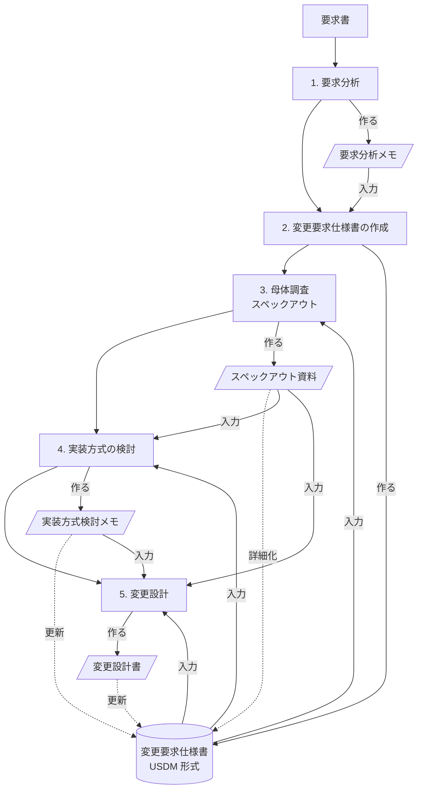

# AIに仕様を伝えるならUSDM：要求・理由から仕様を導出する

## はじめに

AI で開発するとき、結果の良し悪しを一番左右するのは**仕様書**です。
前の記事「[開発手順や仕様をAIに渡す方法](https://qiita.com/gataca27/items/87d54f106112d3a4a7d6)」では、スキルやナレッジを整えても「何を作るか」は仕様書で決まる、と書きました。

では、その仕様書はどう書けばよいのでしょうか。
仕様の書き方には、昔からいろいろな方法があります。
この記事では、それらをざっと紹介したうえで、出会ってから20年以上使っている XDDP という開発アプローチで、仕様書の書き方として使われている **USDM** を説明します。
例は、私が開発中の **XDDPツール**（XDDP を AI の支援で進めるツール）で AI に書かせている決まりに沿って作っています。
最後に、そのツールの概要も紹介します。

### 想定読者

- AI で開発していて、仕様書の伝え方を具体的にどうすればいいの？と、迷っている人
- USDM という名前を聞いたことがない、または名前しか知らない人

### この記事で分かること

1. 仕様の書き方にはどんな方法があるか
2. USDM とは何か、どう書くか（XDDPツールでの書き方）
3. USDM が AI 開発と相性がよいと私が考える理由
4. USDM-Schema の概要
5. XDDP と、開発中の XDDPツールの概要
6. USDM の注意点

:::note info
引用した資料やツールの内容は、2026年11月時点のものです。
USDM の書き方の決まりは、派生開発推進協議会（AFFORDD）の次の資料をもとに、節番号を付けて紹介します。

- 『[USDM 小冊子 基礎編 ver1.3](https://affordd.jp/wp-content/uploads/t2/affordd-t2-usdmtext-basic_1.3.pdf)』（以下「基礎編」）
- 『[USDM 小冊子 補足編 ver1.3](https://affordd.jp/previous/tech_documents/affordd-t2-usdmtext-appendix_1.3.pdf)』（以下「補足編」）
- 「[USDM-Schema](https://affordd.jp/libraries/usdm-schema/)」（説明ページは v1.0.0。XDDPツールは、リポジトリで公開されている v1.1.0 に合わせています。4章で紹介します）

XDDPツールは、これらをもとにしつつ、AI に書かせやすいように独自の決まりも足しています。
資料にない、ツール独自の決まりには「**（ツール独自）**」と付けます。
:::

## 要点

- 仕様の書き方には、決まった文型で書く方法（EARS など）、例で書く方法（Gherkin など）、機械が読める形で書く方法（OpenAPI など）があります。
- **USDM** は、「要求」「理由」「仕様」を分けて、階層で書く方法です。清水吉男さんが提唱しました。
- 要求を「〜して、〜する」という**振る舞い**で書き、その動詞ごとに仕様を引き出します。こうすると、仕様の漏れに気づきやすくなります。
- **理由**を書く欄があるのが大きな特徴です。仕様に書いていないケースでも、理由があれば AI が意図に沿って判断しやすくなります。
- USDM は、AI に仕様を渡すための書き方であるだけでなく、**AI と一緒に仕様を導き出すための道具**にもなります。AI に不明点を聞かせるだけでなく、要求・理由・仕様の形を共通の土台にして、**AI と壁打ちしながら仕様をブラッシュアップ**できます。
- 書き方の決まりがはっきりしているので、曖昧な表現や構造の崩れはスクリプトで、動詞と仕様グループの対応などは AI レビューで確かめられます。

## 1. 仕様の書き方には、どんな方法があるか

まず、世の中の主な方法を見ておきます。

### 決まった文型・構成で書く

| 方法 | 概要 | 出典 |
|---|---|---|
| **ISO/IEC/IEEE 29148** | 要求仕様書の構成や、よい要求の条件（あいまいでない、検証できる など）を定めた国際規格。IEEE 830 の後継 | ISO/IEC/IEEE 29148:2018 |
| **EARS** | 「WHEN 〜, THE SYSTEM SHALL 〜」のような少数の文型で、要求のあいまいさを減らす | Mavin ら, RE'09（Rolls-Royce での研究） |
| **USDM** | 「要求」「理由」「仕様」を分けて階層で書く。要求を振る舞い（動詞）で書き、動詞ごとに仕様を引き出す | 清水吉男『要求を仕様化する技術・表現する技術』 |

### 例やシナリオで書く

| 方法 | 概要 | 出典 |
|---|---|---|
| **ユースケース** | 利用者とシステムのやり取りを、基本の流れと代わりの流れで書く | Alistair Cockburn『Writing Effective Use Cases』 |
| **ユーザーストーリー** | 「〇〇として、△△したい。なぜなら□□だから」の形で書き、受け入れ基準を添える | Mike Cohn『User Stories Applied』 |
| **BDD（Gherkin）** | Given / When / Then の形で書き、そのまま自動テストとして動かせる | Cucumber の Gherkin 構文 |

### 機械が読める形で書く

| 方法 | 概要 |
|---|---|
| **API・スキーマ定義** | OpenAPI、JSON Schema など。入出力の型と制約を厳密に決められる |
| **形式手法** | TLA+、Alloy など。状態の変化を数学的に書いて検証する |

### AI 開発向けの新しい流れ

| 方法・ツール | 概要 |
|---|---|
| **GitHub Spec Kit** | 原則（constitution）→ 仕様（spec）→ 計画（plan）→ タスク（tasks）の順に、AI と段階的に進めるツールキット |
| **Kiro** | `requirements.md`（EARS 形式）、`design.md`、`tasks.md` を作ってから実装する |

### USDM が違うのは「なぜ」と「仕様の引き出し方」

どの方法も、**何を・どうするか**を正確に書く工夫をしています。
一方で、USDM 以外の方法の多くには、**なぜそうするのか**という理由を書く欄がありません。

ユーザーストーリーには「なぜなら」がありますが、ストーリー全体に1つだけです。要求と仕様を階層で結びつけて書く形式でもありません。
ISO/IEC/IEEE 29148 も、要求の属性の1つとして理由（Rationale）を挙げ、要求ごとに残すよう勧めています（29148:2018 5.2.8）。
ただし、要求仕様書の中身と構成を定めた規格で、USDM のように要求・理由・仕様を階層の表で書く書式ではありません。

もう1つの違いは、**要求から仕様をどう引き出すか**です。
ここで挙げたほかの方法の多くは、要求や仕様を「どう書くか」が中心で、要求から仕様を「どう引き出すか」までは、USDM ほど具体的には決めていない、と私は考えています。
USDM は、要求文の動詞と目的語から仕様を引き出すやり方まで決めています（2章で説明します）。

たとえば GitHub Spec Kit の clarify は、できあがった仕様書を、機能の範囲・データモデル・エッジケースなどの観点で調べ、足りない点を質問して埋める手順です（[clarify のテンプレート](https://github.com/github/spec-kit/blob/main/templates/commands/clarify.md)）。
これは、できたものを後から確かめる系統の明確化です。
USDM は、書きながら動詞ごとに仕様を導き出すやり方を持ち、そのうえで、書いた後に曖昧な表現を探す確認も持っています（基礎編 5.2）。

:::note info
要求から仕様（または下位の要求）を導く方法は、USDM のほかにもあります。
たとえばゴール指向要求工学（KAOS など）は、目標を分解してシステムへの要求まで詳細化します（A. van Lamsweerde『Requirements Engineering: From System Goals to UML Models to Software Specifications』2009）。
USDM の特徴は、それを**自然言語の要求文の動詞と目的語から**行う、軽くて実務向けのやり方にある、と私は考えています。
:::

この「なぜ」を要求ごとに必ず書く欄として持ち、要求と仕様を階層で表し、1つの要求の中で仕様を引き出すやり方まで決めている形式が、USDM です。
ただし、USDM の仕様書だけで AI への入力が足りるとは限りません。
既存のコードの調査結果や設計書、図も必要になることがあります（6章で説明します）。
そして、USDM 形式の仕様書を工程ごとに詳細化していく手順を決めているのが、XDDP という開発アプローチです（5章で紹介します）。

## 2. USDM とは

### 概要

USDM（Universal Specification Describing Manner）は、清水吉男さんが提唱した要求と仕様の表現の仕方です（[基礎編 2.1.1](https://affordd.jp/wp-content/uploads/t2/affordd-t2-usdmtext-basic_1.3.pdf#page=5)）。
次の2つからできています。

- 要求と仕様を階層にして書く **様式（フォーマット）**
- 要求と仕様を表現する **書き方の決まり（Describing Manner）**

原典は、清水吉男『[【改訂第2版】[入門+実践]要求を仕様化する技術・表現する技術](https://gihyo.jp/book/2010/978-4-7741-4257-9)』（技術評論社）です。

### 構成要素

USDM では、要求を次の要素に分けて書きます（基礎編 4.1、補足編 1.2、USDM-Schema）。

| 要素 | 何を書くか |
|---|---|
| **カテゴリ** | 要求のまとまり |
| **上位要求** | 作ってほしいこと |
| **理由** | その要求が必要な背景・根拠 |
| **説明** | 補足。実装しなくてよい情報 |
| **要求グループ** | 上位要求を分けたときの、下位要求のまとまり |
| **下位要求** | システムがすること。ソフトウェアの**振る舞い**として書く |
| **仕様グループ** | 要求に含まれる動詞1つ（＋目的語）ごとのまとまり |
| **仕様** | 動詞ごとに、具体的な制約・処理内容・選択肢を書いたもの |

### 要求の階層：3つのパターン

要求は、**上位要求 → 下位要求の2階層まで**です。下位要求の下に、さらに下位要求は作りません（補足編 3.1）。
範囲が大きすぎるときは、階層を深くせずに分けます（分け方は、後の「動詞が8個以上なら、要求を分ける」で説明します）。

XDDPツールでは、USDM-Schema v1.1.0 に合わせて、要求ごとに次の3つのパターンを使い分けます。

| パターン | 使う場面 | 形 |
|---|---|---|
| 1階層 | 要求が単純で、分けなくてよい | 上位要求 → 仕様グループ → 仕様 |
| 2階層 | 要求が複合的で、分ける必要がある | 上位要求 → 要求グループ → 下位要求 → 仕様グループ → 仕様 |
| 強制2層 | 分けたいが、下位要求が1つしか立たない | 下位要求を1つだけ立てる。その下位要求の理由・説明は空欄にしてよい |

強制2層は USDM-Schema v1.1.0 で加わった決まりで、小冊子には書かれていません。

### 例：ログイン失敗時のアカウントロック

小さな例で見てみます（例は私が作ったものです）。
形は、基礎編 4.1 の基本フォーマットのうち「要求が2階層の場合」に合わせています（[基礎編 4.1](https://affordd.jp/wp-content/uploads/t2/affordd-t2-usdmtext-basic_1.3.pdf#page=19)）。
カテゴリ名、ID の付け方、要求グループの分割軸は、XDDPツールの決まりに合わせています。
下位要求は上位要求より1列右に、仕様は下位要求の下に書くので、**列の位置で階層がわかります**。

<table>
<tr><td rowspan="21">＜機能要求＞</td><td>要求</td><td>CR-01-UR-001</td><td colspan="2">ログインに続けて失敗したアカウントをロックし、本人がメールで解除できるようにしたい</td></tr>
<tr><td rowspan="20"></td><td>理由</td><td colspan="2">パスワードの総当たり攻撃を防ぎたいので。ただし、本人が自分で元に戻せないと、サポートへの問い合わせが増えるため</td></tr>
<tr><td>説明</td><td colspan="2">ロック中の画面の文言は、デザイン担当と別途決める</td></tr>
<tr><td colspan="3">＜ロックと解除＞（分割軸：時系列分割）</td></tr>
<tr><td>要求</td><td>CR-01-SR-001-001</td><td>ログインに失敗したとき、失敗回数を数えて、5回続けて失敗したらアカウントをロックする</td></tr>
<tr><td></td><td>理由</td><td>一定回数までは、本人の入力ミスとして許したいため</td></tr>
<tr><td></td><td colspan="2">＜失敗回数を数える＞</td></tr>
<tr><td>□□□</td><td>CR-01-SP-001-001.010</td><td>パスワードが一致しないとき、失敗回数に1を加える</td></tr>
<tr><td>□□□</td><td>CR-01-SP-001-001.020</td><td>ログインに成功したとき、失敗回数を0に戻す</td></tr>
<tr><td>□□□</td><td>CR-01-SP-001-001.030</td><td>登録されていないメールアドレスのときは、パスワード不一致と同じエラーメッセージを表示する</td></tr>
<tr><td></td><td>理由</td><td>登録されているメールアドレスかどうかを、第三者に知られないようにするため</td></tr>
<tr><td></td><td colspan="2">＜アカウントをロックする＞</td></tr>
<tr><td>□□□</td><td>CR-01-SP-001-001.040</td><td>失敗回数が5に達したとき、アカウントの状態を「ロック中」にする</td></tr>
<tr><td>□□□</td><td>CR-01-SP-001-001.050</td><td>ロック中のアカウントでは、正しいパスワードを入力しても「アカウントがロックされています」と表示する</td></tr>
<tr><td>要求</td><td>CR-01-SR-001-002</td><td>アカウントをロックしたとき、本人に解除用リンクをメールで送り、リンクを開いたらロックを解除する</td></tr>
<tr><td></td><td>理由</td><td>本人が、サポートに問い合わせずに自分で元に戻せるようにするため</td></tr>
<tr><td></td><td colspan="2">＜解除用リンクを送る＞</td></tr>
<tr><td>□□□</td><td>CR-01-SP-001-002.010</td><td>状態を「ロック中」にしたとき、有効期限30分の解除用リンクを、登録メールアドレスに送る</td></tr>
<tr><td></td><td colspan="2">＜ロックを解除する＞</td></tr>
<tr><td>□□□</td><td>CR-01-SP-001-002.020</td><td>期限内のリンクを開いたとき、状態を「通常」に戻し、失敗回数を0にする</td></tr>
<tr><td>□□□</td><td>CR-01-SP-001-002.030</td><td>期限切れのリンクを開いたとき、「リンクの有効期限が切れました」と表示し、再送ボタンを表示する</td></tr>
</table>

| 列・記号 | 意味 |
|---|---|
| 1列目 | カテゴリ（基礎編 4.1 ①）。XDDPツールでは「機能要求」「非機能要求」の2つだけを使う（ツール独自） |
| 「要求」「理由」「説明」 | その行に書く内容の種類。上位要求は2〜3列目、下位要求は3〜4列目に書く。仕様の下の「理由」は、その仕様の理由 |
| ＜…＞（分割軸：…） | 要求グループ。上位要求をどの基準で分けたかを添える |
| UR / SR / SP | 上位要求・下位要求・仕様の ID（ツール独自）。先頭に変更要求（CR）の番号（例の `CR-01`）を付ける |
| ＜…＞ | 仕様グループ。下位要求の動詞1つ（＋目的語）ごとに作る |
| □□□ | 仕様ごとのチェック欄（仕様記号）。レビュー済み・実装済み・テスト済みのように、進むごとに ■ で塗る使い方がある（[USDM-Schema](https://affordd.jp/libraries/usdm-schema/)） |

- UR / SR / SP の ID の先頭に CR の番号を付けるのは、CR をまたいでも ID が重ならないようにするためです。
- 仕様の ID の末尾は、連番ではなく、間をあけて振ります（例では 010、020、030）。あとから仕様を足すときは、間の番号（015 など）を使い、既存の ID を変えません（補足編 2.6 の「枝番は飛び番号にしたほうが追加がしやすい」に沿った決まり）。

:::note info
基礎編では、Excel などの表計算ソフトで書くことを勧めています（基礎編 4章）。
上の表は、その形を HTML の表で再現したものです。
XDDPツールでは、同じ内容を Markdown で AI に書かせ、人が表で見たいときは Excel や HTML の表示を生成しています。
Markdown では、仕様ごとに合意の状態（ステータス）と懸念・検討事項の欄も持たせています（ツール独自）。
進み具合（□□□ にあたるもの）は、トレーサビリティ・マトリクスの「設計」「実装」「テスト」の列で管理しています。
:::

### 書き方の決まり

#### 要求は「振る舞い」で、動詞形で書く

要求は、きっかけ（イベント）から始まり、入力 → 変換 → 出力までの一連の動作として書きます。
形は「〜を〜して、〜を〜して、〜を〜する」です（基礎編 2.2.3）。

名詞形ではなく、**動詞形**で書きます（基礎編 2.2.3）。

| | 例 |
|---|---|
| ✕ 名詞形 | 平均値の表示 |
| ○ 動詞形 | 平均値を表示する |

意味は同じですが、動詞形のほうが「動き」が見え、仕様を引き出しやすくなります。

XDDPツールでは、上位要求と下位要求で文の形を分けています（ツール独自）。

| 要求 | 主語 | 形 | 例 |
|---|---|---|---|
| 上位要求（UR） | ユーザー | 「〜したい」。どう作るかは書かない | 本人がメールで解除できるようにしたい |
| 下位要求（SR） | システム | 「〜のとき、〜して、〜する」 | アカウントをロックしたとき、解除用リンクをメールで送り、リンクを開いたらロックを解除する |

下位要求にきっかけ（「〜のとき」）を必ず書かせることで、AI が振る舞いの始まりを書き落とさないようにしています。

#### 動詞が8個以上なら、要求を分ける

要求の中の動詞は、5〜7個程度にまとめます。8個以上になると仕様が多すぎて見づらくなるので、要求を分けます（基礎編 4.2.2）。
分け方は2つです（基礎編 4.2.2）。

- 階層にする（垂直方向）：上位要求の下に下位要求を作る
- 別の要求にする（水平方向）

ただし要求は2階層までなので、下位要求をさらに分けたくなったら、階層を深くせず、別の要求に分ける（水平方向）か、＜＞でグループ化するなどの工夫をします（基礎編 4.2.2、補足編 3.1）。

分ける基準として、次の4つがあります（基礎編 4.2.4）。

| 分割の基準 | 内容 |
|---|---|
| 時系列分割 | 時間の流れで分ける（基本はこれ） |
| 構成分割 | 機能別・構成別に分ける |
| 状態分割 | 状態ごとに分ける |
| 共通分割 | 共通の機能を切り出す |

XDDPツールでは、要求グループに**どの基準で分けたか（分割軸）**を書きます。
分け方が文書に残るので、「この分け方は妥当か」をレビューで確かめられます。

#### 理由は必ずセットで書く

要求には、それが必要な理由（背景）があります。理由は要求よりも変わりにくいものです（基礎編 2.2.5）。
理由をつかんでおくと、次のような効果があると基礎編は挙げています（基礎編 2.2.5）。

- 要求の意味が分かりやすくなる
- 依頼者と作業者の認識のずれを調整できる
- 要求に根拠がないことに気づける
- 仕様の引き出しや設計で配慮できることがある
- 依頼者も気づいていない要求を引き出せることがある

なお、「儲かりたいから」のような一般的な理由ではなく、**その要求に特有の理由**を書きます（基礎編 4.3）。

XDDPツールでは、要素ごとに理由の扱いを次のように決めています。

| 要素 | 理由 | 根拠 |
|---|---|---|
| 上位要求 | 必ず書く。空ならスクリプトがエラーにする | ツール独自（補足編 3.2 は「当初は書かなくてもかまわないが、終盤は記述する」） |
| 下位要求 | 原則書く。強制2層のときだけ空欄でよい | 基礎編 4.2.3（「下位要求にも理由をつけます」）、USDM-Schema |
| 仕様 | 設計判断の根拠があれば「理由」欄に書く | USDM-Schema |

仕様の理由について、補足編は専用の欄を作らず、仕様の文章の中に【理由】として書くよう求めています（補足編 2.4、3.5）。
一方 USDM-Schema は、仕様に理由の項目を持っています。
XDDPツールは USDM-Schema に合わせて、仕様にも「理由」欄を置いています。
設計以降の工程で「なぜこの仕様か」をたどれるようにするためです。

#### 仕様は、動詞1つごとに引き出す

要求の中の動詞（＋目的語）1つごとに仕様グループを作り、その下に仕様を書きます（基礎編 4.4.2）。
上の例では、「失敗回数を数える」「アカウントをロックする」がそれぞれ仕様グループになっています。

動詞ごとに、次の観点で仕様を引き出します（基礎編 2.2.7）。

- 何ができればよいか
- どのような状況で動けばよいか
- 結果をどのような形で返せばよいか

仕様の粒度は、次の3つを満たす程度にします（基礎編 4.4.1）。

- 要求から導かれている（すべての仕様は、どれかの要求に属する）
- 設計をイメージできる（仕様ごとに作業と時間を見積もれる）
- 検証をイメージできる（仕様ごとにテスト方法が分かる）

補足編は、「コード（実現方法）がイメージできる」ほど具体的に書く、とも書いています（補足編 2.4）。
XDDPツールでは、これを「実装する人が質問しなくても実装できる具体さ」として AI に求めています。

#### 曖昧な表現を避ける

基礎編は、見つけやすい曖昧な表現として次の3つを挙げ、まずこれをなくすことから始めるよう勧めています（基礎編 5.2）。

| 曖昧な表現 | 何が問題か | 対策 |
|---|---|---|
| **「等」「etc」** | パターンが途中で止まり、漏れる | 今決められることはすべて書く。未確定なら合意する時期を書く（基礎編 4.5.5） |
| **否定表現（〜しない）** | 「隠れた IF 文」になりやすい。else の場合が書かれない | 「else は何？」と考え、すべての場合分けを書く（基礎編 4.5.4） |
| **ペースト作文（コピペ）** | 一部だけ違う文章を並べると、違いが分かりにくい | 表やデシジョンテーブルで書く（基礎編 4.5.3） |

上の例の CR-01-SP-001-001.030 は、最初「登録されていないメールアドレスのときは、失敗回数を数えない」と書きかけました。これは否定表現です。
「では、そのとき何をするのか」を考えて、表示するメッセージを仕様として書きました。

XDDPツールでは、さらに次の決まりを足しています（ツール独自）。

- 受け身（〜される、〜が存在しない）を避け、「〜が〜する」と主語をはっきり書く
- 述語が「〜しない」になるときは、else 側の仕様を必ず並べて書くか、デシジョンテーブルなどですべての条件を書く

受け身の文だと、AI は「誰が」その動作をするのかを取り違えやすいためです。

#### 漏れなく、重複なく仕様を出すには

基礎編は、USDM にはロジカルシンキングの **MECE**（漏れなく、重複なく）の考え方が取り入れられている、と書いています（基礎編 3.1 ①）。
基礎編から読み取れる具体的なやり方は、次のとおりです。

| 観点 | やり方 | 基礎編 |
|---|---|---|
| 動詞の漏れ | 要求を振る舞いで書き、動詞と目的語をすべて書き出す。動詞1つごとに仕様グループを作る | 2.2.3、4.4.2 |
| 仕様の漏れ | 動詞ごとに「何ができればよいか」「どの状況で動けばよいか」「結果をどの形で返すか」を問う | 2.2.7 |
| データの漏れ | 上限・下限、正常・異常の基準を、範囲として示す | 2.2.4 |
| 条件の漏れ | 「〜しない」があれば else を考える。「等」で止めずに書き切る | 4.5.4、4.5.5 |
| 分割の重複 | 時系列・構成・状態・共通のどれかの基準で分ける | 4.2.4 |
| 範囲外・重複 | 仕様が親の要求の範囲内かを確かめる。共通する要求は切り出す | 4.2.7、4.2.8 |

ただし、「このやり方で分ければ必ず MECE になる」と保証する方法までは、基礎編には書かれていません。

そこで私は、**USDM で範囲を区切り（動詞ごとの仕様グループ）、その中の網羅はテスト設計の技法で確かめる**、という組み合わせがよいと考えています。
基礎編も、仕様の欄にはフローチャートやデシジョンテーブルなど、テスト工程で条件を分類するときの書き方を使うとよい、と勧めています（基礎編 4.5.3）。

| やり方 | 内容 | 例（2章のアカウントロック） |
|---|---|---|
| **1回の分割では、軸を1つにする** | 「時系列」と「状態」を混ぜて分けると、重複が生まれる。 1回の分割では、分割の基準を1つだけ使う | 下位要求を「ロックする」「解除する」と時系列だけで分ける（要求グループの分割軸を「時系列分割」とする） |
| **二分法を使う** | 「A か、A でないか」で分けると、それだけで漏れも重複もなくなる。 否定表現から else を考えるのと同じ考え方 | 「パスワードが一致する／一致しない」 |
| **デシジョンテーブル** | 条件の組み合わせをすべて並べる（「はい／いいえ」の2値の条件が n 個なら 2ⁿ 通り） | 「パスワードが一致するか」×「ロック中か」の4通りを、すべて仕様にする |
| **状態遷移表** | 状態 × イベントのマスをすべて埋める。 「何もしない」も1つの仕様として書く | 「通常／ロック中」×「ログイン成功／失敗／解除リンクを開く」の6マス |
| **同値分割と境界値** | 入力の値を、同じ扱いになるグループに分け、グループの境目の値も確かめる。 基礎編 2.2.4 の「データの範囲」を具体的にするやり方 | 失敗回数の「4回まで／5回以上」と、境目の4回・5回 |

デシジョンテーブル、状態遷移、同値分割、境界値は、ISTQB（JSTQB）の Foundation Level シラバスでブラックボックステスト技法として扱われているものです（[ISTQB CTFL Syllabus v4.0.1](https://www.istqb.org/wp-content/uploads/2024/11/ISTQB_CTFL_Syllabus_v4.0.1.pdf)）。

行と列をそれぞれ MECE にした表なら、マスをすべて埋めれば網羅できます。
空いたマスが、そのまま**仕様の漏れ**です。

:::note info
XDDPツールでは今のところ、変更要求仕様書を書く段階でこれらの表を作ることまでは AI に求めていません。
「1回の分割では軸を1つにする」は要求グループの分割軸で、「否定表現から else を考える」は書き方の決まりで扱っています。
境界値は、テスト設計の工程でテストケースとして洗い出しています。
:::

## 3. USDM が AI 開発と相性がよい理由

ここからは、USDM をソフトウェア開発で長年使い、AI への入力として試行している私の考えです。

### 理由があると、書いていないケースでも AI が意図に沿って判断しやすい

どんなに丁寧に書いても、仕様にすべてのケースは書けません。
書いていないケースに出会ったとき、AI は何かしらの判断をします。

上の例で、「管理者アカウントもロックするか」は書いていません。
理由に「総当たり攻撃を防ぎたい」とあれば、管理者アカウントこそ守るべきだと AI は判断しやすくなります。
理由がなければ、AI は一般的によくある実装を選ぶだけです。

もちろん、理由があっても AI が正しく判断するとは限りません。
それでも、**AI が判断に迷ったときに質問を返す材料**にはなります。
「理由からすると管理者もロック対象と思われますが、仕様に書かれていません。どうしますか？」と聞いてくれれば、仕様の穴が見つかります。
XDDPツールでは、こうした点を AI に「懸念・検討事項」として書かせ、人が答えるまで残しておきます。

### AI と一緒に仕様を導き出し、壁打ちで磨ける

USDM の書き方の決まりがあると、AI と一緒に仕様を導出できます。
XDDPツールでは、次の流れで進めます。

| 手順 | 人 | AI |
|---|---|---|
| 1. 要求を分析する | 要求書を書いて渡す | 要求書の記述を1つずつ、上位要求・下位要求・仕様のどれにあたるかに振り分ける。理由の案と、曖昧な点（考えられる解釈を2つ並べて）を挙げる |
| 2. 仕様の案を作る | 曖昧な点に答える | 振り分けた結果をもとに、USDM 形式で要求・理由・仕様まで書く。仕様だけの記述からは、その上の要求を推定して補う |
| 3. 磨く | USDM を読み、足りない仕様を追加する。気になる点を AI に相談する | 作成とは別のコンテキストの AI がレビューし、指摘を直す。相談に応じて仕様を詳細化する |

手順1で振り分けておくと、要求書に「上位要求と下位要求が1文に混ざった記述」があっても、手順2で「ゴールは上位要求、条件と動作は下位要求」のように分けて書けます。
不明点を聞かれて答えるだけでなく、手順3の往復で仕様が磨かれていきます。
また、私が暗黙的に当たり前と思っている点や、気づいていない必要な仕様を AI が抽出してくれるときもあります。
どの仕様を採用するかを決めるのは人です。

チャットでこの流れを回すときは、USDM の書き方の決まりを AI に伝え、できた仕様書はこまめにファイルに書き出しておきます。

### 仕様の粒度が、AI の作業単位にちょうどよい

USDM の仕様は「設計をイメージできる」「検証をイメージできる」粒度で書きます（基礎編 4.4.1）。
これは、そのまま **AI に頼む1つの作業**と、**その作業の完了を確かめるテスト**の単位になります。

### 要求の範囲が、AI の「やりすぎ」を防ぐ

仕様は要求の下に書くので、要求の範囲から外れた仕様は、レビューで違和感が出て見つけやすくなります（基礎編 3.1 ④）。
AI はときどき、頼んでいない機能まで作ります。
要求の範囲がはっきりしていれば、それが「範囲外」だと判断できます。

### ID で追跡できる

要求と仕様には ID を振ります（基礎編 4.2.5、4.4.4）。
AI にコードやテストを書かせるとき、「CR-01-SP-001-002.030 を実装して」「このテストはどの仕様を確かめているか ID で書いて」と頼めます。
漏れの確認（すべての仕様にテストがあるか）も、ID で機械的にできます。
XDDPツールでは、ID の先頭に CR の番号を付けているので、複数の CR の仕様書をまたいでも ID が重なりません。

### 漏れのチェックを、AI とスクリプトで回せる

書き方の決まりがはっきりしているので、**チェックを自動化しやすい**のです。
XDDPツールでは、文字列や構造で判断できることはスクリプトで、言葉の意味の判断が要ることは AI レビューで確かめています。

- スクリプト：仕様の文の「等」「〜しない」、同じ文の仕様（ペースト作文の疑い）、理由の空欄、ID の重複、要求の3階層
- AI レビュー：下位要求の動詞ごとに仕様グループがあるか、仕様が親の要求の範囲に収まっているか、仕様がコードをイメージできる具体さか

### ほかの方法と組み合わせられる

USDM は、ほかの方法と対立するものではありません。
仕様の欄には表やデシジョンテーブルを使ってよい、と基礎編にもあります（基礎編 4.5.3）。
たとえば、条件分岐は EARS の文型やデシジョンテーブルで、API の入出力はスキーマで書き、USDM の仕様からそれを参照する、という組み合わせができます。
内容が複雑になる場合は、シーケンス図、DFD（データフロー図）、フローチャートなども作り、USDM の仕様から参照します。

## 4. USDM-Schema：USDM を機械が読める形にする標準

AI やツールで USDM を扱う流れを後押しするものとして、派生開発推進協議会（AFFORDD）が 2026年5月の派生開発カンファレンスで「[USDM-Schema](https://affordd.jp/libraries/usdm-schema/)」を発表しました。
公開のお知らせは 2026年6月10日に出ています（[お知らせ](https://affordd.jp/t23-result-20260610/)）。
USDM の構造を JSON Schema で定義した規格です（規格番号 AFFORDD-USDM-JSON-001、ライセンス CC BY 4.0）。
スキーマ本体や記述例は、GitHub のリポジトリ [affordd-prj/usdm-schema](https://github.com/affordd-prj/usdm-schema) で公開されています。
説明ページの版は Version 1.0.0 ですが、リポジトリには v1.1.0 も公開されています（2026年11月時点）。

### なぜ作られたか

USDM-Schema のページでは、背景として次の2つの課題が挙げられています。

- USDM には形式的な定義（メタモデル）がなく、書き方が書き手によってばらつきやすい
- 事実上 Excel が標準になっていて、差分の管理や自動処理がしにくく、ツールどうしの互換性もない

### 何を決めているか

| 項目 | 内容 |
|---|---|
| 構成要素 | キーワードラベル、要求、理由、説明、仕様、仕様ラベル、グループ、カテゴリの8つ |
| 階層 | 上位要求 → 下位要求の2階層まで |
| 分割軸 | 時系列分割、構成分割、状態分割、共通分割（共通分割は要求のみ） |
| ステータス | 仕様ラベルの記号で表す（未レビュー □□□ → レビュー済み ■□□ → 実装済み ■■□ → テスト済み ■■■） |

### 正規化した JSON を正本にする利点

USDM-Schema は、正規化した JSON（Canonical JSON）を正本とし、そこから Markdown などの形式に変換する考え方をとっています。
ページでは、利点として次の4つが挙げられています。

- Git で意味のある差分が取れる
- JSON Schema で正しい形かを検証できる
- 形式どうしの変換が「N×N ではなく N+N」で済む
- 特定のツールに依存しない

AI との連携の例として、Markdown で書いた仕様書を JSON にして AI に渡す、AI が作った JSON を Markdown に戻して人がレビューする、という使い方も紹介されています。

### XDDPツールでの取り入れ方

XDDPツールは、まだ JSON での入出力には対応していません。
代わりに、USDM-Schema の**構造の決まり**（グループ名を＜＞で囲む、要求グループに分割軸を書く、1階層・2階層・強制2層を使い分ける、仕様にも理由の欄を持つ）を、Markdown の書き方に取り入れています。

書き方の決まりが文章だけでなく**スキーマとして機械的に確かめられる**ようになると、AI が書いた USDM の形の崩れを自動で見つけられます。3章で書いた「チェックを自動化しやすい」という性質が、さらに強くなると考えています。
ただし、スキーマが確かめるのは形だけです。否定表現や「等」、動詞の数のような**文の書き方**は、スキーマでは確かめられません。XDDPツールで、スクリプトと AI レビューを別に回しているのはそのためです。

## 5. XDDP と、開発中の XDDPツール

### XDDP とは

**XDDP**（eXtreme Derivative Development Process）は、清水吉男さんが提案した開発アプローチです（[AFFORDD「派生開発とXDDP」](https://affordd.jp/derivative-development/xddp/)）。
**派生開発**とは、新規開発に対峙させた概念で、既存のソフトウェアに新しい機能を追加したり、改善したりする開発です。流用や移植のときの調整にも、派生開発の特徴が見られるとされています（[AFFORDD「派生開発とは」](https://affordd.jp/derivative-development/)）。

XDDP は派生開発の現場で考案され、「派生開発に特化した開発アプローチ」と紹介されることがあります。
ただ、新規開発であっても、要求から仕様を導き出し、設計からテストまでを行い、トレーサビリティをとる必要があることに変わりはありません。
XDDP は新規開発にも適用でき（次の節で説明します）、私も新規開発に XDDP を適用してきています。

XDDP では、変更を「**変更3点セット**」と呼ばれる3つの成果物で表します（清水吉男『「派生開発」を成功させるプロセス改善の技術と極意』、[AFFORDD「XDDPの特徴」](https://affordd.jp/derivative-development/xddp/characteristic/)）。

| 成果物 | 表すこと | 書き方 |
|---|---|---|
| 変更要求仕様書 | **何を**変更するか | **USDM** の記法を使い（[基礎編 2.1.2](https://affordd.jp/wp-content/uploads/t2/affordd-t2-usdmtext-basic_1.3.pdf#page=7)）、変更要求と変更仕様を階層で、変更前後を Before / After で書く（[AFFORDD「XDDPを支える2つの手法」](https://affordd.jp/derivative-development/xddp/method/)） |
| トレーサビリティ・マトリクス | **どこを**変更するか | — |
| 変更設計書 | **どうやって**変更するか | — |

XDDP の全体像（変更3点セットそれぞれの中身や、成果物どうしの関係）は、諏訪真一さんの解説記事「[技術調査 - USDM × XDDP](https://zenn.dev/suwash/articles/usdm_xddp_20260325)」にまとまっています。

### 新規の追加と変更は、別のプロセスで扱う

XDDP では、既存の部分を**変更**する要求と、機能を**新規に追加**する要求を、別のプロセスで扱います（[AFFORDD「XDDPの特徴」](https://affordd.jp/derivative-development/xddp/characteristic/)）。
そのため、XDDP は派生開発だけでなく、新規開発にも適用できます。
新規開発では母体調査や変更設計書は使いませんが、USDM で要求と仕様を書くことと、ID で設計からテストまでをつなぐことは同じです。

| | 新規追加 | 変更（派生開発） |
|---|---|---|
| 要求と仕様 | USDM で書く | USDM で書く（仕様は Before / After） |
| 母体調査（スペックアウト） | なし | する |
| 設計 | 既存のほかの設計手法を使う。ただし、要求・仕様の ID などは設計にも使い、追跡できるようにする | 変更設計書を書く |
| その後 | 実装・テスト | 実装・テスト。テストで品質を確かめてから、仕様書を更新する |

どちらのプロセスでも、要求と仕様は USDM で書きます。USDM の ID が、設計・実装・テストをつなぐ共通の手がかりになります。
XDDPツールでは、設定で新規開発か変更かを選びます。
新規開発では仕様を1つの文で（2章の例）、変更では Before / After の対で書きます。

### 変更仕様は Before / After で書く

派生開発では、すでに動いているソフトウェアを変えます。
そのため変更要求仕様書では、仕様を**変更前の動作（Before）**と**変更後の動作（After）**の対で書きます（[AFFORDD「XDDPを支える2つの手法」](https://affordd.jp/derivative-development/xddp/method/)）。
Before / After は XDDP で USDM を変更に応用したもので、USDM の小冊子（基礎編・補足編）には書かれていません。

2章のアカウントロックが、すでに動いているとします。
「総当たり攻撃の試行が増えたので、ロックまでの回数を減らし、ロックしたら管理者にも知らせたい」という変更要求（CR-02）が来た場合、XDDPツールでは、仕様グループ「＜アカウントをロックする＞」の変更仕様を次のように書きます。

| 仕様ID | Before | After | 理由 |
|---|---|---|---|
| CR-02-SP-001-001.010 | 失敗回数が5に達したとき、アカウントの状態を「ロック中」にする | 失敗回数が**3**に達したとき、アカウントの状態を「ロック中」にする | 総当たり攻撃の試行が増えたため、試せる回数を減らす |
| CR-02-SP-001-001.020 | なし | 状態を「ロック中」にしたとき、**管理者に通知メールを送る** | — |

- 新しく追加する仕様は、Before を「なし」と書きます。
- 仕様の ID は、CR-02 の変更要求仕様書の中で、間をあけて振ります。
  工程が進むにつれて、新たな仕様が判明することがあります。
  仕様は時系列に並べたほうが分かりやすいので、既存の仕様の途中に挿入したくなります。連番だと、そのたびに既存の番号が変わってしまいます。
  そのため、たとえば母体調査で .010 と .020 の間に入れる仕様が見つかったら、.015 を振ります。
- 先頭が CR の番号なので、2章（CR-01）の ID とは重なりません。

Before があると、AI にも人にも「今どう動いていて、どこが変わるのか」がはっきりします。
After だけを渡すと、AI は既存の動作との違いがわからず、変える必要のない部分まで書き換えてしまうことがあります。
Before を正しく書くには、今の動作を知る必要があります。
そのために行うのが、次の節で紹介する母体調査（スペックアウト）です。

### 変更要求仕様書を、段階的に詳細化する

XDDPツールでは、変更（派生開発）の変更要求仕様書を一度で書き上げるのではなく、次の段階で詳細化し、更新していきます。

| 段階 | やること | 変更要求仕様書（USDM 形式） |
|---|---|---|
| 1. 要求分析 | 要求書の記述を、上位要求・下位要求・仕様に振り分け、理由の案と曖昧な点を挙げる | —（要求分析メモを作る） |
| 2. 変更要求仕様書の作成 | 要求分析の結果をもとに、USDM 形式で要求・理由・仕様を書く | 作る |
| 3. 母体調査（スペックアウト） | 既存のソフトウェア（母体）を調べ、その結果をもとに要求・仕様を詳細化する | 詳細化する |
| 4. 実装方式の検討 | 実装方式を検討したら、その結果を変更要求仕様書に反映する | 更新する |
| 5. 変更設計 | 変更設計書を書いたら、その内容を変更要求仕様書に反映する | 更新する |

こうして、**段階的な詳細化**、**要求と仕様の管理**、**トレーサビリティの確保**を進めていきます。
段階1で理由の案を出しておくと、段階2で要求・仕様を整理する手がかりになります。

### XDDPツールの概要

AI に仕様を伝えてから、実装・評価までを進める XDDP のプロセスを、AI の支援で行えるツールを開発しています。
Claude Code のスキル・エージェント・テンプレートとして作っていて、GitHub で公開しています。

https://github.com/tsuna44/XddpSettings

このツールでは、USDM 形式の変更要求仕様書を **AI への入力として使うだけではありません**。
上の段階的な詳細化、要求と仕様の管理、トレーサビリティの確保も、**AI 自身が USDM 形式で行えるようにしています**。

- 上の段階ごとにコマンドがあります。変更設計のあとは、コーディング、テスト、最新仕様書の作成まで進めます。
- 各工程は、AI が作る → AI がレビューして直す → 人がレビューして確定する、の順に進みます。
- 新規開発では、母体調査は行いません。
- 要求分析では、要求書の記述を上位要求・下位要求・仕様に振り分け、それをもとに変更要求仕様書を書きます（3章）。
- 母体調査、実装方式の検討、変更設計の結果は、AI が変更要求仕様書に反映します。
- 変更要求仕様書は、2章の表と同じ内容を Markdown で書きます。3章のとおり、曖昧な表現や構造の崩れはスクリプトで、動詞と仕様グループの対応などは AI レビューで確かめます。
- 人がレビューしやすいように、変更要求仕様書の Markdown から Excel や HTML の表示を生成できます。
- 将来は、USDM-Schema の JSON での入出力にも対応する予定です（4章）。

:::note info
XDDPツールは開発中です。詳しい使い方や作りは、別の記事で紹介する予定です。
:::

## 6. USDM の注意点

USDM がいつでも最適というわけではありません。

| 場面・注意点 | 内容 |
|---|---|
| **理由を聞き出すのは難しい** | 「なぜ必要ですか」と聞いても、「業務効率化のため」のような答えしか返ってこないことがある、と基礎編にもあります（基礎編 4.3.1）。聞き方の工夫が必要です |
| **書く量が増える** | 理由や仕様グループを書く分、手間はかかります。 小さなツールや、捨てる前提の試作なら、バイブコーディングで試すほうが早いこともあります |
| **型や入出力の厳密な定義** | API の型や値の範囲は、OpenAPI や JSON Schema のほうが正確に書けます。 USDM の仕様からスキーマを参照するのがよいと考えています |
| **USDM の形でも、中身が正しいとは限らない** | 書き方が整っていても、要求そのものが間違っていれば意味がありません。最後は人が中身を確認します |

### USDM だけでは、AI への入力として足りないこともある

USDM で書いた仕様が伝えるのは、**何を作る（変える）か**と、**なぜか**です。
既存のソフトウェアの**どこに**、**どういう構造で**手を入れるかまでは伝わりません。
とくに派生開発では、既存のコードの構造や動きを知らないまま AI に作業させると、仕様どおりでも既存の作りに合わないコードが出てきます。

そのため、USDM の仕様書に加えて、次のような資料も AI に渡す必要がある場合があります。

| 資料 | AI に伝わること |
|---|---|
| **スペックアウト資料** | 既存のコードが今どう動いているか。変更する箇所と、影響が及ぶ箇所 |
| **変更設計書** | どのモジュール・関数を、どう変えるか |
| **シーケンス図** | 処理の順番と、モジュールどうしのやり取り |
| **DFD（データフロー図）** | データがどこから来て、どう変換され、どこへ行くか |
| **クラス図・関連図** | クラスやモジュールの構造と、それらの関係 |

USDM の仕様は、これらの資料の**起点**になります。
仕様の ID から、関係するスペックアウト資料や設計、図をたどれるようにしておくと、AI に渡す資料を必要な分だけ選べます。

## まとめ

- 仕様の書き方には、決まった文型で書く方法、例で書く方法、機械が読める形で書く方法などがあります。
- **USDM** は、要求・理由・仕様を分け、要求の動詞ごとに仕様を引き出す書き方です。
- **理由**があると、仕様に書いていないケースでも AI が意図に沿って判断したり、質問を返したりしやすくなります。
- XDDPツールでは、USDM の小冊子と USDM-Schema をもとに、要求グループと分割軸、ID の付け方などを決めて、AI に書かせています。
- ただし USDM だけでは足りないこともあります。スペックアウト資料、変更設計書、シーケンス図、DFD、クラス図・関連図なども、必要に応じて AI に渡します。
- 書き方の決まりがはっきりしているので、曖昧な表現や構造の崩れはスクリプトで、動詞と仕様グループの対応などは AI レビューで確認できます。

AI が力を発揮する場面はたくさんありますが、最も威力を発揮するのは、思考を整理するパートナーになってくれるところだと思います。
思考が整理されれば、実作業への入力も明確になるはずです。

AI を使っても、仕様を考えて決めるのは人です。
USDM は、その「考える」作業を助け、決めた内容を AI に正確に渡すための書き方だと考えています。

## 参考資料

**USDM・XDDP**

- 清水吉男『[【改訂第2版】[入門+実践]要求を仕様化する技術・表現する技術](https://gihyo.jp/book/2010/978-4-7741-4257-9)』技術評論社, 2010
- 派生開発推進協議会 T2研究会『[USDM 小冊子 基礎編 ver1.3](https://affordd.jp/wp-content/uploads/t2/affordd-t2-usdmtext-basic_1.3.pdf)』2016
- 派生開発推進協議会 T2研究会『[USDM 小冊子 補足編 ver1.3](https://affordd.jp/previous/tech_documents/affordd-t2-usdmtext-appendix_1.3.pdf)』2016
- 派生開発推進協議会『[USDM-Schema](https://affordd.jp/libraries/usdm-schema/)』2026（リポジトリ：[affordd-prj/usdm-schema](https://github.com/affordd-prj/usdm-schema)）
- 清水吉男『「派生開発」を成功させるプロセス改善の技術と極意』技術評論社, 2007
- [派生開発推進協議会（AFFORDD）](https://affordd.jp/)：XDDP や USDM の研究・普及を行っている団体。研究会の成果や資料が公開されています
  - [派生開発とは](https://affordd.jp/derivative-development/)
  - [派生開発とXDDP](https://affordd.jp/derivative-development/xddp/)
  - [XDDPの特徴](https://affordd.jp/derivative-development/xddp/characteristic/)
  - [XDDPを支える2つの手法（USDM と PFD）](https://affordd.jp/derivative-development/xddp/method/)
- 諏訪真一「[技術調査 - USDM × XDDP](https://zenn.dev/suwash/articles/usdm_xddp_20260325)」Zenn, 2026：USDM と XDDP の関係や、変更3点セットの構造、AI エージェントとの組み合わせを整理した解説記事

**ほかの仕様の書き方**

- [ISO/IEC/IEEE 29148:2018](https://www.iso.org/standard/72089.html)
- Mavin, A. et al., "[Easy Approach to Requirements Syntax (EARS)](https://research.manchester.ac.uk/en/publications/easy-approach-to-requirements-syntax-ears/)", RE'09, 2009
- [GitHub Spec Kit](https://github.github.com/spec-kit/)（[clarify コマンドのテンプレート](https://github.com/github/spec-kit/blob/main/templates/commands/clarify.md)）
- [Kiro: Specs](https://kiro.dev/docs/specs/)
- A. van Lamsweerde『Requirements Engineering: From System Goals to UML Models to Software Specifications』Wiley, 2009

**テスト設計の技法**

- [ISTQB Certified Tester Foundation Level Syllabus v4.0.1](https://www.istqb.org/wp-content/uploads/2024/11/ISTQB_CTFL_Syllabus_v4.0.1.pdf)（日本語版は [JSTQB](https://jstqb.jp/) で公開）

**関連記事**

- [開発手順や仕様をAIに渡す方法：決まった処理はスクリプト、手順はスキル、事実はナレッジ、何を作るかは仕様書](https://qiita.com/gataca27/items/87d54f106112d3a4a7d6)
- [AIエージェントのスキルはどう分ける？工程ごとの汎用スキルと、作業ごとの定型スキル](https://qiita.com/gataca27/items/aab5bcd6a413c9e3fd89)
- [「さくらのAI Engine」を使ってClaude Code の XDDP 支援 Agents と Skills の開発を継続してみた](https://qiita.com/gataca27/items/edf98c59a351de5e167c)
