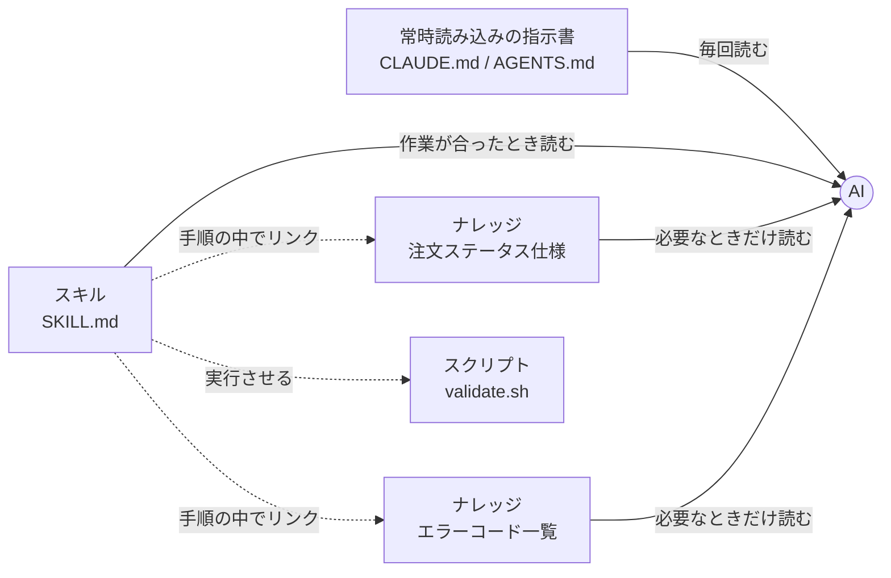
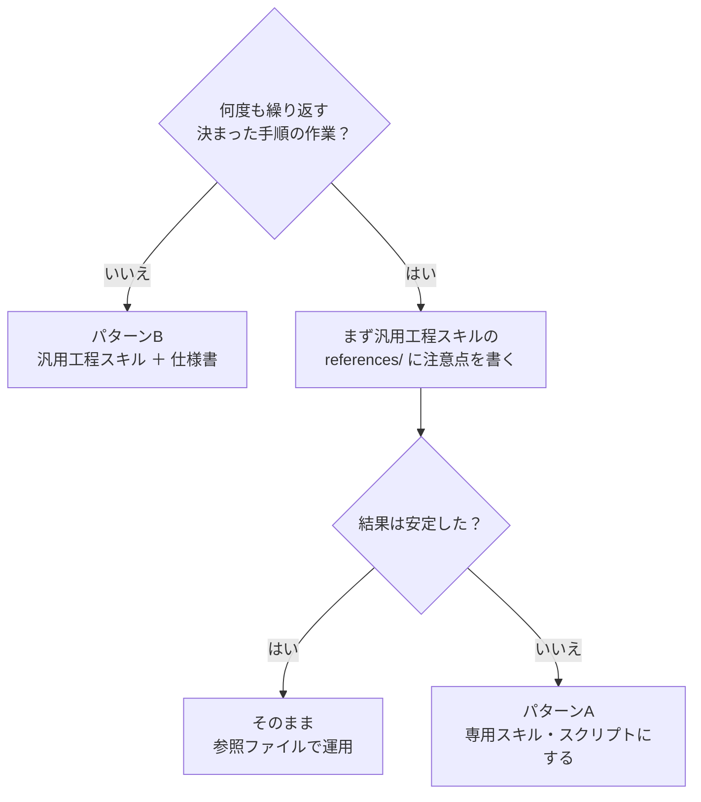
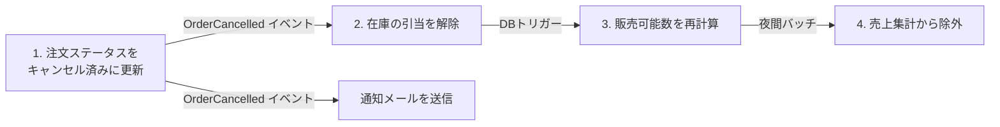
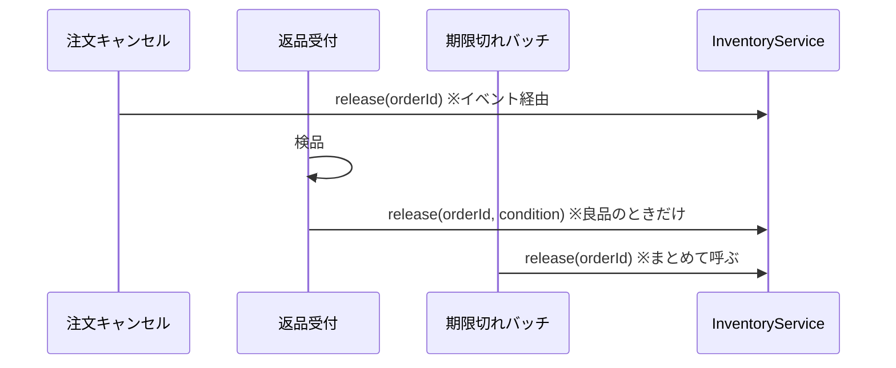
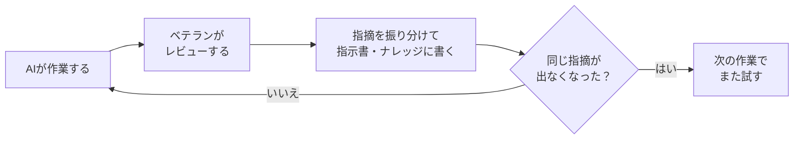

# 開発手順や仕様をAIに渡す方法：人向けの手順書を「スキル」と「ナレッジ」に作り直す（2026年11月版）

## はじめに

チャットで「〇〇の機能を作って」と頼み、結果を見て直してもらう。
いわゆる **バイブコーディング** からAI開発を始めた人は多いと思います。
小さなツールならこれで十分です。

ところが、チーム開発に使おうとすると、すぐに次の壁にぶつかります。

- 開発手順（ブランチの切り方、レビューの通し方、テストの書き方）を守ってくれない
- 社内フレームワークや設計ルールを知らず、「一般的には正しいが、このプロジェクトでは間違い」なコードが出てくる
- 毎回チャットで同じ説明をしている。説明する人によって結果が変わる

そこで「手順書や仕様書をAIに読ませればいい」と考えます。
方向は正しいのですが、**人向けの手順書をそのまま渡しても、多くの場合うまくいきません**。

この記事では、開発固有の手順や仕様をAIに渡す仕組みの作り方を説明します。

### 想定読者

- AIでの開発は、チャットのプロンプトでのバイブコーディングしかしたことがない人
- `CLAUDE.md`、`AGENTS.md`、`SKILL.md` などの「AIへの指示書」をまだ書いたことがない人

### この記事で分かること

1. AIへの指示書の基本的な考え方
2. 人向けの手順書をそのまま渡すと、なぜうまくいかないのか
3. 「スキル化」と「ナレッジ化」の違いと使い分け
4. 指示書を作る手順（例つき）
5. ベテランの知見をAIに注入する方法
6. よくある失敗と対策

:::note info
例は Claude Code と GitHub Copilot（VS Code）のファイル名で書いています。考え方はほかのAIエージェントにも当てはまります。
ファイルの置き場所や読み込みの細かい違いは、各ツールの公式ドキュメントを確認してください。
:::

## 要点

先に結論をまとめます。

- **AIは、学習済みの知識と、その場で与えられた情報をもとに判断します。**
  ただし、たくさん渡すほど賢くなるわけではありません。量が増えるほど、内容を正しく思い出す力は落ちます。
- 渡す情報は、性質で3つに分けます。

  | 性質 | 内容 | 置き場所 |
  |---|---|---|
  | **ルール** | 毎回必ず守ること | 常時読み込みの指示書（`CLAUDE.md` / `AGENTS.md` など） |
  | **手順** | 特定の作業のやり方 | **スキル**（`SKILL.md`） |
  | **事実** | 仕様・設計・用語など、作業中に調べるもの | **ナレッジ**（参照用のドキュメント） |

- スキルの作り方には2つのパターンがあります。
  - **定型作業スキル**：変更の種類ごとに作る
  - **汎用工程スキル ＋ 機能ごとの仕様（入力）**：どの開発にも使う

  筆者のおすすめは、**汎用工程スキルを土台にし、定型作業スキルは条件を満たす作業だけに絞る**やり方です。
- スキルで防げるのは**作り方のぶれ**だけです。**何を作るか**は、人が渡す仕様書で決まります。
  どちらのパターンでも、仕様書がダメなら結果もダメです。
- スキルを作っても、「〇〇を実装して」の一言で期待どおりのコードは出てきません。
  **通常の開発と同じく、仕様を検討して決めることが大前提**です。仕様が固まっていなければ、AIに質問させて仕様書を作るところから始めます。
- 人向けの手順書は、AIにとって次の状態です。
  - **要らない内容が多い**（一般的な知識の丁寧な説明など）
  - **必要な内容が足りない**（プロジェクト固有の前提、完了条件など）

  要らない内容を削り、**入力・出力・完了条件・判断の基準・検証方法**をはっきり書き直します。
- 指示書は書いて終わりではありません。次のサイクルを繰り返して育てます。
  **指示書なしでAIにやらせて失敗を観察 → 失敗を防ぐ最小限を書く → また試す**

## 1. AIへの指示書の基本

### AIは学習済みの知識とコンテキストを使う

AIエージェントが作業で使う情報は、大きく2つです。

| 種類 | 例 |
|---|---|
| 学習済みの一般知識 | プログラミング言語、有名なライブラリ、一般的な設計手法 |
| **その場で与えられる情報（コンテキスト）** | システムや開発者からの指示、チャットの依頼、読み込んだファイル、使えるツールや実行結果 |

特定のプロジェクトの手順や仕様を、AIが学習済みで正確に把握しているとは限りません。
必要な情報はコンテキストとして渡します。これが「AIへの指示書」の役割です。

### コンテキストは有限で、多ければよいわけではない

ここが一番大事なポイントです。

Anthropic は記事「Effective context engineering for AI agents」で、次のように述べています。

> as the number of tokens in the context window increases, the model's ability to accurately recall information from that context decreases.
> （コンテキストのトークン数が増えるほど、そこから情報を正確に思い出す能力は低下する）

この現象は **context rot** と呼ばれています。
同じ記事では、目標を「望む結果を得られる可能性を最大にする、*最小の*、情報価値の高いトークンの集まりを見つけること」としています。

つまり、**手順書を全部読ませれば解決、とはなりません**。
必要なときに、必要な分だけ渡す設計が要ります。

:::note info
コンテキストを節約する方法には **サブエージェント** もあります（Claude Code のサブエージェント、Copilot のカスタムエージェントなど）。調査やレビューを別のコンテキストで行わせ、結果の要約だけを受け取ります。
この記事では、指示書の書き方に絞って説明します。
:::

### 指示書の3つの種類

「必要なときに必要な分だけ」を実現するため、指示書には読み込まれるタイミングが違う種類があります。

| 種類 | 何を書くか | いつ読み込まれるか | 代表的なファイル |
|---|---|---|---|
| 常時読み込みの指示書 | 毎回守るルール（ビルドコマンド、コーディング規約、禁止事項） | 会話の開始時に毎回 | `CLAUDE.md`、`AGENTS.md`、`.github/copilot-instructions.md` |
| スキル | 特定の作業の手順 | 作業内容が合ったとき | `.claude/skills/<名前>/SKILL.md`、`.github/skills/<名前>/SKILL.md` など |
| ナレッジ（参照資料） | 仕様・設計・用語・過去の判断などの事実 | AIが必要だと判断して読んだとき | `docs/` 配下の Markdown など |

このほかに、**特定のフォルダやファイルを扱うときだけ読み込まれる指示書**もあります。
「`src/api/` を変えるときだけ守るルール」のような、**場所で決まるルール**に向いています。

| ツール | 仕組み |
|---|---|
| GitHub Copilot（VS Code） | `.github/instructions/*.instructions.md` の `applyTo` に、対象のファイルのパターン（例：`tests/**/*.py`）を書く |
| Claude Code | `.claude/rules/` のファイルの `paths` に、対象のファイルのパターンを書く。サブディレクトリに置いた `CLAUDE.md` も、そのフォルダのファイルを読み書きしたときに読み込まれる |
| Cursor | `.cursor/rules/` のルール（`.mdc` ファイル）の `globs` に、対象のファイルのパターンを書く |

（出典：[Use custom instructions in VS Code](https://code.visualstudio.com/docs/agent-customization/custom-instructions)、[Manage Claude's memory](https://code.claude.com/docs/en/memory)、[Cursor Rules](https://cursor.com/docs/context/rules)）

スキルの読み込みは段階的です。Claude の Agent Skills のドキュメントでは、次の3段階で説明されています。

| 段階 | 内容 | 読み込まれるタイミング | 量の目安 |
|---|---|---|---|
| Level 1 | スキルの名前と説明（メタデータ） | 常に（起動時） | 1スキルあたり約100トークン |
| Level 2 | `SKILL.md` の本文（手順） | スキルが呼ばれたとき | 5,000トークン未満 |
| Level 3 | スキルから参照されるファイルやスクリプト | 必要になったとき | 読まれるまで0 |

（出典：[Agent Skills overview](https://platform.claude.com/docs/en/agents-and-tools/agent-skills/overview)）

この仕組みを **段階的な開示（progressive disclosure）** と呼びます。
スキルをたくさん用意しても、普段コンテキストを使うのは名前と説明だけです。

:::note info
各ツールでの具体的な置き場所や設定方法は、次の別記事にまとめています。
- [GitHub Copilot と Claude Code のプロンプト・スキル・エージェント機能の比較](https://qiita.com/gataca27/items/c320df90b4cf655ce3f6)
- [GitHub Copilot の「AIへの指示書」まとめ](https://qiita.com/gataca27/items/aa0b87bdf13e2219d6c1)

この記事では「何をどう書くか」に絞ります。
:::

## 2. 人向けの手順書をそのまま渡すと、なぜうまくいかないのか

最初に試しがちなのが、社内Wikiの手順書をそのままAIに読ませる方法です。
うまくいかないのは、人とAIでは**必要な情報が違う**からです。人向けの手順書には、AIから見て2つの問題が同時にあります。

| 問題 | 例 | 対処 |
|---|---|---|
| **要らない内容が多い** | 一般的な知識の丁寧な説明（Gitのブランチとは、など）、画面操作の説明、経緯や改訂履歴、「AでもBでもよい」という選択肢の列挙 | **削る**。AIはすでに一般的な知識を持っている |
| **必要な内容が足りない** | どれを手本にするか、何をもって完了とするか、どこで止まって人に確認するか、といったプロジェクト固有の前提 | **足す**。社内の人には「当たり前」なので書かれていない |

| | 人向けの手順書 | AIに必要なもの |
|---|---|---|
| 一般的な知識 | 新人にも分かるよう丁寧に書く | 不要 |
| プロジェクト固有の前提 | 社内の人には当たり前なので省く | 必要 |

「削る」側の詳しい基準は、別記事「[GitHub Copilot の「AIへの指示書」まとめ](https://qiita.com/gataca27/items/aa0b87bdf13e2219d6c1)」の「SKILL.md に書かないこと」にまとめています。
ここからは「足す」側を見ていきます。

### 人向けの手順書にありがちな書き方

例として、ある社内システムの「APIエンドポイント追加手順」を考えます。

```markdown
## APIエンドポイント追加手順

1. いつも通りブランチを切る
2. controllers に新しいコントローラを追加する（既存のを参考に）
3. 必要に応じてバリデーションを追加
4. Swagger を更新する（画面の「Generate」ボタンを押す）
5. テストを書いて、問題なければPRを出す
6. ※ 認証が必要なものは田中さんに確認すること
```

人間の新メンバーなら、分からないところは先輩に聞けます。
しかしAIは、あいまいな部分を **それらしく推測して埋めます**。

| 書き方 | 人が読むと | AIが読むと |
|---|---|---|
| 「いつも通り」 | 先輩に聞く、過去の例を見る | 何が「いつも」かを知らないので、一般的な方法で進める |
| 「既存のを参考に」 | 似た機能を自分で探す | どれを参考にするか決められない。たまたま開いた、古い書き方のファイルを真似することもある |
| 「必要に応じて」 | 経験で判断する | 判断の基準がないので、やりすぎるか、やらない |
| 「ボタンを押す」 | 画面を操作する | 画面を操作できないことが多い。コマンドでの方法が必要 |
| 「問題なければ」 | 何を確認すべきか分かっている | 何を確認すれば「問題ない」のかが分からない。テストを1回流しただけで「完了しました」と報告する |
| 「田中さんに確認」 | 田中さんに聞く | 田中さんが誰か分からない。止まるべき場面でも止まらない |

### AI向けに書き直すと

同じ内容を、AIが実行できる形に直すと次のようになります。

```markdown
## APIエンドポイントの追加

### 入力
- 追加するエンドポイントのパス、HTTPメソッド、リクエスト/レスポンスの項目

### 手順
1. `main` から `feature/api-<リソース名>` の名前でブランチを作る
2. `src/controllers/user_controller.ts` を手本にして、コントローラを追加する
   - 手本以外の古いコントローラ（`src/legacy/` 配下）は真似しない
3. リクエストの全項目に、`src/validators/` のスキーマでバリデーションを書く
4. `npm run openapi:generate` を実行して `openapi.yaml` を更新する
5. `tests/controllers/` にテストを追加する

### 完了条件（すべて満たすまで完了と報告しない）
- [ ] `npm test` がすべて成功する
- [ ] `npm run lint` でエラーがない
- [ ] `openapi.yaml` の差分に、追加したエンドポイントが含まれている

### 止まって人に確認すること
- 認証・認可が必要なエンドポイントの場合は、実装を始める前に作業を止め、
  必要な権限を人に確認する
```

違いを整理すると、次の5点です。

1. **入力と出力**がはっきりしている
2. あいまいな言葉（「いつも通り」「必要に応じて」）が、**具体的なファイル名・コマンド・基準**に置き換わっている
3. **手本**が1つに決まっている。真似してはいけないものも書いてある
4. **完了条件**が、AI自身が確認できる形で書いてある
5. **人に判断を戻す場面**が書いてある

Claude Code のメモリ機能のドキュメントでも、「検証できるくらい具体的に書く」ことが勧められています。
例：「変更をテストする」ではなく「コミット前に `npm test` を実行する」と書く（出典：[Manage Claude's memory](https://code.claude.com/docs/en/memory)）。

:::note warn
インデントや命名などのコードスタイルは、具体的に書けばよいわけではありません。
フォーマッタやリンタで守らせられるものは、指示書に書かずにツールに任せます（6章の失敗13を参照）。
:::

## 3. 「スキル化」と「ナレッジ化」の違いと使い分け

開発固有の情報をAIに渡す方法は、大きく2つです。

- **スキル化**：開発手順を、スキル（`SKILL.md`）として書く
- **ナレッジ化**：仕様や設計情報を参照用のドキュメントとして整備し、AIに読ませる

どちらが正しいというより、**渡す情報の性質で使い分けます**。

### 違いは「やり方」か「事実」か

| | スキル | ナレッジ |
|---|---|---|
| 書く内容 | **やり方**（手順、判断の流れ、完了条件） | **事実**（仕様、設計、データ構造、用語、過去の設計判断とその理由） |
| 文の形 | 「〜する」「〜したら〜する」 | 「〜は〜である」「〜の理由は〜」 |
| 使われ方 | 作業の開始時に呼ばれ、AIがその手順に沿って進める | 作業の途中で、AIが必要な部分を調べて読む |
| 例 | 「APIエンドポイントを追加する手順」「DBマイグレーションを作る手順」 | 「注文ステータスの状態遷移」「認証基盤の構成」「エラーコード一覧」 |
| 変わる頻度 | 開発の進め方が変わったとき | 仕様や設計が変わるたび |

### 判断の目安

| こういう情報なら | 置き場所 |
|---|---|
| どの作業でも毎回守ってほしい（ビルド・テスト・Lint のコマンド、規約、禁止事項） | 常時読み込みの指示書 |
| 決まった作業の進め方で、手順の順番や確認が大事 | スキル |
| 何段階もあるビルド・リリースの手順 | スキル（決まった手順ならスクリプトにする） |
| 特定のフォルダやファイルを触るときだけ守ってほしい（`src/api/` の規約など） | パスで適用範囲を決める指示書 |
| 作業によって必要な部分が違う、量が多い、仕様や設計の説明 | ナレッジ |
| 毎回まったく同じ結果になってほしい処理（コード生成、形式チェック） | スクリプト（スキルから実行させる） |

### 実際は組み合わせて使う

スキルとナレッジは組み合わせるのが基本です。
スキルには手順だけを書き、手順の中で必要な事実はナレッジへのリンクで渡します。

ただし、**リンクを書いただけでは、AIが中身を読むとは限りません**。VS Code のドキュメントにも次のようにあります。

> A link doesn't guarantee that the document's contents reach the model.
> （リンクは、ドキュメントの中身がモデルに届くことを保証しない）
> （[Use custom instructions in VS Code](https://code.visualstudio.com/docs/agent-customization/custom-instructions)）

そのため、リンクには次の2つのルールを設けます。

| ルール | 理由・書き方 |
|---|---|
| **リンクで渡すのは「事実（ナレッジ）」だけ** | 手順はスキルの本文に書く。手順が読まれないと、作業そのものが抜けるため |
| **「いつ読むか」を必ず書く** | ×「詳しくは〜を参照」<br>○「注文の状態を変える処理を書くときは `docs/knowledge/order-status.md` を読む」 |



こうしておけば、仕様が変わってもナレッジだけを直せば済みます。
手順と事実が混ざっていると、仕様が1つ変わるたびに複数のスキルを直すことになり、どこかで直し忘れが起きます。

### スキルの粒度：2つのパターン

スキルを作り始めると、次の疑問にぶつかります。

> 「API追加のスキル」「DBのカラム追加のスキル」「画面追加のスキル」……と、機能ごとにスキルを作っていけばいいの？

スキルの作り方には、大きく2つのパターンがあります。

| | パターンA：定型作業スキル | パターンB：汎用工程スキル ＋ 仕様（入力） |
|---|---|---|
| スキルの単位 | **変更の種類**ごと（API追加、DBマイグレーション、画面追加……） | **工程**ごと（仕様の確認 → 設計 → 実装 → 検証） |
| 機能ごとの違いの渡し方 | スキルの本文に書く | 機能ごとの**仕様書（入力）**と、変更の種類ごとの**参照ファイル**で渡す |
| スキルの数 | 変更の種類が増えるたびに増える | 工程の数でほぼ決まり、あまり増えない |
| 作り方のぶれ | 小さい（手順が細かく決まっている） | Aよりは大きい（変更の種類ごとの注意点は参照ファイル頼み） |
| 仕様（何を作るか）の質への依存 | **大きい** | **大きい** |
| 作る手間 | 1つは小さいが、数が増えると大きくなる | 最初の設計に手間がかかる。そのあとは仕様書を書くだけ |
| 保守 | ブランチ・テスト・完了条件など共通の部分が各スキルに重複し、直し漏れが起きやすい | 共通の部分は1か所にある |
| AIのスキル選択 | 似たスキルが増えると、どれを使うかの判断がぶれる | スキルが少ないので迷いにくい |
| 想定外の変更 | 当てはまるスキルがなければ、指示書なしと同じになる | どんな変更にも使える |
| 向いている作業 | 何度も繰り返す、手順が決まった、プロジェクト固有の作業 | 新機能の追加、仕様変更など、ほとんどの開発 |

#### 世の中の資料はどちらを勧めているか

仕様駆動開発（SDD）のツールや Anthropic の公式資料には、パターンB の考え方が多く見られます。
一方で、パターンA を支える記述もあります。

**パターンB を支える資料**

| 根拠 | 内容 |
|---|---|
| [GitHub Spec Kit](https://github.com/github/spec-kit) | `/speckit-specify` → `/speckit-plan` → `/speckit-tasks` → `/speckit-implement` は、どの機能にも使う共通の工程です。README には "Create a constitution once per project and repeat the remaining steps for each feature."（constitution はプロジェクトに1回だけ作り、残りの手順を機能ごとに繰り返す）と書かれています。**機能ごとに変わるのは仕様のほう**です。 |
| [Kiro](https://kiro.dev/docs/specs/) | 機能ごとに `requirements.md`・`design.md`・`tasks.md` の仕様を作ります。プロジェクト全体の知識は steering ファイル（`product.md`・`tech.md`・`structure.md`）に置きます。 |
| [Anthropic 公式のスキル集](https://github.com/anthropics/skills) | `pdf`・`docx`・`frontend-design`・`webapp-testing`・`mcp-builder` など、**能力や領域の単位**でスキルが作られています。ただし公開のスキル集なので、特定プロジェクトの機能ごとのスキルはもともと入りようがありません。プロジェクト内でのスキルの分け方の直接の根拠にはなりません。 |
| [Skill authoring best practices](https://platform.claude.com/docs/en/agents-and-tools/agent-skills/best-practices) | 「Domain-specific organization」というパターンとして、1つのスキル（`bigquery-skill`）の中に `reference/finance.md`・`sales.md` などを置く例が載っています。**細かい違いはスキルを分けずに、参照ファイルで吸収する**形です。（この記事の例では、Agent Skills の仕様で決められているディレクトリ名 `references/` を使います） |
| [Effective context engineering for AI agents](https://www.anthropic.com/engineering/effective-context-engineering-for-ai-agents) | ツールについて、"One of the most common failure modes we see is bloated tool sets"（最もよく見る失敗の1つは、膨れ上がったツール群）、"If a human engineer can't definitively say which tool should be used in a given situation, an AI agent can't be expected to do better."（どのツールを使うべきか人間のエンジニアが断言できないなら、AIにもそれ以上は期待できない）と書かれています。スキルについての記述ではありませんが、似たスキルが増えすぎたときにも同じことが起きると考えられます。 |

※ Spec Kit と Kiro は、どちらも仕様駆動開発（SDD）のツールです。同じ考え方にもとづくため、2つの独立した根拠ではありません。

**パターンA を支える資料**

| 根拠 | 内容 |
|---|---|
| [Skill authoring best practices](https://platform.claude.com/docs/en/agents-and-tools/agent-skills/best-practices) | スキルを作るきっかけとして "Notice what information you repeatedly provide"（何度も渡している情報に気づく）とあります。繰り返す作業ごとにスキルを作る考え方です。名前の付け方の良い例も `processing-pdfs`・`analyzing-spreadsheets`・`testing-code` のように、作業の単位になっています。 |
| [Agent Skills overview](https://platform.claude.com/docs/en/agents-and-tools/agent-skills/overview) | 段階的な開示により、普段読み込まれるのはスキルの名前と説明だけです（1スキルあたり約100トークン）。スキルが増えても、コンテキストへの負担は小さく抑えられます。 |
| [Understanding Spec-Driven-Development: Kiro, spec-kit, and Tessl](https://www.martinfowler.com/articles/exploring-gen-ai/sdd-3-tools.html)（Birgitta Böckeler、2025年10月） | Kiro で小さなバグを直そうとしたら、要求文書が4つのユーザーストーリー・16の受け入れ条件になり、"like using a sledgehammer to crack a nut"（くるみを割るのに大槌を使うようなもの）だったと書かれています。spec-kit については、大量の Markdown のレビューが "very verbose and tedious"（とても冗長で退屈）だったとしています。工程ごとの重い進め方が、どの大きさの変更にも合うわけではない、という指摘です。 |

:::note warn
「どちらのパターンが何割使われているか」を数字で示す調査は、見つけられませんでした。
このあとの使い分けは、上の資料と筆者の経験にもとづく**筆者のおすすめ**です。
:::

#### 筆者のおすすめ：Bを土台に、Aは絞って使う

**パターンB を土台にし、パターンA は次の条件をすべて満たす作業だけに絞る**やり方をおすすめします。
理由は、共通の手順を1か所で保守でき、想定外の変更にも使えるからです（上の比較表を参照）。

ただし、次の点に注意してください。

- 変更の種類が少なく毎回ほぼ決まっている場合（定型の保守作業が中心など）は、パターンA 中心のほうが合うこともあります。
- Böckeler の指摘のとおり、小さな変更にまで全工程を踏ませると、かえって手間が増えます。汎用工程スキルには、小さな変更なら工程を省ける道を用意しておきます。

パターンA（専用のスキル）にする作業の条件は、次のとおりです。

- 何度も繰り返す（月に何回も発生する）
- 手順が決まっていて、毎回ほぼ同じ
- プロジェクト固有で、AIの一般知識では正しくできない
- 間違えたときの影響が大きい（DBマイグレーション、リリース作業など）

条件を満たしても、いきなり専用のスキルにする必要はありません。
まずは汎用工程スキルの `references/` に「変更の種類ごとの注意点」として置き、それでも結果が安定しないときに専用のスキルやスクリプトにします。



変更の種類が**フォルダで分かれている**場合（API は `src/controllers/`、画面は `src/components/` など）は、パスで適用範囲を決める指示書（1章）に注意点を書く方法もあります。
この方法なら、AIがスキルを呼ばなくても、そのフォルダのファイルを触れば自動で読み込まれます。

#### どちらのパターンでも、仕様がダメなら結果もダメ

「パターンA なら手順が決まっているから、仕様が多少いい加減でも大丈夫」とはなりません。

| | 決めること | 例 |
|---|---|---|
| **スキル** | どう作るか | ブランチの切り方、手本、テストの書き方、完了条件 |
| **仕様** | 何を作るか | 目的、受け入れ条件、対象外 |

スキルで減らせるのは**作り方のぶれ**だけです。**何を作るかの間違い**は防げません。

パターンA で仕様がダメな場合は、むしろ**気づきにくいゴミ**になります。

- 手順どおりに作られるので、見た目は整っていて、lint もテストも通る
- ところが、そのテストも間違った仕様から作られている
- そのため、検証のループを回しても間違いが見つからない

パターンA は入力の項目が狭く決まっているので（API追加なら、パス、HTTPメソッド、リクエスト/レスポンスの項目など）、「入力不足に気づいて止まる」仕組みは作りやすくなります。
それでも、**仕様の中身が正しいかどうかは、どちらのパターンでも人が担保するしかありません**。

だからこそ、スキルを増やすより、**仕様書のテンプレートを整え、仕様をブラッシュアップするほうに力を使います**。
パターンB は入力の範囲が広いので、テンプレートがとくに重要です（具体例は4章の Step 3）。

#### スキルを作っても、仕様を決める作業はなくならない

「スキルさえ作れば、『〇〇を実装して』と頼むだけで期待どおりのコードが出てくる」と考える人は少なくありません。しかし、そうはなりません。

人のチームで考えると分かりやすくなります。
手順書を完璧に整えても、「〇〇を作っておいて」の一言で、期待どおりのものができることはありません。何を、どこまで作り、どうなれば完成かを、誰かが検討して決める必要があります。AIでも同じです。

**AIを使っても、通常の開発と同じく、仕様を検討して決めることが大前提です。**
スキルは「決まった仕様を、決まった作り方で形にする」道具であり、仕様を決める作業は肩代わりしてくれません。

| 「〇〇を実装して」の一言で頼んだとき | 何が起きるか |
|---|---|
| 目的が書かれていない | AIは一般的によくある形で作る。このプロジェクトで欲しかったものとは限らない |
| 受け入れ条件が書かれていない | 何をもって完成かをAIが自分で決める。テストもその解釈で書かれる |
| 対象外が書かれていない | 頼んでいない機能まで作る |
| 決まっていないことがある | AIが自分の判断で決めて、それらしく実装する |

#### 仕様書がない・固まっていないとき

最初から人が完璧な仕様書を書いておく必要はありません。
大事なのは、**実装を始める前に、何を作るかを人が決めていること**です。仕様書を作る作業そのものには、AIを使えます。

| 状況 | 進め方 |
|---|---|
| 仕様が固まっていない | AIに質問させて、仕様書を書かせる |
| 人向けの仕様書がある | テンプレートの形に書き直させる |
| 何を作るべきかが分からない | 試作で探る |

##### 仕様が固まっていない：AIに質問させて、仕様書を書かせる

Claude Code のベストプラクティスでは、何を作りたいかがはっきりしないときに、AIにインタビューさせる方法が紹介されています（出典：[Best practices for Claude Code](https://code.claude.com/docs/en/best-practices)）。

> When you don't know exactly what you want yet, you don't have to work it all out before you prompt. Ask Claude to interview you instead
> （何を作りたいかがまだはっきりしないときは、プロンプトの前に全部を詰める必要はない。代わりに Claude にインタビューさせる）

プロンプトの例は "Interview me until you could write the spec, then write it to SPEC.md."（仕様書を書けるようになるまで私にインタビューして、SPEC.md に書いて）です。
仕様書ができたら、新しい会話で実装を始めるよう勧められています。

GitHub Spec Kit の `/speckit-specify` や Kiro の Specs も、機能の説明の文章から仕様書を作ります。

流れは次のとおりです。

1. 人が、やりたいことをざっくり伝える
2. AIが質問し、人が答える。決まっていない点を埋める
3. AIが、仕様書のテンプレートに沿って仕様書を書く
4. **人が仕様書をレビューして、内容を決める**
5. 新しい会話で、仕様書を渡して実装させる

仕様はプロンプトのまま終わらせず、ファイルに残します。理由は次のとおりです。

- 人がレビューできる
- 新しい会話でもそのまま使える
- 実装後に仕様と照らして確かめられる

AIに質問させても、**答えて決めるのは人**です。
AIの質問で検討の漏れには気づきやすくなりますが、答えられないことはAIと話していても決まりません。チームや関係者と検討して決めます。

##### 人向けの仕様書がある：テンプレートの形に書き直させる

Excel や Word の仕様書がある場合は、AIに仕様書のテンプレート（`spec-template.md`、例は4章の Step 3）の形へ書き直させ、人が確認します（2章と同じ考え方です）。
書き直す途中で、「受け入れ条件がない」「対象外が書かれていない」といった抜けが見つかることもよくあります。

##### 何を作るべきかが分からない：試作で探る

この段階なら、仕様書を書くより、バイブコーディングで試作して探るほうが早いこともあります。
ただし、分かったことは仕様書にまとめ直してから本番のコードを作ります。試作のコードをそのまま本番にはしません。

Böckeler の記事（3章で紹介）も、仕様を先に書く進め方は "definitely valuable in many situations"（多くの場面で確かに価値がある）としつつ、最初から細かく長い仕様を書くことには懐疑的です。
仕様の細かさは、変更の大きさに合わせます。

## 4. 指示書の作り方

ここからは、実際に作る手順です。

### Step 0：指示書なしでAIにやらせて、失敗を観察する

いきなり書き始めないのがポイントです。

Claude のスキル作成のベストプラクティスでは、「大量のドキュメントを書く**前に**評価を作る」ことが勧められています（出典：[Skill authoring best practices](https://platform.claude.com/docs/en/agents-and-tools/agent-skills/best-practices)）。

1. 指示書なしでAIに作業させ、どこで失敗するかを見つける
2. その失敗を確かめるシナリオを3つ作る
3. 指示書なしでの結果を記録する（ベースライン）
4. 失敗を防ぐ最小限の指示を書く
5. シナリオを試して、改善を繰り返す

AIは一般的なプログラミングはすでにできます。
指示書に書くべきなのは、**AIが知らないこと、間違えることだけ**です。失敗を観察すると、それが具体的に分かります。

### Step 1：手順を棚卸しする

対象の作業について、次の項目を書き出します。人向けの手順書があれば材料にします。

| 項目 | 確認すること |
|---|---|
| 目的 | この作業は何のためにするのか |
| 入力 | 作業を始めるのに何が必要か（チケット、仕様書、設計書など） |
| 出力 | 何ができれば終わりか（ファイル、PR、レポートなど） |
| 手順 | どの順番で何をするか |
| 判断ポイント | 途中で分岐するところと、その判断の基準 |
| 完了条件 | どう確認すれば「できた」と言えるか（コマンドで確認できる形が理想） |
| 禁止事項 | やってはいけないこと、触ってはいけないファイル |
| 人に戻す場面 | AIが勝手に判断してはいけないこと |
| 前提知識 | 作業に必要な仕様・設計の知識 |

棚卸しをすると、人向けの手順書に書かれていなかった暗黙の知識が見えてきます。
それこそがAIに渡すべき情報です。

:::note warn
指示書は「お願い」であって、強制ではありません。VS Code のドキュメントには「Instructions guide the model. They don't guarantee compliance or replace tests, code review, or security controls.」とあります（[Use custom instructions in VS Code](https://code.visualstudio.com/docs/agent-customization/custom-instructions)）。
本番環境の操作や特定のファイルの変更など、**破られると困る禁止事項**は、フックや権限設定でも防いでください。
:::

### Step 2：情報を振り分ける

棚卸しした項目を、3章の目安で振り分けます。

- 手順、判断ポイント、完了条件、人に戻す場面 → **スキル**
- 前提知識（仕様・設計・用語） → **ナレッジ**
- どの作業にも共通するルール → **常時読み込みの指示書**
- 毎回同じ結果になるべき処理 → **スクリプト**

スキルにする手順は、3章の「スキルの粒度」に沿って振り分けます。

| 手順の種類 | 書く場所 |
|---|---|
| どの開発にも共通する進め方 | 汎用工程スキル（パターンB） |
| 変更の種類ごとの注意点 | 汎用工程スキルの参照ファイル |
| 条件を満たす作業 | 専用の定型作業スキル（パターンA） |

### Step 3：スキルを書く

スキルは、フォルダの中に `SKILL.md` を置いて作ります。2つのパターンの例を見比べてください。

#### 汎用工程スキルの工程の決め方

必要な工程や成果物は組織によって違うため、決まった正解はありません。
一例として、既存の仕様駆動開発（SDD）ツールの工程を参考にする方法があります。

| ツール | 工程 | 成果物 |
|---|---|---|
| [GitHub Spec Kit](https://github.com/github/spec-kit) | `/speckit-specify` → `/speckit-plan` → `/speckit-tasks` → `/speckit-implement` | `spec.md`・`plan.md`・`tasks.md`（テンプレートはリポジトリの `templates/` にある） |
| [Kiro](https://kiro.dev/docs/specs/) | 要求 → 設計 → タスク（各段階で人が確認してから次へ進む） | `requirements.md`・`design.md`・`tasks.md` |

これらを出発点に、自分の組織に必要な工程・成果物・人が承認する場所を足し引きします。
次の例1は、「仕様の確認 → 設計 → 実装 → 検証」の4工程にしています。

#### 例1：パターンB（汎用工程スキル ＋ 仕様書）…基本はこちら

どの機能の開発にも使う「機能の実装」スキルです。
変更の種類ごとの注意点は `references/` に分け、必要なものだけを読ませます。

```text
.claude/skills/implement-feature/
├── SKILL.md                 # 工程（仕様の確認 → 設計 → 実装 → 検証）
├── spec-template.md         # 仕様書のテンプレート
└── references/
    ├── api-endpoint.md      # API追加・変更のときの注意点と手本
    ├── db-migration.md      # DBのテーブル・カラム変更のときの注意点
    └── ui-component.md      # 画面部品を追加するときの注意点
```

`SKILL.md` の例です。

```markdown
---
name: implement-feature
description: 仕様書（docs/specs/ 配下）にもとづいて、機能を設計・実装・検証する。新機能の追加や、既存機能の変更を頼まれたときに使う。
---

# 機能の実装

## 1. 仕様を確認する
- 仕様書が `spec-template.md` の項目を満たしているか確認する
- 次のどれかに当てはまる場合は、実装を始めず、質問を箇条書きにして人に返す
  - 「目的」「受け入れ条件」「対象外」のどれかが空、またはあいまい
  - 「未決事項」が残っている、または本文に `[要確認:` が残っている

## 2. 設計する
- 変更の種類に合う参照ファイルを読む
  - APIの追加・変更：[references/api-endpoint.md](references/api-endpoint.md)
  - DBのテーブル・カラム変更：[references/db-migration.md](references/db-migration.md)
  - 画面部品の追加：[references/ui-component.md](references/ui-component.md)
- 仕様書の「関連するナレッジ」に書かれたファイルを読む
- 変更するファイルと変更の方針を箇条書きにして人に見せ、承認を得てから次へ進む

## 3. 実装する
- 受け入れ条件ごとにテストを書いてから実装する
- 設計で挙げたファイル以外は変更しない。必要になったら止めて人に相談する

## 4. 検証する
- `npm test` と `npm run lint` がすべて成功するまで、修正と再実行を繰り返す
- 受け入れ条件ごとに、満たしていることをどう確認したかを報告する
```

このスキルには、機能ごとに仕様書を書いて渡します。
**どちらのパターンでも、仕様書の質が結果を決めます。** パターンB は入力の範囲が広いので、テンプレートでとくに抜けを防ぎます。

`spec-template.md` の例です。各欄に「何を書くか」をコメントで添えておくと、人もAIも迷わずに書けます。

```markdown
# 仕様：<機能名>

<!-- 記入のルール
- 決まっていない点は空欄にせず、その場所に [要確認: 何が決まっていないか] と書き、
  「未決事項」にも挙げる
- 「どう作るか」（クラス名、使うライブラリなど）は書かない。設計の工程で決める
-->

## 目的（なぜ作るか）
<!-- 誰の、どんな困りごとを解決するか。1〜3行で -->

## 受け入れ条件
<!-- EARS 記法で、1つの条件を1行に。テストにできる形で書く -->
- WHEN <条件>、THE SYSTEM SHALL <期待する動き>

## 対象外（今回やらないこと）
<!-- AIが「ついでに」作りそうなものを書く -->

## 制約
<!-- 変えてはいけないもの、互換性、性能など -->

## 関連するナレッジ
<!-- docs/knowledge/INDEX.md の「読むべき場面」から選ぶ -->

## 決定事項
<!-- 検討して決めたことを、決めた日と一緒に書く -->

## 未決事項
<!-- 決まっていないこと。ここが空になるまで実装を始めない -->
```

テンプレートを一から作る場合は、GitHub Spec Kit の [spec-template.md](https://github.com/github/spec-kit/blob/main/templates/spec-template.md) も参考になります。
ユーザーストーリー、機能要件、成功基準、前提などの欄があります。

`[要確認: …]` は、Spec Kit のテンプレートが使っている `[NEEDS CLARIFICATION: …]` という印にならったものです。
決まっていない点を、仕様書の該当箇所にそのまま書き込みます。AIが勝手に決めずに印を残すので、人は検索するだけで未決の箇所を一覧できます。

テンプレートに沿って書いた仕様書の例です。

```markdown
# 仕様：注文のキャンセル機能

## 目的（なぜ作るか）
発送前の注文を、利用者が自分でキャンセルできるようにする。
問い合わせ窓口へのキャンセル依頼を減らすため。

## 受け入れ条件
- WHEN 利用者が「発送準備中」以前の注文のキャンセルを要求したとき、
  THE SYSTEM SHALL 注文ステータスを「キャンセル済み」にする
- WHEN 「発送済み」以降の注文のキャンセルを要求したとき、
  THE SYSTEM SHALL エラーコード E-ORDER-012 を返し、ステータスを変えない
- WHEN キャンセルが成功したとき、THE SYSTEM SHALL 在庫を元に戻す
- WHEN キャンセルが成功したとき、THE SYSTEM SHALL 利用者に通知する
  [要確認: 通知の手段はメールか、アプリ内通知か]

## 対象外（今回やらないこと）
- 返金処理（別の仕様で対応する）
- 管理画面からのキャンセル

## 制約
- 既存の `POST /orders` のレスポンス形式は変えない

## 関連するナレッジ
- docs/knowledge/order-status.md
- docs/knowledge/error-codes.md

## 決定事項
- 一部の商品だけのキャンセルは認めない（2026-11-20 決定）

## 未決事項
- キャンセル成功時の通知の手段（メールか、アプリ内通知か）
```

この例は、未決事項が1つ残った状態です。
このまま渡すと、スキルの手順1でAIが実装を始めずに、通知の手段について質問を返します。人が決めて「決定事項」に移してから、もう一度渡します。

受け入れ条件は、Kiro が採用している EARS 記法（WHEN 〜 THE SYSTEM SHALL 〜）で書いています。
条件と期待する動きを1文ずつ分けると、AIがテストに落とし込みやすくなります。

「対象外」と「未決事項」は忘れずに書いてください。
書かないと、AIは頼まれていない返金処理まで作ったり、決まっていないことを自分で決めたりします。

#### 例2：パターンA（定型作業スキル）…条件を満たす作業だけ

2章で書き直したAPI追加の手順を、専用のスキルにした例です。
API追加を頻繁に行い、手順が厳密に決まっている場合に限って使います。

```text
.claude/skills/add-api-endpoint/
├── SKILL.md              # 手順（本文）
├── checklist.md          # 詳しい確認項目（必要なときだけ読ませる）
└── scripts/
    └── validate.sh       # 完了条件をまとめて確認するスクリプト
```

`SKILL.md` の例です。

```markdown
---
name: add-api-endpoint
description: REST APIのエンドポイントを新しく追加する。コントローラ・バリデーション・OpenAPI定義・テストを、プロジェクトの規約どおりに作成する。新しいAPIの追加や、エンドポイントの作成を頼まれたときに使う。
---

# APIエンドポイントの追加

## 入力
- エンドポイントのパスとHTTPメソッド
- リクエストとレスポンスの項目
- エラー時の動き（返すエラーコードと条件）

## 始める前に
- 入力のどれかが欠けている、またはあいまいな場合は、実装を始めず、
  質問を箇条書きにして人に返す
- 注文に関係するエンドポイントの場合は、`docs/knowledge/order-status.md` を読む
- 認証・認可が必要な場合は、ここで作業を止め、必要な権限を人に確認する

## 手順
次のチェックリストを回答にコピーし、終わったものにチェックを入れながら進める。

- [ ] 1. `feature/api-<リソース名>` ブランチを作る
- [ ] 2. `src/controllers/user_controller.ts` を手本にコントローラを追加する
- [ ] 3. `src/validators/` にリクエストのスキーマを追加する
- [ ] 4. `npm run openapi:generate` で OpenAPI 定義を更新する
- [ ] 5. `tests/controllers/` にテストを追加する
- [ ] 6. `bash scripts/validate.sh` を実行する

## 検証
`scripts/validate.sh` がエラーを出したら、エラーを直して再実行する。
エラーがなくなるまで、完了と報告しない。

## してはいけないこと
- `src/legacy/` 配下のコードを手本にしない
- 既存のエンドポイントのレスポンス形式を変えない
```

#### 2つの例を見比べると

| 観点 | 例1（パターンB） | 例2（パターンA） |
|---|---|---|
| 共通の部分（ブランチ、テスト、検証） | `SKILL.md` に1回だけ書く | 各スキルにコピーされる。テストの方法が変わると全スキルを直す |
| 変更の種類・機能ごとの違い | 種類ごとの違いは `references/`、機能ごとの違いは仕様書 | スキルの本文に書く |
| 作り方のぶれ | 例2より大きい | 手順が細かく決まっているぶん小さい |

API追加を毎日のように行い、例1では手順の抜けが出るようなら、例2のような専用スキルにする価値があります。

ただし、例2でも「入力」（どんなAPIを作るか）が間違っていれば、手順どおりに間違ったAPIができあがります。
そのため、どちらの例も、入力が足りないときは止まって質問するように書いています。

#### 書くときのポイント

Claude のスキル作成のベストプラクティスに沿って説明します（出典：[Skill authoring best practices](https://platform.claude.com/docs/en/agents-and-tools/agent-skills/best-practices)）。

##### ① `description` に「何をするか」と「いつ使うか」を書く

普段AIが見ているのは、スキルの名前と説明（`description`）だけです。AIはこの説明を見て、スキルを使うかを決めます。
説明には「何をするか」と「いつ使うか」の両方を含め、三人称で書くことが勧められています。

- 悪い例：`ドキュメントを手伝う`（何をするのか、いつ使うのか分からない）
- 良い例：`REST APIのエンドポイントを新しく追加する。……新しいAPIの追加や、エンドポイントの作成を頼まれたときに使う。`

##### ② AIが知っていることは書かない

ベストプラクティスには「Claude はすでにとても賢い、と考える」「Claude がまだ知らないことだけを書く」とあります。
「TypeScriptの型とは」「テストとは」のような一般論は不要です。各段落について「使うトークンに見合うか？」と問うよう勧められています。

##### ③ 作業の危うさに合わせて、指示の細かさを変える

ベストプラクティスでは、これを **自由度（degrees of freedom）** と呼んでいます。

| 自由度 | 書き方 | 向いている作業 |
|---|---|---|
| 高 | 文章で方針を書く | やり方が何通りもあってよい作業（コードレビューの観点など） |
| 中 | 疑似コードや、引数つきのスクリプト | 推奨の型はあるが、多少の違いは許される作業 |
| 低 | 決まったスクリプトを、決まった通りに実行させる | 失敗すると困る作業、手順を変えてはいけない作業（DBマイグレーションなど） |

ドキュメントでは、低い自由度を「両側が崖の細い橋」、高い自由度を「危険のない広い野原」にたとえています。

##### ④ チェックリストと、検証してから直すループを入れる

- 複雑な手順は、AIが回答にコピーしてチェックしながら進められるチェックリストにする
- 「検証する → エラーを直す → もう一度検証する」のループを入れる

ベストプラクティスでも、この形は出力の品質を大きく上げるとされています。

##### ⑤ 長くなったら分ける

- `SKILL.md` の本文は **500行未満** にする
- 詳しい内容は別ファイルに分け、`SKILL.md` からリンクする
- リンクは `SKILL.md` から **1段階まで**（A→B→C と深くたどらせない）

### Step 4：ナレッジを書く

ナレッジは、AIが作業中に「調べて読む」ものです。
人向けの設計書をそのまま置かず、AIが探しやすく、読み違えにくい形にします。

```text
docs/knowledge/
├── INDEX.md                    # 目次：どのファイルに何が書いてあるか
├── order-status.md             # 注文ステータスの状態遷移
├── order-cancel-ripple.md      # 注文キャンセルの多段の波及
├── inventory-service-usage.md  # 在庫サービスを使う機能ごとのシーケンス
├── error-codes.md              # エラーコード一覧
└── glossary.md                 # 用語集
```

`INDEX.md` の例です。

```markdown
# ナレッジ目次

| ファイル | 内容 | 読むべき場面 |
|---|---|---|
| order-status.md | 注文ステータスの種類と遷移の条件 | 注文の状態を変える処理を書くとき |
| order-cancel-ripple.md | 注文キャンセル後に連鎖する処理（在庫・販売可能数・売上集計・通知） | 注文ステータスや在庫の処理を変えるとき |
| inventory-service-usage.md | 在庫サービスを使う機能ごとの呼び出し順と前提条件 | 在庫サービス（src/inventory/）を変えるとき |
| error-codes.md | APIのエラーコードと意味 | エラーレスポンスを返す処理を書くとき |
| glossary.md | 業務用語と、コード上の名前の対応 | 業務用語の意味が分からないとき |
```

#### ナレッジにとくに向いている情報：AIが自力でたどりにくいもの

ナレッジがないと、AIは grep やファイルの読み込みでコードを探しながら作業します。
この探し方では、次のような情報をたどるのが苦手です。

| 情報 | AIが自力でたどりにくい理由 |
|---|---|
| **多段の波及**（データの玉突き：Aを変えるとBが変わり、さらにCが変わる） | 1段目は見つけられても、2段目・3段目まで追い切らずに「影響はここだけ」と判断しやすい |
| **1つのモジュールを複数の機能が使う場合のシーケンス** | 機能ごとに呼び出し順や前提条件が違うのに、AIが今見ている1つの機能の使われ方を、すべての機能に当てはめてしまう。ある機能のための修正で、別の機能を壊す |
| 複数のモジュールにまたがるシーケンス | 多くのファイルを順に読む必要がある。読むほどコンテキストを使い、最初に読んだ内容を正しく思い出しにくくなる（1章の context rot） |
| 呼び出し元がコードの文字列から見えないつながり | イベントやメッセージキュー、DBトリガー、設定ファイルで決まる呼び出し先など。関数名で grep しても見つからない |

最初の2つは、筆者の経験でも、AIがとくに混乱しやすいと感じているものです。
人が一度まとめておけば、AIは毎回の探索を省けて、見落としも減ります。

書くときは、次の点に注意します。

| ポイント | 内容 |
|---|---|
| **確かめられる形にする** | コードが変わると古くなりやすいので、根拠のファイル名・関数名と、確認したコミットを書き添える。AIが「今もそうか」をコードで確かめられる。スクリプトで生成できる部分は生成にする |
| **grep で分かることは書かない** | 直接の呼び出し関係を全部書き写すと、量が増えてすぐ古くなる。書くのは、見えないつながり、多段の波及、機能ごとの違い、「なぜそうなっているか」 |
| **図は Mermaid などのテキストで書く** | 画像よりAIが確実に読め、差分もレビューできる。図だけでは条件や例外が抜けやすいので、表や文章も添える |
| **「変えるときに何を確認すべきか」まで書く** | 確認の観点があると、AIが影響範囲を見落としにくくなる |

##### 例1：多段の波及のナレッジ

````markdown
# 注文キャンセルの波及

> 確認したコミット：a1b2c3d（2026-11-20）
> 注文ステータス・在庫・売上集計の処理を変えたら、このファイルも更新すること

## 概要
注文が「キャンセル済み」になると、4段階の処理が連鎖する。
2段目以降はイベント名・DBトリガー・バッチで結びついているため、
`cancelOrder` を grep しても見つからない。

## 波及の流れ


## 各段の根拠
| 段 | 処理 | 根拠（コード） | つながり方 |
|---|---|---|---|
| 1 | 注文ステータスの更新 | `src/orders/cancel.ts` の `cancelOrder()` | 直接の呼び出し |
| 2 | 在庫の引当を解除（`inventory.reserved` を減らす） | `src/inventory/handlers/on_order_cancelled.ts` | `OrderCancelled` イベントを購読 |
| 3 | 販売可能数（`products.available_qty`）を再計算 | `db/migrations/20250301_trg_stock_available.sql` | `inventory` テーブルのDBトリガー |
| 4 | 売上集計（`sales_daily`）から除外 | `batch/sales_daily.py` | 夜間バッチが注文ステータスを見て除外 |
| - | 通知メール | `src/notify/handlers/on_order_cancelled.ts` | `OrderCancelled` イベントを購読 |

## 変えるときに確認すること
- 注文ステータスを追加するときは、2〜4段目がそのステータスをどう扱うかを確認する
  （`batch/sales_daily.py` は除外するステータスの一覧を直接書いている）
- `OrderCancelled` イベントの項目を変えるときは、購読している2つのハンドラを両方直す
- 在庫テーブルの列を変えるときは、DBトリガーも直す（アプリのコードには現れない）
````

##### 例2：1つのモジュールを複数の機能が使う場合のナレッジ

````markdown
# 在庫サービスの使われ方

> 確認したコミット：a1b2c3d（2026-11-20）
> 対象：`src/inventory/inventory_service.ts`

## 概要
`InventoryService.release()`（在庫の引当解除）は、3つの機能から呼ばれる。
機能によって、呼ばれるタイミングと前提条件が違う。
1つの機能の都合で `release()` の動きを変えると、ほかの機能が壊れる。

## 機能ごとの違い
| 機能 | 呼び出し元 | 呼ばれるタイミング | 前提条件 | 解除後の在庫の扱い |
|---|---|---|---|---|
| 注文キャンセル | `src/inventory/handlers/on_order_cancelled.ts` | キャンセル直後（イベント経由） | 注文は「発送準備中」以前 | すぐ販売可能に戻す |
| 返品受付 | `src/returns/accept_return.ts` | 返品された商品の検品後 | 検品結果が「良品」 | 検品後に販売可能に戻す。「不良品」なら戻さない |
| 引当の期限切れ | `batch/expire_reservations.py` | 夜間バッチ | 決済されないまま24時間経過 | すぐ販売可能に戻す |

## シーケンス


## 変えるときに確認すること
- `release()` の引数や動きを変えるときは、3つの呼び出し元すべてで動作を確認する
- 返品受付だけが `condition` 引数を渡している。省略時の既定値を変えると、ほかの2機能の動きが変わる
- 期限切れバッチは大量にまとめて呼ぶ。1件ごとの処理を重くすると、バッチの処理時間に響く
````

例2のように、**機能ごとの違いを表で並べる**と、AIは「この変更は、ほかの機能ではどう影響するか」を考えやすくなります。

#### ナレッジを書くときのポイント

| ポイント | 理由 |
|---|---|
| **1ファイル1テーマにする** | 必要な部分だけを読めるようにするため |
| **目次（INDEX）を作る** | 「どの場面で読むべきか」まで書くと、AIが読むファイルを選びやすい |
| **長いファイルには先頭に目次をつける** | AIは先頭だけを読んで中身を判断することがある。ベストプラクティスでは、100行を超える参照ファイルに目次をつけることが勧められている |
| **用語を統一する** | 「注文」「オーダー」「受注」と書き分けると、AIは別物と解釈することがある。ベストプラクティスにも「1つの用語を選び、全体で使う」とある |
| **理由も書く** | 「なぜこの設計か」があれば、書かれていないケースでもAIが理由に沿って判断できる |
| **すぐ古くなる情報は書かない** | 「来月から〜」のような日付に依存する書き方は、いずれ嘘になる |

#### ナレッジはスキルのフォルダの外に置いてよい

この記事の例では、ナレッジを `skills/` の外の `docs/knowledge/` に置いています。
Claude Code や VS Code の Copilot のように、AIがリポジトリのファイルを読める環境なら、スキルのフォルダの外にあるファイルでも読みに行けます。

スキルの中に置くものと外に置くものは、次のように使い分けます。

| 置き場所 | 向いているもの | 理由 |
|---|---|---|
| スキルの中（`skills/<名前>/references/`） | そのスキルでしか使わない「やり方」の補足（変更の種類ごとの注意点、手本など） | スキルと一緒に持ち運べる。スキル単体で完結する |
| スキルの外（`docs/knowledge/`） | 仕様・設計・用語など、**複数のスキルや人間も使う「事実」** | 1か所にまとめられ、同じ事実を各スキルにコピーせずに済む。仕様変更のPRで、コードと一緒に更新しやすい |

ナレッジをスキルの中にコピーすると、失敗6（複数の場所に書いて矛盾する）や失敗7（ナレッジが古くなる）を自分から起こすことになります。

パスの書き方は、次のようにそろえると分かりやすくなります。

- スキルの外のファイル：リポジトリのルートからのパス（`docs/knowledge/order-status.md`）
- スキルの中のファイル：`SKILL.md` からの相対パス（`references/api-endpoint.md`）

:::note warn
次の使い方では、スキルのフォルダの外にある `docs/` は一緒に届きません。必要な情報をスキルの中に置いてください。
- `gh skill` などで別のリポジトリに配布する
- claude.ai・API にスキルをアップロードする

なお、GitHub CLI の `gh skill` は現在プレビュー機能で、仕様が変更される可能性があります（[公式ドキュメント](https://cli.github.com/manual/gh_skill)）。
:::

#### リポジトリの外にあるナレッジ：MCP でつなぐ

仕様や設計が Confluence などの社内Wikiやチケット管理システムにある場合は、**MCP（Model Context Protocol）** のサーバーでAIにつなぐ方法もあります。
AIは、作業中に必要なページを検索して読めます。

| | リポジトリに Markdown で置く | MCP で外部につなぐ |
|---|---|---|
| 向いているもの | コードと一緒に変わる仕様・設計 | 別のチームが管理する仕様、チケット、議事録 |
| 良い点 | コードと同じPRで更新・レビューできる | 今ある資料をそのまま使える |
| 注意点 | 書き直す手間がかかる | 人向けの資料のままなので、2章の問題（要らない内容が多く、必要な内容が足りない）が残る。アクセス権や情報漏えいにも注意する |

AIが頻繁に参照する重要な事実は、リポジトリの Markdown に書き直しておくことをおすすめします。

### Step 5：常時読み込みの指示書は短く保つ

`CLAUDE.md` や `AGENTS.md` には、すべての作業で必要なことだけを書きます。
Claude Code のドキュメントでは、次のように勧められています（出典：[Manage Claude's memory](https://code.claude.com/docs/en/memory)）。

- `CLAUDE.md` は **1ファイル200行未満** を目安にする（長いほどコンテキストを使い、指示が守られにくくなる）
- 何段階もある手順は、スキルなどに移す

何を書かないかの基準として、Claude Code のベストプラクティスでは次の2つを問うよう勧められています（出典：[Best practices for Claude Code](https://code.claude.com/docs/en/best-practices)）。

- コードを読めば分かるか？
- AIは実際にそれを調べに行くか？

両方が「はい」なら書きません。

| 情報 | 書くか | 理由 |
|---|---|---|
| ディレクトリ構成、依存ライブラリの一覧 | 書かない | リポジトリを読めば分かる |
| ビルド・テスト・Lint のコマンド | 書く | 作業のたびに結果の確認に使う。書かないと毎回探し直す |

```markdown
# プロジェクトの指示

## コマンド
- ビルド: `npm run build`
- テスト: `npm test`
- Lint: `npm run lint`

## ルール
- 新しいコントローラは `src/controllers/user_controller.ts` を手本にする
- `src/legacy/` 配下は変更しない
- 注文・在庫・決済に関わるコードを変更する前に、`docs/knowledge/INDEX.md` を読み、
  「読むべき場面」が当てはまるファイルを読む
```

最後の行のように、ナレッジの入口を「いつ読むか」と一緒に書いておくと、AIは必要なときにナレッジを探しにいけます。
「仕様は `INDEX.md` を参照」のようにリンクだけだと、読まれないことがあります（3章を参照）。

### Step 6：試して、直して、育てる

書き終わったら、Step 0 で作ったシナリオを試します。

- 指示書なしのときより、結果が良くなったか
- AIが、スキルを呼ぶべき場面で呼んでいるか
- AIが、意図しないファイルを読んだり、手順を飛ばしたりしていないか

ベストプラクティスでは、スキルを書くAI（Claude A）と、使って作業するAI（Claude B）を分けて改善するやり方も紹介されています。
Claude B の動きを観察し、うまくいかなかった点を Claude A に伝えて直してもらう流れです。

運用が始まってからも、**AIが同じ種類の間違いを繰り返したら、指示書の修正を検討します**。
チャットで「違う、そうじゃなくて〜」と訂正しても、次の会話に引き継がれるとは限りません。会話をまたぐ記憶の有無や動作はツールによって異なるため、再発する重要な間違いは指示書などに記録します。

## 5. ベテランの知見をAIに注入する

「ベテランの知見をAIに渡して、AIでも同じ品質で実装できるようにしたい」場合も、この記事の考え方がそのまま使えます。
ただし、ベテランの知見には特有の難しさがあります。**一番難しいのは、知見を書くことより、取り出すことです。**

### ベテランの知見も、性質で振り分ける

ベテランの知見も、ルール・手順・事実に振り分ければ、これまでの章で説明した置き場所に収まります。

| ベテランの知見の例 | 置き場所 |
|---|---|
| 「このプロジェクトでは必ず〜する」「〜は絶対にやらない」 | 常時読み込みの指示書 |
| 「この種の変更は、この順番で進める」 | 汎用工程スキルの手順、または `references/` |
| 「Aを変えるとCまで響く」「このモジュールは3つの機能が使っている」 | ナレッジ（多段の波及、機能ごとのシーケンス） |
| 「こういうときは〜と判断する。なぜなら〜」 | スキルの判断ポイント、またはナレッジ（設計の理由、過去の判断） |
| 「これはベテランでも判断に迷う。客先との調整が要る」 | スキルの「人に戻す場面」 |

Step 4 で紹介した「多段の波及」や「1つのモジュールを複数の機能が使う場合のシーケンス」は、ベテランの頭の中にしかないことが多い知見の典型です。

### 難しさ：ベテランは、自分が何を知っているかを自覚していない

ベテランは、知見を「当たり前のこと」として身につけています。
そのため「知見を書いてください」と頼んでも、当たり前だと思っていることは書かれません。できあがるのは、2章で見た人向けの手順書と同じ、あいまいな文書です。

言葉にしにくい知識（暗黙知）を言葉にする（形式知化）難しさは、野中郁次郎・竹内弘高『知識創造企業』（1996年）の SECI モデルで論じられています。

### 取り出し方：AIに先に作業させ、ベテランにレビューしてもらう

おすすめは、4章の Step 0 を応用した次の方法です。

1. 指示書なしで（または今ある指示書だけで）、AIに実際の作業をさせる
2. ベテランが結果をレビューし、「ここが違う」「これだと〜で問題が出る」と指摘する
3. **その指摘が、注入すべき知見そのもの**になる。指摘を、ルール・手順・事実・判断の基準に振り分けて書く
4. もう一度AIにやらせて、同じ指摘が出なくなるかを確かめる



ゼロから書くより、間違いを指摘するほうが、ベテランにとってずっと楽です。
具体的な間違いを目の前にすると、「当たり前」だと思っていた知見も出てきやすくなります。

Skill authoring best practices にも、スキルを作るきっかけとして "Notice what information you repeatedly provide"（何度も渡している情報に気づく）とあります。作業の中から知見を拾う、という考え方は同じです。

ほかに、次のものも材料になります。

- 過去のコードレビューの指摘
- 障害報告書
- 設計判断の記録（ADR）
- AIにベテランへのインタビューをさせた記録（「この変更で気をつけることは？」「なぜそうするのか？」）

### 注入するときの注意

| 注意点 | 対処 |
|---|---|
| **「なぜ」を必ず聞く** | ルールだけだと、書かれていない場面でAIが判断できない。理由があれば応用できる |
| **ベテラン同士で意見が違うことがある** | 両方書くと失敗6（指示の矛盾）になる。書く前にチームで結論を出す |
| **ベテランの知見も古くなる** | 昔の制約が今は無いこともある。根拠のファイル名や確認したコミットを添え、コードで確かめられる形で書く |
| **AIに任せきれない判断は、無理に書かない** | その場の状況で決まる判断（客先の事情、実機の挙動など）は、スキルの「人に戻す場面」にする |

## 6. よくある失敗事例

Claude のスキル作成のベストプラクティスにあるアンチパターンと、筆者の経験をもとに、失敗のパターンを整理しました。

| # | 失敗 | 一言でいうと |
|---|---|---|
| 1 | 人向けの手順書をコピペしただけ | 要らない内容が多く、必要な内容が足りない |
| 2 | 全部を `CLAUDE.md` / `AGENTS.md` に詰め込む | 常時読み込みが肥大化して守られない |
| 3 | スキルが呼ばれない | `description` があいまい |
| 4 | AIが知っていることを長々と書く | 肝心のルールが埋もれる |
| 5 | 完了条件がない | AIが自分の判断で終わる |
| 6 | 指示が矛盾している、用語がばらばら | 動きが毎回違う |
| 7 | ナレッジが古くなる | 廃止された仕様で自信満々に書く |
| 8 | 毎回同じになるべき処理を、文章で指示する | 結果が毎回微妙に違う |
| 9 | 試さずに運用を始める | 配ってから動かないと言われる |
| 10 | 機能ごとにスキルを作って、スキルが増えすぎる | AIが迷い、保守も重い |
| 11 | スキルは立派なのに、仕様書があいまい | 欲しかったものと違う |
| 12 | ベテランに知見を書いてもらったが、あいまいで使えない | 何を書けばよいか自覚できない |
| 13 | フォーマッタやリンタで済むことを、指示書に書く | 守られる保証がなく、コンテキストも無駄にする |

### 失敗1：人向けの手順書をコピペしただけ

- **症状**：
  - 「いつも通り」「必要に応じて」を勝手に解釈し、プロジェクトの流儀と違うコードを書く
  - 画面操作の手順で止まる
  - 一般的な説明が長く、肝心の注意点が守られない
- **原因**：人向けの手順書は、一般的な知識は丁寧に書くが、プロジェクト固有の前提は書かない。
- **対策**：
  - 2章のとおり、一般的な説明は削り、入力・出力・具体的なファイル名やコマンド・完了条件・人に戻す場面を書き足す
  - 手順書をリンクで渡すだけで済ませず、手順はスキルの本文に書く

### 失敗2：全部を `CLAUDE.md` / `AGENTS.md` に詰め込む

- **症状**：常時読み込みの指示書が数百行〜数千行になる。書いてあるのに守られない指示が出てくる。
- **原因**：毎回すべてが読み込まれ、コンテキストを圧迫する。量が増えるほど、個々の指示は守られにくくなる（1章の context rot）。
- **対策**：常時読み込みには全作業共通のルールだけを残す（目安200行未満）。手順はスキルへ、仕様はナレッジへ移す。

### 失敗3：スキルが呼ばれない

- **症状**：スキルを作ったのに、AIがスキルを使わずに作業を始める。
- **原因**：`description` が「APIのスキル」「helper」のようにあいまいで、AIが今の作業と結びつけられない。
- **対策**：
  - `description` に「何をするか」と「いつ使うか（どんな頼まれ方をしたときか）」を具体的に書く
  - ユーザーが実際に使いそうな言葉を入れる
  - AIの判断に任せる限り、必ず選ばれるとは限らない。大事な作業は `/スキル名` で明示的に呼ぶ

### 失敗4：AIが知っていることを長々と書く

- **症状**：指示書が教科書のように長くなる。肝心のプロジェクト固有のルールが埋もれる。
- **原因**：「AIは何も知らない」と考えて、一般的なプログラミングの説明まで書いてしまう。
- **対策**：Step 0 で失敗を観察し、AIが知らないこと・間違えることだけを書く。

### 失敗5：完了条件がない

- **症状**：AIが「実装しました」と報告するが、テストが通らない、ビルドが壊れている。
- **原因**：何をもって完了とするかが書かれていないので、AIは自分の判断で終わる。
- **対策**：完了条件を、コマンドで確認できる形で書く。「検証 → 修正 → 再検証」のループと、「満たすまで完了と報告しない」を明記する。

### 失敗6：指示が矛盾している、用語がばらばら

- **症状**：AIの動きが毎回違う。ある指示が守られたり、守られなかったりする。
- **原因**：`CLAUDE.md` には「テストは Jest」、スキルには「テストは Vitest」のように、指示同士が矛盾している。Claude Code のドキュメントにも、矛盾があるとどちらか一方が恣意的に選ばれることがあると書かれている。
- **対策**：
  - 同じことを複数の場所に書かない（1つの事実は1か所に書き、ほかからはリンクする）
  - 用語集を作り、用語を統一する

### 失敗7：ナレッジが古くなる

- **症状**：AIが、すでに廃止された仕様や関数を前提に、自信を持ってコードを書く。
- **原因**：コードや仕様は変わったのに、ナレッジが更新されていない。AIは、ナレッジが古いかどうかを判断できない。
- **対策**：
  - ナレッジをコードと同じリポジトリに置き、仕様変更のPRで一緒に更新する
  - PRのチェックリストに「ナレッジの更新」を入れる
  - 手順と事実を分けておくと、直す場所が少なくて済む（3章）

### 失敗8：毎回同じになるべき処理を、文章で指示する

- **症状**：コードの雛形やファイル形式が、実行するたびに微妙に違う。
- **原因**：決まった処理を文章で説明し、AIに毎回解釈させている。
- **対策**：決まった処理はスクリプトにして、スキルから実行させる（自由度「低」）。AIには、スクリプトの実行と結果の確認を任せる。

### 失敗9：試さずに運用を始める

- **症状**：チームに配ってから「動かない」「思った結果にならない」と言われる。
- **原因**：書いた本人の頭の中では手順が完結しているので、書かれていない前提に気づかない。
- **対策**：Step 0 と Step 6 のとおり、シナリオで試してから配る。書いた人とは別の会話（別のコンテキスト）で試すと、書き漏れに気づきやすい。

### 失敗10：機能ごとにスキルを作って、スキルが増えすぎる

- **症状**：
  - 「API追加」「API変更」「DBカラム追加」「画面追加」……とスキルが数十個になる
  - AIが似たスキルのどれを使うかで迷い、別のスキルを使ってしまう
  - テストの方法を変えたら、全スキルを直すことになった
- **原因**：機能ごとの違いを、仕様書（入力）ではなくスキルで表現しようとしている。
- **対策**：
  - 3章のとおり、汎用工程スキル（パターンB）を土台にする
  - 変更の種類ごとの注意点は参照ファイルに、機能ごとの違いは仕様書に書く
  - 専用のスキル（パターンA）は、条件を満たす作業だけに絞る

### 失敗11：スキルは立派なのに、仕様書があいまい

- **症状**：
  - 汎用工程スキル（パターンB）を整えたのに、頼んでいない処理まで作られる。決まっていないことを、AIが勝手に決めて実装する。
  - 定型作業スキル（パターンA）で手順どおりに作られ、lint もテストも通るのに、できたものが欲しかったものと違う。
- **原因**：
  - スキルが決めるのは「どう作るか」だけで、「何を作るか」は仕様書から入る。「キャンセル機能を作って」の一行だけでは、どちらのパターンでもバイブコーディングと変わらない
  - パターンA では、テストも間違った仕様から作られるので、検証のループを回しても気づけない
- **対策**：
  - 仕様書のテンプレートを用意し、目的・受け入れ条件・対象外・未決事項を必ず書く
  - 仕様書や入力が足りないときは実装を始めず、質問を返すようスキルに書く（Step 3 の例1・例2）
  - 仕様書は、実装を頼む前に人がレビューする
  - 仕様が固まっていなければ、3章の「仕様書がない・固まっていないとき」のとおり、AIに質問させて仕様書を作るところから始める

### 失敗12：ベテランに知見を書いてもらったが、あいまいで使えない

- **症状**：ベテランに知見をまとめてもらったが、「状況に応じて判断する」「経験的に注意が必要」といった書き方ばかりで、AIに渡しても結果が変わらない。
- **原因**：ベテランは知見を「当たり前のこと」として身につけているので、何を書けばよいか自覚できない。ゼロから書く作業は負担も大きい。
- **対策**：5章のとおり、AIに先に作業させ、その結果をベテランにレビューしてもらう。指摘を知見として書き、「なぜ」も聞いておく。

### 失敗13：フォーマッタやリンタで済むことを、指示書に書く

- **症状**：
  - `CLAUDE.md` やスキルに、インデント・命名・import の順番などのスタイル規約が長々と並ぶ
  - 守られたり守られなかったりする。肝心のプロジェクト固有のルールが埋もれる
- **原因**：ツールで機械的に守らせられることを、AIへの「お願い」で実現しようとしている。指示書は守られる保証がない（4章 Step 1 の注記）。
- **対策**：
  - スタイルはフォーマッタ・リンタの設定に書き、AIがファイルを編集したらフックで自動実行する（Claude Code なら `PostToolUse` フック）
  - 指示書には、Lint を実行するコマンドだけを書く
  - 指示書に書くのは、ツールでは判定できない規約（手本にするファイル、真似してはいけないコードなど）だけにする

Claude Code のベストプラクティスでは、`Always run the formatter after editing` のように例外のないルールは、`CLAUDE.md` から外してフックにするよう勧めています。フォーマッタを `PostToolUse` フックで実行する設定例も載っています（出典：[Best practices for Claude Code](https://code.claude.com/docs/en/best-practices)）。
HumanLayer の記事「[Writing a good CLAUDE.md](https://www.humanlayer.dev/blog/writing-a-good-claude-md)」にも、"Never send an LLM to do a linter's job"（リンタの仕事をLLMにさせるな）とあります。

## 7. チェックリスト

指示書を作ったら、次の項目を確認してください。

**全体**
- [ ] ルール・手順・事実を、常時読み込み・スキル・ナレッジに分けている
- [ ] 同じ内容を複数の場所に書いていない
- [ ] 用語が統一されている
- [ ] 指示書なしのときと比べて、結果が良くなることを確かめた

**スキル**
- [ ] スキルの粒度（工程ごとか、変更の種類ごとか）を、理由を持って決めている。似たスキルが増えすぎていない
- [ ] `description` に「何をするか」と「いつ使うか」が書いてある
- [ ] 入力・出力・完了条件が書いてある
- [ ] 完了条件を、コマンドなどで確認できる
- [ ] 人に判断を戻す場面が書いてある
- [ ] 「いつも通り」「必要に応じて」「適宜」のような、あいまいな言葉がない
- [ ] 本文が500行未満で、参照ファイルへのリンクは1段階まで

**仕様書（入力）**
- [ ] テンプレートがある
- [ ] 目的・受け入れ条件・対象外・未決事項が書いてある
- [ ] 受け入れ条件が、テストにできる形で書いてある
- [ ] 実装を頼む前に、人が仕様書をレビューしている（定型作業スキルの入力も含む）

**ナレッジ**
- [ ] 1ファイル1テーマになっている
- [ ] 目次（INDEX）があり、「どの場面で読むか」が書いてある
- [ ] 設計の理由が書いてある
- [ ] 更新の担当やタイミングが決まっている

**常時読み込みの指示書**
- [ ] 全作業共通のルールだけが書いてある（目安200行未満）
- [ ] ナレッジの入口（INDEXの場所）が書いてある
- [ ] フォーマッタやリンタで守らせられるスタイル規約を書いていない

## まとめ

- AIは、プロジェクト固有の情報を正確に把握しているとは限りません。**必要なときに、必要な分だけ渡す**のが基本です。
- 人向けの手順書は、AI向けに書き直します。
  ポイントは **入力・出力・具体的な手順・完了条件・人に戻す場面** です。
- **やり方はスキルに、事実はナレッジに**書き分けます。
  スキルからナレッジへリンクすれば、仕様が変わっても直す場所が少なくて済みます。
- スキルの粒度は、**工程ごとの汎用スキルを土台にする**のが筆者のおすすめです。
  - 機能ごとの違いは仕様書で渡し、**仕様書のブラッシュアップ**に力を使う
  - 専用の定型作業スキルは、何度も繰り返す決まった作業だけに絞る
- スキルを作っても、「〇〇を実装して」の一言で期待どおりのコードは出てきません。
  **通常の開発と同じく、仕様を検討して決めることが大前提**です。仕様書づくりにAIは使えますが、決めるのは人です。
- 指示書は、**失敗を観察してから書き、試して直し続ける**ものです。
- ベテランの知見は、**AIの作業結果をレビューしてもらい、その指摘を知見にする**ほうが取り出しやすくなります。

まずは、チャットで毎回書いていた説明を、1つの作業ぶんだけでもスキルにしてみてください。
「毎回同じ説明をしなくていい」「誰が頼んでも同じ品質になる」効果を実感できると思います。

## 参考資料

- [Skill authoring best practices - Claude Docs](https://platform.claude.com/docs/en/agents-and-tools/agent-skills/best-practices)
- [Agent Skills overview - Claude Docs](https://platform.claude.com/docs/en/agents-and-tools/agent-skills/overview)
- [Effective context engineering for AI agents - Anthropic Engineering](https://www.anthropic.com/engineering/effective-context-engineering-for-ai-agents)
- [Manage Claude's memory - Claude Code Docs](https://code.claude.com/docs/en/memory)
- [Best practices for Claude Code - Claude Code Docs](https://code.claude.com/docs/en/best-practices)
- [Hooks guide - Claude Code Docs](https://code.claude.com/docs/en/hooks-guide)
- [Writing a good CLAUDE.md - HumanLayer](https://www.humanlayer.dev/blog/writing-a-good-claude-md)
- [Use custom instructions in VS Code - Visual Studio Code Docs](https://code.visualstudio.com/docs/agent-customization/custom-instructions)
- [Rules - Cursor Docs](https://cursor.com/docs/context/rules)
- [Model Context Protocol](https://modelcontextprotocol.io/)
- [Understanding Spec-Driven-Development: Kiro, spec-kit, and Tessl - martinfowler.com](https://www.martinfowler.com/articles/exploring-gen-ai/sdd-3-tools.html)
- [AGENTS.md](https://agents.md/)
- [github/spec-kit - GitHub](https://github.com/github/spec-kit)
- [Specs - Kiro Docs](https://kiro.dev/docs/specs/)
- [anthropics/skills - GitHub](https://github.com/anthropics/skills)
- 野中郁次郎・竹内弘高『知識創造企業』東洋経済新報社、1996年

### 関連記事

- [GitHub Copilot と Claude Code のプロンプト・スキル・エージェント機能の比較](https://qiita.com/gataca27/items/c320df90b4cf655ce3f6)
- [GitHub Copilot の「AIへの指示書」まとめ](https://qiita.com/gataca27/items/aa0b87bdf13e2219d6c1)
