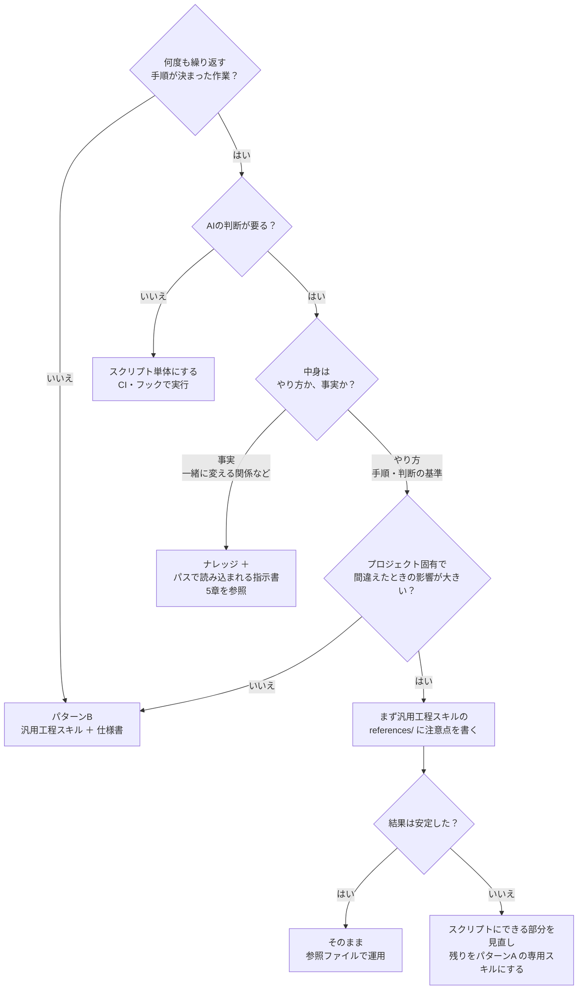

# AIエージェントのスキルはどう分ける？工程ごとの汎用スキルと、作業ごとの定型スキル

## はじめに

スキル（`SKILL.md`）をいくつか作ると、次の疑問にぶつかります。

> 「API追加のスキル」「DBのカラム追加のスキル」「画面追加のスキル」……と、機能ごとにスキルを作っていけばいいの？

この記事では、スキルの分け方（粒度）を2つのパターンで整理し、どちらを土台にして、もう一方をいつ使うかを説明します。

この記事は「[開発手順や仕様をAIに渡す方法：決まった処理はスクリプト、手順はスキル、事実はナレッジ、何を作るかは仕様書](https://qiita.com/gataca27/items/87d54f106112d3a4a7d6)」（以下、前の記事）の続きです。
スキル・ナレッジ・仕様書の違いや、指示書の書き方は前の記事で説明しています。

### 想定読者

- スキルをいくつか作り、数が増えてきて分け方に迷っている人
- 「変更の種類ごとにスキルを作る」か「工程ごとにスキルを作る」かを決めたい人

### この記事で分かること

1. スキルの粒度の2つのパターンと、その違い
2. 公式資料や仕様駆動開発（SDD）のツールが、どちらの考え方に近いか
3. どちらを土台にし、もう一方をいつ使うか
4. 「Aを直したらB・Cも直す」型の修正を、スキルにしないほうがよい理由と、代わりの方法

:::note info
例は Claude Code と GitHub Copilot（VS Code）のファイル名で書いています。考え方はほかのAIエージェントにも当てはまります。
ツールの仕様や引用したドキュメントの内容は、2026年11月時点のものです。
:::

## 要点

- スキルの分け方には、2つのパターンがあります。
  - **パターンA：定型作業スキル**：変更の種類ごとに作る。**スクリプトにできない作業に限る**
  - **パターンB：汎用工程スキル ＋ 機能ごとの仕様（入力）**：工程ごとに作り、どの開発にも使う
- おすすめは、**パターンB を土台にし、パターンA は、スクリプトにできない作業のうち、条件をすべて満たすものだけに絞る**やり方です。
  条件は、何度も繰り返す、手順が決まっている、プロジェクト固有、間違えたときの影響が大きい、の4つです。
- 条件を満たしても、いきなり専用のスキルにはしません。まず汎用工程スキルの `references/` に注意点として書きます。結果が安定しないときは、スクリプトにできる部分がないかを見直し、残った部分だけを専用のスキルにします。
- 「Aを直したらB・Cも直す」のような修正は、手順ではなく**事実**です。スキルではなく、ナレッジと、パスで読み込まれる指示書で扱います。
- どちらのパターンでも、**何を作るか**は仕様書で決まります。仕様書がダメなら結果もダメです。

## 1. スキルの粒度：2つのパターン

スキルの作り方には、大きく2つのパターンがあります。

| | パターンA：定型作業スキル | パターンB：汎用工程スキル ＋ 仕様（入力） |
|---|---|---|
| スキルの単位 | **変更の種類**ごと（API追加、DBマイグレーション、画面追加……） | **工程**ごと（仕様の確認 → 設計 → 実装 → 検証） |
| 機能ごとの違いの渡し方 | スキルの本文に書く | 機能ごとの**仕様書（入力）**と、変更の種類ごとの**参照ファイル**で渡す |
| スキルの数 | 変更の種類が増えるたびに増える | 工程の数でほぼ決まり、あまり増えない |
| 作り方のぶれ | 小さい<br>（手順が細かく決まっている） | Aよりは大きい<br>（変更の種類ごとの注意点は参照ファイル頼み） |
| 仕様（何を作るか）の質への依存 | **大きい** | **大きい** |
| 作る手間 | 1つは小さいが、数が増えると大きくなる | 最初の設計に手間がかかる。<br>そのあとは仕様書を書くだけ |
| 保守 | ブランチ・テスト・完了条件など共通の部分が各スキルに重複し、直し漏れが起きやすい | 共通の部分は1か所にある |
| AIのスキル選択 | 似たスキルが増えると、どれを使うかの判断がぶれる | スキルが少ないので迷いにくい |
| 想定外の変更 | 当てはまるスキルがなければ、指示書なしと同じになる | どんな変更にも使える |
| 向いている作業 | 何度も繰り返す、手順が決まった、プロジェクト固有の作業 | 新機能の追加、仕様変更など、ほとんどの開発 |

:::note warn
パターンA は、**スクリプトにできない作業に限ります**。
手順が決まった作業ほど、スクリプトにできることが多いからです。スクリプトは毎回同じように動きますが、スキルはAIへの「お願い」なので、手順を飛ばすことがあります。
手順の置き場所は、スクリプト単体 → スクリプト ＋ 短いスキル → スキル の順に検討します（前の記事の3章「判断の目安」）。
:::

## 2. 世の中の資料はどちらを勧めているか

仕様駆動開発（SDD）のツールや Anthropic の公式資料には、パターンB の考え方が多く見られます。
一方で、パターンA を支える記述もあります。
結論だけ知りたい場合は、3章へ進んでください。

**パターンB を支える資料**

| 根拠 | 内容 |
|---|---|
| [GitHub Spec Kit](https://github.com/github/spec-kit) | `/speckit-specify` → `/speckit-plan` → `/speckit-tasks` → `/speckit-implement` → `/speckit-converge` は、どの機能にも使う共通の工程です。<br>README には "Create a constitution once per project and repeat the remaining steps for each feature."（constitution はプロジェクトに1回だけ作り、残りの手順を機能ごとに繰り返す）と書かれています。<br>**機能ごとに変わるのは仕様のほう**です。 |
| [Kiro](https://kiro.dev/docs/specs/) | 機能ごとに `requirements.md`・`design.md`・`tasks.md` の仕様を作ります。<br>プロジェクト全体の知識は steering ファイル（`product.md`・`tech.md`・`structure.md`）に置きます。 |
| [Anthropic 公式のスキル集](https://github.com/anthropics/skills) | `pdf`・`docx`・`frontend-design`・`webapp-testing`・`mcp-builder` など、**能力や領域の単位**でスキルが作られています。<br>ただし公開のスキル集なので、特定プロジェクトの機能ごとのスキルはもともと入りようがありません。<br>プロジェクト内でのスキルの分け方の直接の根拠にはなりません。 |
| [Skill authoring best practices](https://platform.claude.com/docs/en/agents-and-tools/agent-skills/best-practices) | 「Domain-specific organization」というパターンとして、1つのスキル（`bigquery-skill`）の中に `reference/finance.md`・`sales.md` などを置く例が載っています。<br>**細かい違いはスキルを分けずに、参照ファイルで吸収する**形です。<br>（この記事の例では、Agent Skills の仕様で任意のディレクトリとして挙げられている `references/` を使います） |
| [Effective context engineering for AI agents](https://www.anthropic.com/engineering/effective-context-engineering-for-ai-agents) | ツールについて、"One of the most common failure modes we see is bloated tool sets"（最もよく見る失敗の1つは、膨れ上がったツール群）、"If a human engineer can't definitively say which tool should be used in a given situation, an AI agent can't be expected to do better."（どのツールを使うべきか人間のエンジニアが断言できないなら、AIにもそれ以上は期待できない）と書かれています。<br>スキルについての記述ではありませんが、似たスキルが増えすぎたときにも同じことが起きると考えられます。 |

※ Spec Kit と Kiro は、どちらも仕様駆動開発（SDD）のツールです。
同じ考え方にもとづくため、2つの独立した根拠ではありません。

**パターンA を支える資料**

| 根拠 | 内容 |
|---|---|
| [Skill authoring best practices](https://platform.claude.com/docs/en/agents-and-tools/agent-skills/best-practices) | スキルを作るきっかけとして "Notice what information you repeatedly provide"（何度も渡している情報に気づく）とあります。<br>繰り返す作業ごとにスキルを作る考え方です。名前の付け方の良い例も `processing-pdfs`・`analyzing-spreadsheets`・`testing-code` のように、作業の単位になっています。 |
| [Agent Skills overview](https://platform.claude.com/docs/en/agents-and-tools/agent-skills/overview) | 段階的な開示により、普段読み込まれるのはスキルの名前と説明だけです（1スキルあたり約100トークン）。<br>スキルが増えても、コンテキストへの負担は小さく抑えられます。 |
| [Understanding Spec-Driven-Development: Kiro, spec-kit, and Tessl](https://www.martinfowler.com/articles/exploring-gen-ai/sdd-3-tools.html)（Birgitta Böckeler、2025年10月） | Kiro で小さなバグを直そうとしたら、要求文書が4つのユーザーストーリー・16の受け入れ条件になり、"like using a sledgehammer to crack a nut"（くるみを割るのに大槌を使うようなもの）だったと書かれています。<br>spec-kit については、大量の Markdown のレビューが "very verbose and tedious"（とても冗長で退屈）だったとしています。<br>工程ごとの重い進め方が、どの大きさの変更にも合うわけではない、という指摘です。 |


:::note warn
「どちらのパターンが何割使われているか」を数字で示す調査は、見つけられませんでした。
このあとの使い分けは、上の資料と筆者の経験にもとづく筆者の判断です（検討の整理には Claude Opus 5.5 を使いました）。
:::

## 3. おすすめ：Bを土台に、Aは絞って使う

**パターンB を土台にし、パターンA は、スクリプトにできない作業のうち、次の条件をすべて満たすものだけに絞る**やり方をおすすめします。
理由は、共通の手順を1か所で保守でき、想定外の変更にも使えるからです（上の比較表を参照）。

ただし、次の点に注意してください。

- 変更の種類が少なく毎回ほぼ決まっている場合（定型の保守作業が中心など）は、パターンA 中心のほうが合うこともあります。
  その場合も、決まった処理はスクリプトにして、スキルからはそれを実行させるのが基本です（前の記事の5章 Step 3 の「③ 作業の危うさに合わせて、指示の細かさを変える」の自由度「低」を参照）。
- Böckeler の指摘のとおり、小さな変更にまで全工程を踏ませると、かえって手間が増えます。
  汎用工程スキルには、小さな変更なら工程を省ける道を用意しておきます。

パターンA を検討する前に、**まずスクリプトにできないかを考えます**。

- 作業全体が、いつ・何を実行するかまで決まっていてAIの判断が要らない場合は、**スキルにせず、スクリプト単体にします**（CI やフックで実行）。
- 作業の一部だけが決まっている場合は、その部分をスクリプトにして、スキルには実行する順番と判断の基準だけを書きます。

スクリプトにできない（AIの判断が要る）作業のうち、パターンA（専用のスキル）にするのは、次の条件をすべて満たす作業です。

- 何度も繰り返す（月に何回も発生する）
- 手順が決まっていて、毎回ほぼ同じ
- プロジェクト固有で、AIの一般知識では正しくできない
- 間違えたときの影響が大きい（DBマイグレーション、リリース作業など）

条件を満たしても、いきなり専用のスキルにする必要はありません。
まずは汎用工程スキルの `references/` に「変更の種類ごとの注意点」として置きます。
それでも結果が安定しないときは、スクリプトにできる部分がないかをもう一度見直し、残った部分だけを専用のスキルにします。

また、条件を満たして見えても、中身が「やり方」ではなく、「AとBは一緒に変える」のような**事実**のことがあります。
その場合は、5章を参照してください。



変更の種類が**フォルダで分かれている**場合（API は `src/controllers/`、画面は `src/components/` など）は、パスで適用範囲を決める指示書（前の記事の1章）に注意点を書く方法もあります。
この方法なら、AIがスキルを呼ばなくても、そのフォルダのファイルを触れば自動で読み込まれます。

## 4. 2つのパターンの例を見比べる

パターンB（汎用工程スキル ＋ 仕様書）の例は、前の記事の5章 Step 3 にあります（以下、例1と呼びます）。
ここでは、同じAPI追加をパターンA の専用スキルにした例（例2）を示し、2つを比べます。

### 例2：パターンA（定型作業スキル）…条件を満たす作業だけ

前の記事の2章で書き直したAPI追加の手順を、専用のスキルにした例です。
API追加を頻繁に行い、手順が厳密に決まっている場合に限って使います。
決まった確認は `scripts/validate.sh` にまとめ、スキルの本文には、実行する順番と判断（止まって人に確認する場面など）だけを書いています。

```text
.claude/skills/add-api-endpoint/
├── SKILL.md              # 手順（本文）
├── checklist.md          # スクリプトでは確かめられない確認項目（完了の前に読ませる）
└── scripts/
    └── validate.sh       # 完了条件をまとめて確認するスクリプト
```

`SKILL.md` の例です。

```markdown
---
name: add-api-endpoint
description: REST APIのエンドポイントを新しく追加する。コントローラ・バリデーション・OpenAPI定義・テストを、プロジェクトの規約どおりに作成する。新しいAPIの追加や、エンドポイントの作成を頼まれたときに使う。
---

# APIエンドポイントの追加

## 入力
- エンドポイントのパスとHTTPメソッド
- リクエストとレスポンスの項目
- エラー時の動き（返すエラーコードと条件）

## 始める前に
- 入力のどれかが欠けている、またはあいまいな場合は、実装を始めず、
  質問を箇条書きにして人に返す
- 注文に関係するエンドポイントの場合は、`docs/knowledge/order-status.md` を読む
- 認証・認可が必要な場合は、ここで作業を止め、必要な権限を人に確認する

## 手順
次のチェックリストを回答にコピーし、終わったものにチェックを入れながら進める。

- [ ] 1. `feature/api-<リソース名>` ブランチを作る
- [ ] 2. `src/controllers/user_controller.ts` を手本にコントローラを追加する
- [ ] 3. `src/validators/` にリクエストのスキーマを追加する
- [ ] 4. `npm run openapi:generate` で OpenAPI 定義を更新する
- [ ] 5. `tests/controllers/` にテストを追加する
- [ ] 6. このスキルのフォルダにある `scripts/validate.sh`（`.claude/skills/add-api-endpoint/scripts/validate.sh`）を実行する

## 検証
`scripts/validate.sh` がエラーを出したら、エラーを直して再実行する。
エラーがなくなったら、[checklist.md](checklist.md) を読み、スクリプトでは確かめられない項目を確認する。
両方を満たすまで、完了と報告しない。

## してはいけないこと
- `src/legacy/` 配下のコードを手本にしない
- 既存のエンドポイントのレスポンス形式を変えない
```

### 2つの例を見比べると

| 観点 | 例1（パターンB） | 例2（パターンA） |
|---|---|---|
| 共通の部分（ブランチ、テスト、検証） | `SKILL.md` に1回だけ書く | 各スキルにコピーされる。テストの方法が変わると全スキルを直す |
| 変更の種類・機能ごとの違い | 種類ごとの違いは `references/`、機能ごとの違いは仕様書 | スキルの本文に書く |
| 作り方のぶれ | 例2より大きい | 手順が細かく決まっているぶん小さい |

API追加を毎日のように行い、例1では手順の抜けが出るようなら、例2のような専用スキルにする価値があります。

ただし、例2でも「入力」（どんなAPIを作るか）が間違っていれば、手順どおりに間違ったAPIができあがります。
そのため、どちらの例も、入力が足りないときは止まって質問するように書いています。

## 5. 「定型的な修正」に見えて、手順ではないこともある

3章で触れた、定型的な修正に見える作業の扱いです。

次のような修正を考えます。

> 構造体Aにメンバを追加したら、構造体B・Cにも同じメンバを追加し、変換処理の cpp も直す。

毎回同じ形で繰り返すので、パターンA の条件を満たし、`references/` に注意点を書く作業に見えます。
しかし、この修正を中身で分けると、次のようになります。

| 中身 | 性質 | 置き場所 |
|---|---|---|
| メンバを追加する、cpp に代入を1行足す | AIが一般知識でできる作業 | 書かなくてよい |
| AとB・Cが対応していること。対応している理由 | **事実** | ナレッジ |
| 1つの変更のたびに、複数の場所を一緒に直す必要があること | **コードの構造の問題** | 直せるならコードで直す。直せないなら、ナレッジと機械での検出で補う |

手順として書くべきことは、ほとんど残りません。

### 構造の問題であることは、AIに限った話ではない

Martin Fowler『リファクタリング』では、1つの変更のたびに多くの場所を少しずつ直す必要がある状態を **Shotgun Surgery** と呼び、コードの匂い（code smell）の1つにしています。
Andrew Hunt・David Thomas『達人プログラマー』の **DRY 原則** も、同じ知識をシステムの中で1か所にだけ表現するよう求めています。
人が直しても漏れやすい構造は、AIが直しても漏れやすい構造です。

### ただし、既存のコードでは、構造を直せないことが多い

既存のコードに手を加えて機能を足す開発では、問題が分かっていても、構造を気軽には変えられません。たとえば次のような事情があります。

- 変更した箇所には、影響範囲の確認と再テストが要る。リファクタリングをすると、その範囲が広がる
- 変更は、要求された範囲に限るという方針がある
- 出荷済みのため、品質保証や客先の承認をやり直すことになる
- B・Cの形が、外部の仕様（通信の形式、ファイル形式など）や別のチームの管理で決まっている

そこで、構造を直すことを前提にせず、次の手段を使います。
既存のコードの開発ですぐに取れるのは1〜3です。4と5は、変更範囲の方針で認められる範囲で行います。

1. **事実をナレッジに書く**
   「A・B・Cは一緒に変える」「なぜ対応しているか」を、前の記事の5章 Step 4 の多段の波及と同じ形で書く。
   コードを読めば、AとB・Cの間に変換があることは分かる。
   しかし「Aにメンバを足したらB・Cにも足す必要がある」ことは分からず、AIもメンバを1つ足すだけのときにB・Cを探しには行かない（前の記事の5章 Step 5 の基準）。
   そのため、この関係と理由を書く。
   変換している関数の一覧のように、grep で分かるものは書き写さない（前の記事の5章 Step 4 の「grep で分かることは書かない」）
2. **入口を、パスで読み込まれる指示書に置く**
   Aを定義しているファイルのパスを対象に、「Aを変えるときは `docs/knowledge/xxx.md` を読む」と書く（前の記事の1章）
3. **汎用工程スキルには1行だけ足す**
   設計の工程に「変更するファイルについて、一緒に変える関係をナレッジで確認し、変更の一覧に入れる」と書く。
   個別の関係はスキルに書かない
4. **できる範囲で、機械で検出する**
   製品のコードに手を入れにくくても、テストのコードだけで足せる検出がある（A→B・Cの変換のテストなど）。
   `static_assert` のように製品のコードに足すものは、変更範囲の方針と相談する
5. **構造の改善は、認められたときに行う**
   新規開発や、リファクタリングを独立した変更として計画できる場合は、B・CがAを含む形にする、X-macro やコード生成で1か所の定義から作る、などで直す場所を1か所にする。
   それまでは、ナレッジに「本来は1か所にまとめたい。まとめていない理由は〜」と書いておくと、改善を検討するときの材料になる

専用スキルにしない理由は2つです。

- 書くべき中身が、手順ではなく事実だから
- この種の修正が**ほかの機能の実装の途中で起きる**場合、専用スキルは呼ばれるとは限らない（前の記事の7章の失敗3）。
  パスで読み込まれる指示書なら、Aのファイルを触った時点で読み込まれる

:::note warn
「Shotgun Surgery はコードの構造の問題」という点は、上の文献にもとづく考え方です。
ただし、問題だと分かっていても、既存のコードの開発ではすぐに直せるとは限りません。
この修正が、単独の作業として何度も頼まれる場合（定型の保守作業など）は、作業の進め方と確認のしかたを専用スキルにしてもかまいません。
その場合も、AとB・Cの関係そのものはナレッジに置き、スキルからリンクします（前の記事の3章「実際は組み合わせて使う」を参照）。
:::

## 6. よくある失敗：機能ごとにスキルを作って、スキルが増えすぎる

- **症状**：
  - 「API追加」「API変更」「DBカラム追加」「画面追加」……とスキルが数十個になる
  - AIが似たスキルのどれを使うかで迷い、別のスキルを使ってしまう
  - テストの方法を変えたら、全スキルを直すことになった
- **原因**：機能ごとの違いを、仕様書（入力）ではなくスキルで表現しようとしている。
- **対策**：
  - 3章のとおり、汎用工程スキル（パターンB）を土台にする
  - 変更の種類ごとの注意点は参照ファイルに、機能ごとの違いは仕様書に書く
  - 専用のスキル（パターンA）は、スクリプトにできない作業のうち、条件を満たすものだけに絞る

## チェックリスト

- [ ] スキルの粒度（工程ごとか、変更の種類ごとか）を、理由を持って決めている
- [ ] ブランチ・テスト・完了条件など共通の手順が、1か所にだけ書いてある
- [ ] 専用の定型作業スキルは、スクリプトにできない作業のうち、4つの条件をすべて満たすものだけにしている
- [ ] 似たスキルが増えすぎていない。どのスキルを使うべきか、人が断言できる
- [ ] 汎用工程スキルに、小さな変更なら工程を省ける道を用意している
- [ ] 「Aを直したらB・Cも直す」型の修正は、手順ではなく事実としてナレッジに書いた。変更範囲の方針で認められる範囲で、機械での検出や構造の改善も検討した

## まとめ

- スキルの粒度は、**工程ごとの汎用スキル（パターンB）を土台にする**のがおすすめです。
  機能ごとの違いは仕様書で、変更の種類ごとの注意点は参照ファイルで渡します。
- **専用の定型作業スキル（パターンA）** は、スクリプトにできない作業のうち、何度も繰り返し、手順が決まっていて、プロジェクト固有で、間違えたときの影響が大きいものだけに絞ります。
  まず参照ファイルで試し、結果が安定しなければ、スクリプトにできる部分を見直したうえで、残りを専用のスキルにします。
- 「Aを直したらB・Cも直す」型の修正は、**事実としてナレッジに書き**、パスで読み込まれる指示書を入口にします。
- どちらのパターンでも、**仕様書の質が結果を決めます**。

## 参考資料

- [Skill authoring best practices - Claude Docs](https://platform.claude.com/docs/en/agents-and-tools/agent-skills/best-practices)
- [Agent Skills overview - Claude Docs](https://platform.claude.com/docs/en/agents-and-tools/agent-skills/overview)
- [Effective context engineering for AI agents - Anthropic Engineering](https://www.anthropic.com/engineering/effective-context-engineering-for-ai-agents)
- [Understanding Spec-Driven-Development: Kiro, spec-kit, and Tessl - martinfowler.com](https://www.martinfowler.com/articles/exploring-gen-ai/sdd-3-tools.html)
- [github/spec-kit - GitHub](https://github.com/github/spec-kit)
- [Specs - Kiro Docs](https://kiro.dev/docs/specs/)
- [anthropics/skills - GitHub](https://github.com/anthropics/skills)
- Martin Fowler『リファクタリング（第2版）』オーム社、2019年
- Andrew Hunt・David Thomas『達人プログラマー（第2版）』オーム社、2020年

### 関連記事

- [開発手順や仕様をAIに渡す方法：決まった処理はスクリプト、手順はスキル、事実はナレッジ、何を作るかは仕様書](https://qiita.com/gataca27/items/87d54f106112d3a4a7d6)
- [GitHub Copilot と Claude Code のプロンプト・スキル・エージェント機能の比較](https://qiita.com/gataca27/items/c320df90b4cf655ce3f6)
- [GitHub Copilot の「AIへの指示書」まとめ](https://qiita.com/gataca27/items/aa0b87bdf13e2219d6c1)
